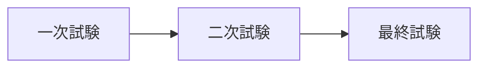
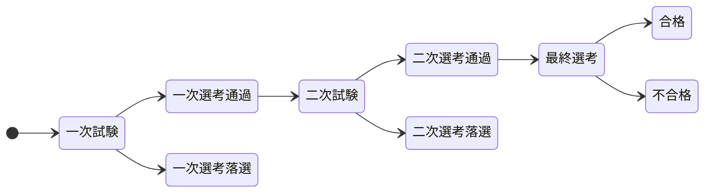
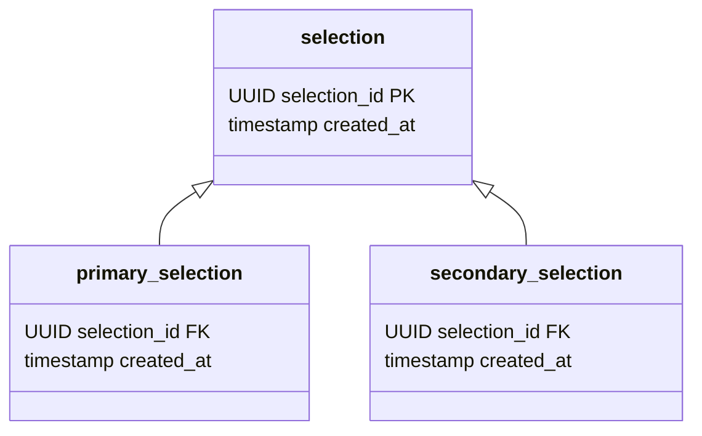
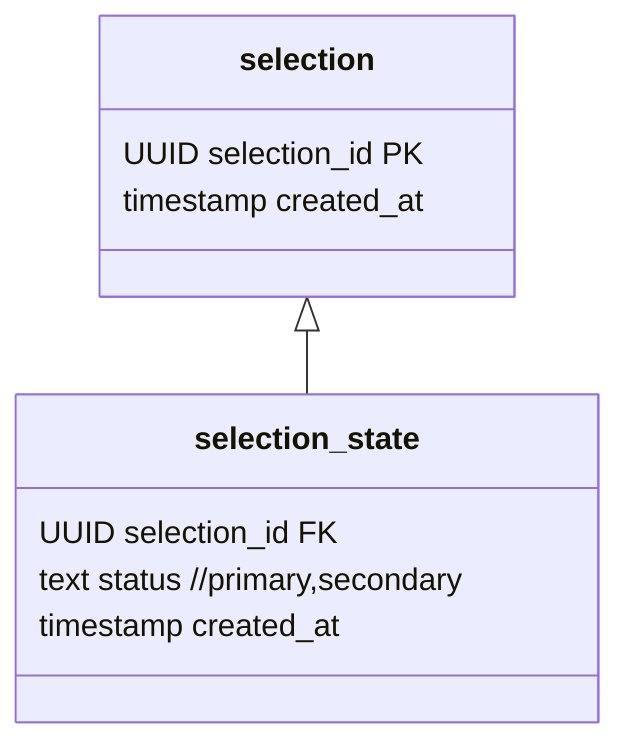
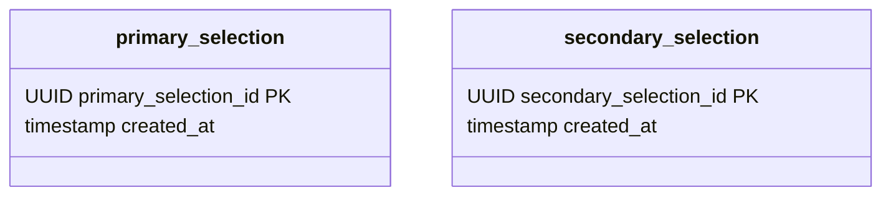

試験について考えてみましょう。



次に、受験生の目線で考えてみましょう。



試験を開催する側と受験する側でモデルが違います。
つまり「アクターによってユースケースが違う」モデルです。
モデルが違うのであれば、勿論Repositoryも分割します。

```kotlin
interface PrimarySelectionRepository //一次試験

interface SecondarySelectionRepository //二次試験

interface FinalSelectionRepository //最終試験
```

問題になるのは受験生のモデルです。
今回はモデルひとつにつきひとつのRepositoryを作りました。

```kotlin
interface ExamineeInPrimarySelectionRepository //一次選考中
interface PassedPrimarySelectionRepository //一次選考通過
interface FailedPrimarySelectionRepository //一次選考落選

interface ExamineeInSecondarySelectionRepository //二次選考中
interface PassedSecondarySelectionRepository //二次選考通過
interface FailedSecondarySelectionRepository //二次選考落選

interface ExamineeInFinalSelectionRepository //最終選考中
interface PassedFinalSelectionRepository //最終選考通過
interface FailedFinalSelectionRepository //最終選考落選
```

このように、状態ごとにRepositoryを作るパターンもあります。
特に、状態遷移に制約がある場合には有効です。

> 💡 一次選考を通過しないと二次試験は受験できない、のような、状態遷移をするための条件があることを**制約**と呼んでいます。

### 状態とは
受験生のモデルでは試験をするごとに通過又は落選し、次の試験がある場合は受験していました。
受験している人は同じ人なので受験idは同じものを使いまわしたほうが良いでしょう。(順不同の属性を持っている場合にはExamineeIdRepositoryを作る可能性もあります)
このような、同一性があるものの、タイミングによって持っているデータが変わるようなことを**状態**と呼んでいます。

一方で、試験のモデルでは一次試験、二次試験、最終試験を扱っていましたが、これは状態と呼べるでしょうか。
これは注目する物事によって状態になったり、ならなかったりします。
「2020年度の試験」という考え方をするのであれば「2020年度の試験の一次試験」、「2020年度の試験の二次試験」となり、状態と呼んでも良いでしょう。
この場合は試験idは同じものを使います。
同一性の無い「試験」という考え方をするのであれば「1回目の試験」、「2回目の試験」となり、これは状態とは呼べず、全く別のものとして扱います。このようなもののことを**種別**と呼びます。
この場合は試験idは別のものを使います。

種別が違うのであればRepositoryを分けたほうが良いでしょう。
状態が違い、制約がある場合もRepositoryを分けたほうが良いでしょう。
同じ種別で状態遷移の制約が無い場合はRepositoryを分ける恩恵はあまりありません。

### statusテーブル
状態ごとにRepositoryを分割した場合、状態ごとにテーブルを作るパターンとstatusテーブルを作るパターンがあります。

#### **状態ごとにテーブルを作るパターン**



※同一性があるためselectionテーブルに依存する形になっています。
このパターンだとidテーブルが増えてしまい、かつprimary_selection、secondary_selectionごとにvalueテーブルを作らなければならないので次のパターンで実装することをおすすめします。

#### statusテーブルを作るパターン



valueテーブルをひとつ追加するだけで済みますが、他のvalueテーブルは状態を気にせず値が入ってしまっています。
そのため、Repositoryではselection_state.created_atから見て最新の一件を他のvalueテーブルから取得する必要があります。
insert時の処理順に依存しないために、Repository#addでは各valueテーブルに同じ値のcreated_atがinsertされるようにする必要があります。

#### 種別ごとにテーブルを作るパターン



※同一性が無いため独自のidを持っています。
種別が違うのであれば、データモデルでも全く別のものとして扱います。

[【コラム】Repositoryのシグネチャー](9bd5395a6b0b4bfdb7ba04bf233a4854.md)
