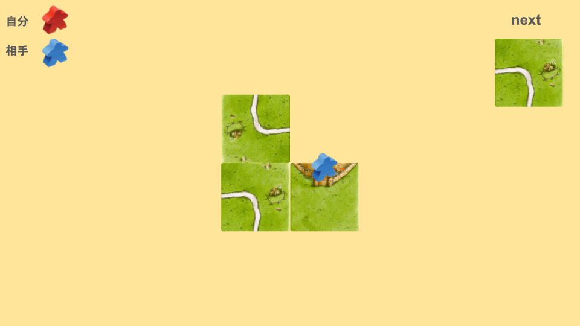
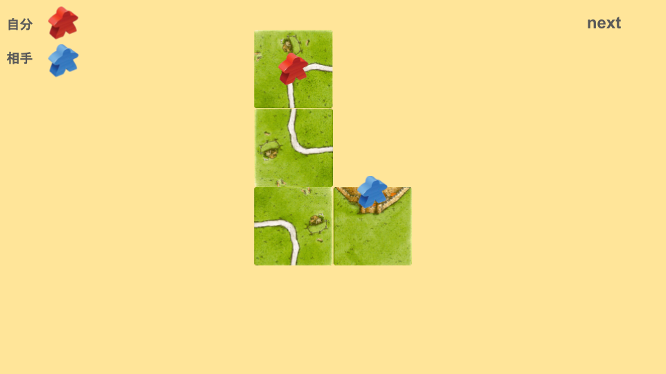
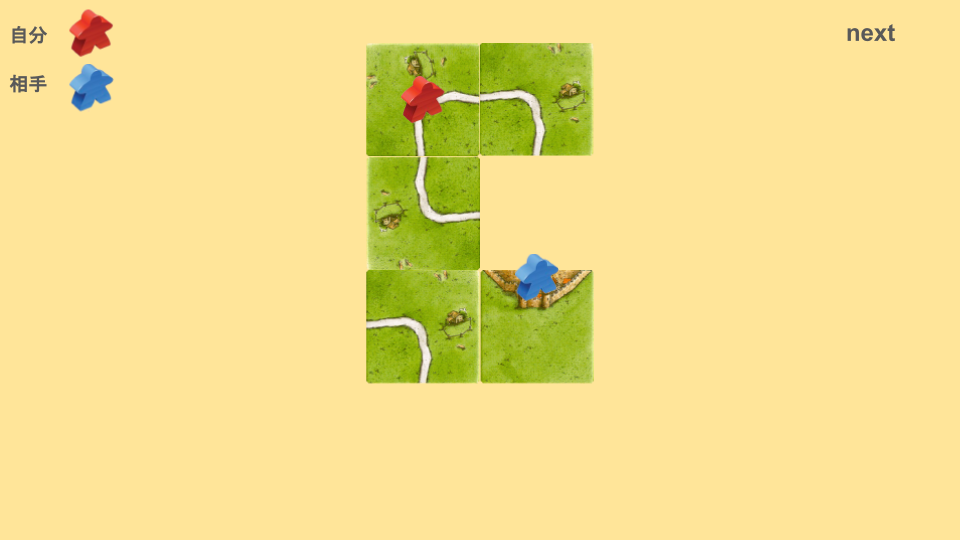
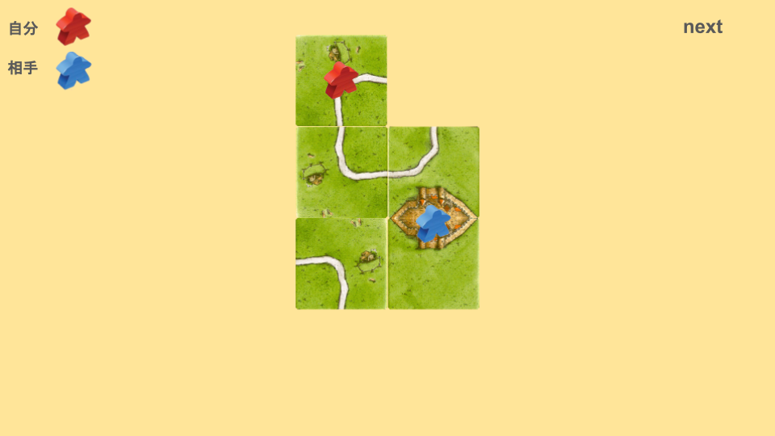
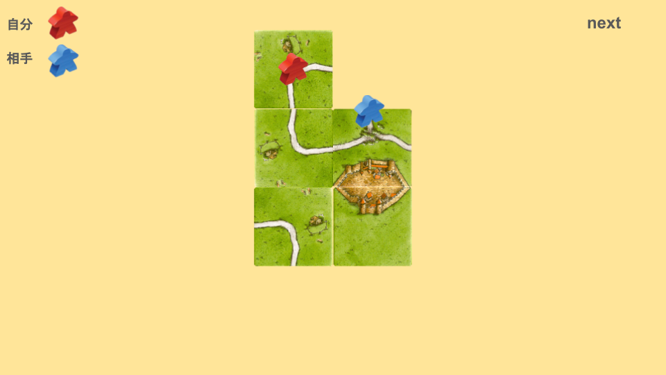
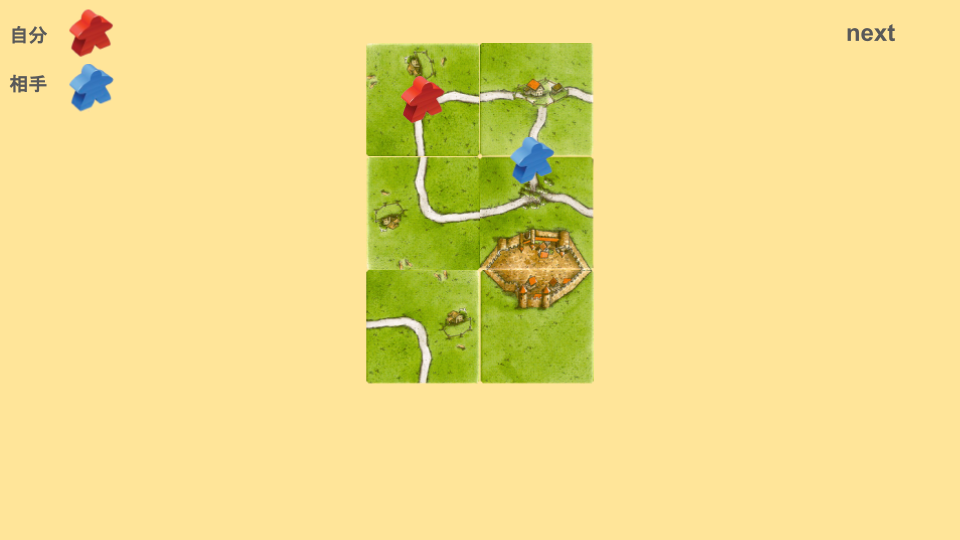
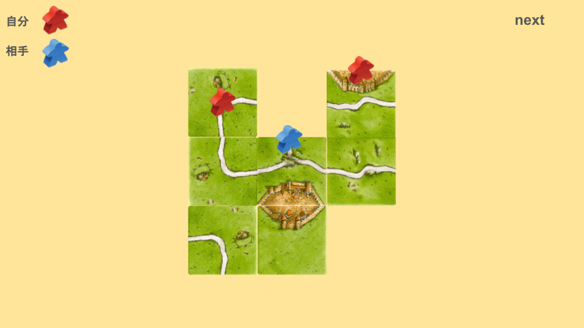
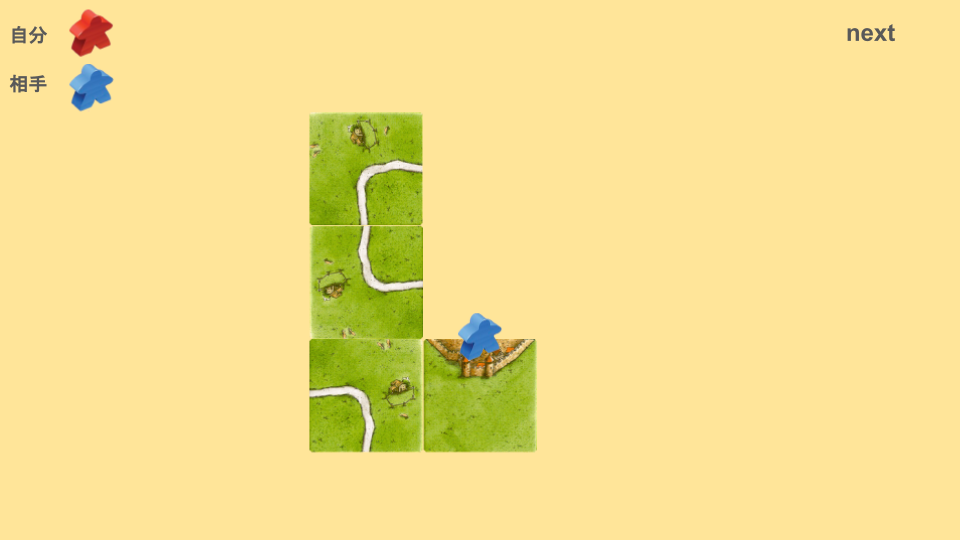
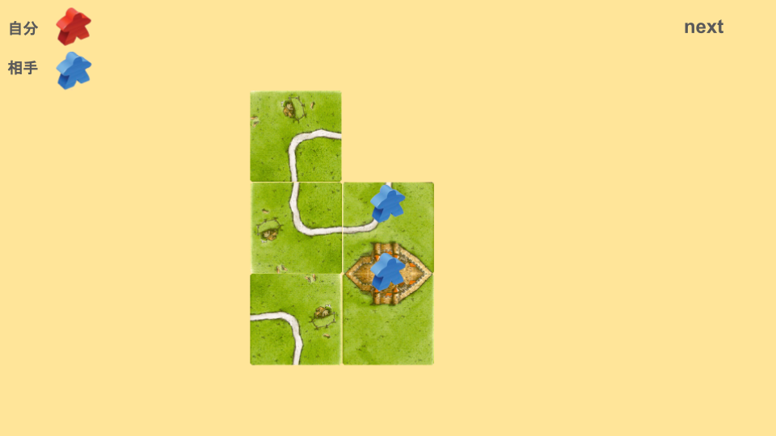

# ループ刺しとは
次の画像を見てください。

この場合、どのように配置しますか？

次のように配置することを「ループ刺し」と言います。

この時点でかなり強力な盤面になっています。

次のように進展させるとより強力です。

自分と相手はミープルひとつずつ投入しているものの、自分3点、相手1点のため、もし破壊されても盤面有利となります。

ループ刺しをすると、もし都市を完成させられても、ループの点数で相殺することができます。

一辺三叉でループの相殺を狙われることもあります。

ですが、いくつかの方法で対応することができます。

①三叉を置く。
ループの相殺を防ぐことができます。

②カーブ破壊をする。
道を刺すことで、カーブが置けなくなり、ループの相殺を妨害することができます。
また、画像のように、都市の建設をついでに行えると非常に強力です。

三叉を自分で置くよりも、カーブ破壊をするほうがおすすめです。
# 注意点
ミープルを置くタイミングを間違えると、相手に点数をあげることになってしまいます。
カーブ2枚目の時にミープルを置かない場合を見てみましょう。

このように配置され、都市も道も取られてしまいます。

そのため、二枚目のカーブの時点でミープルを置くようにしましょう。
