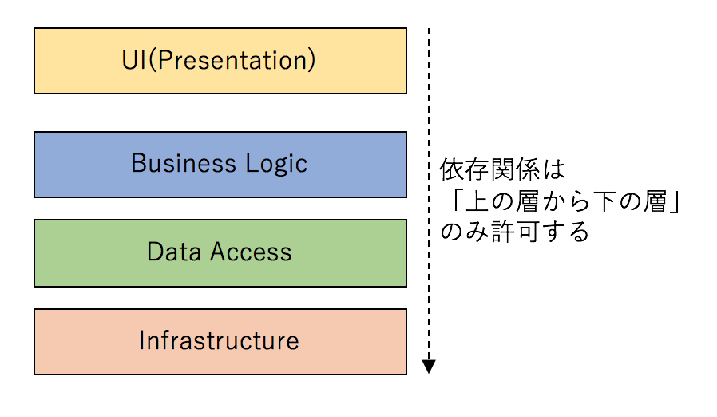
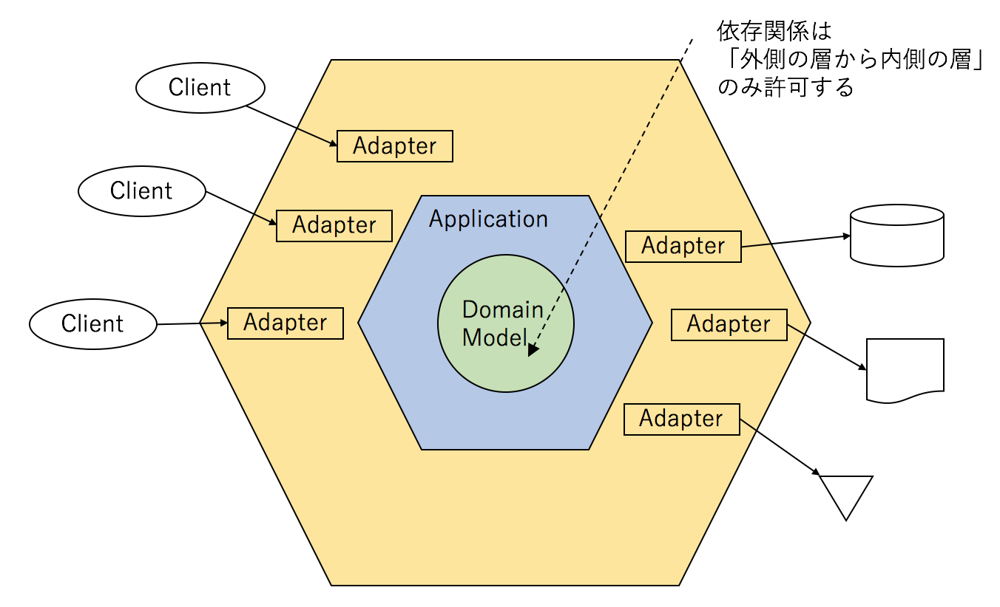
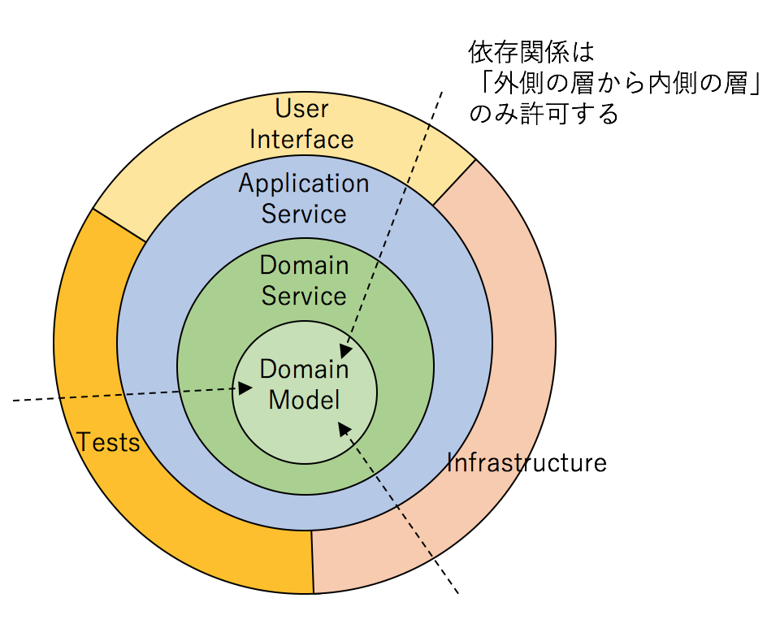
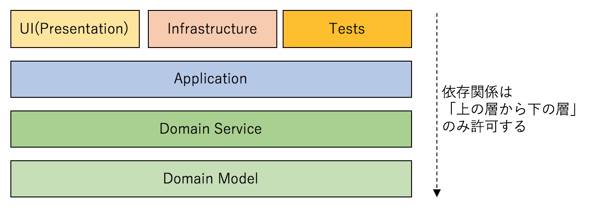
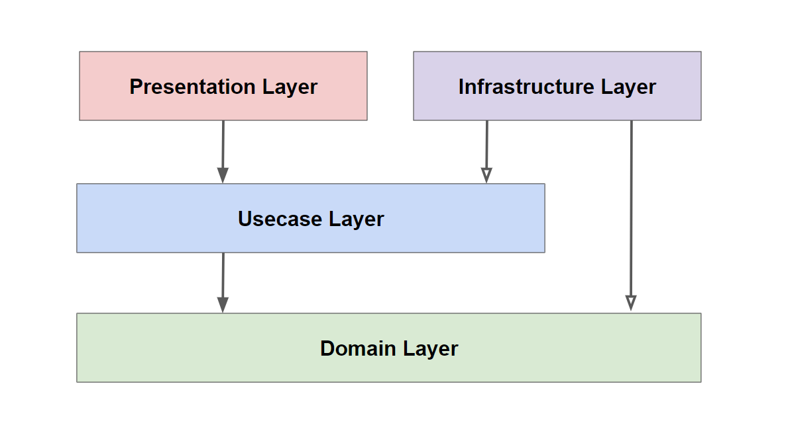
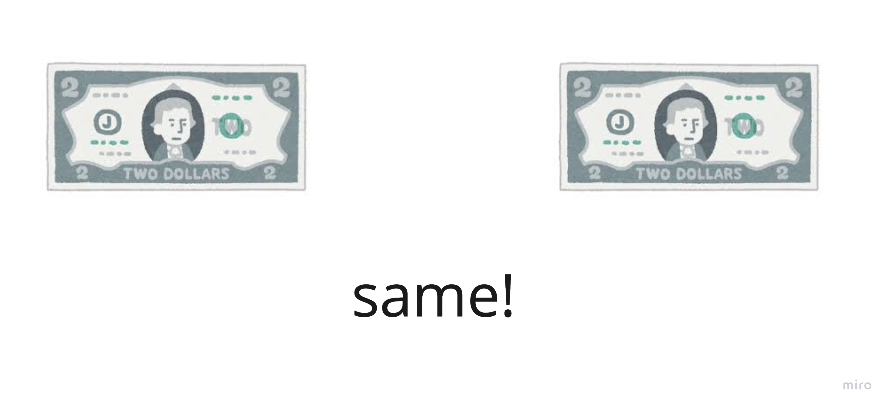
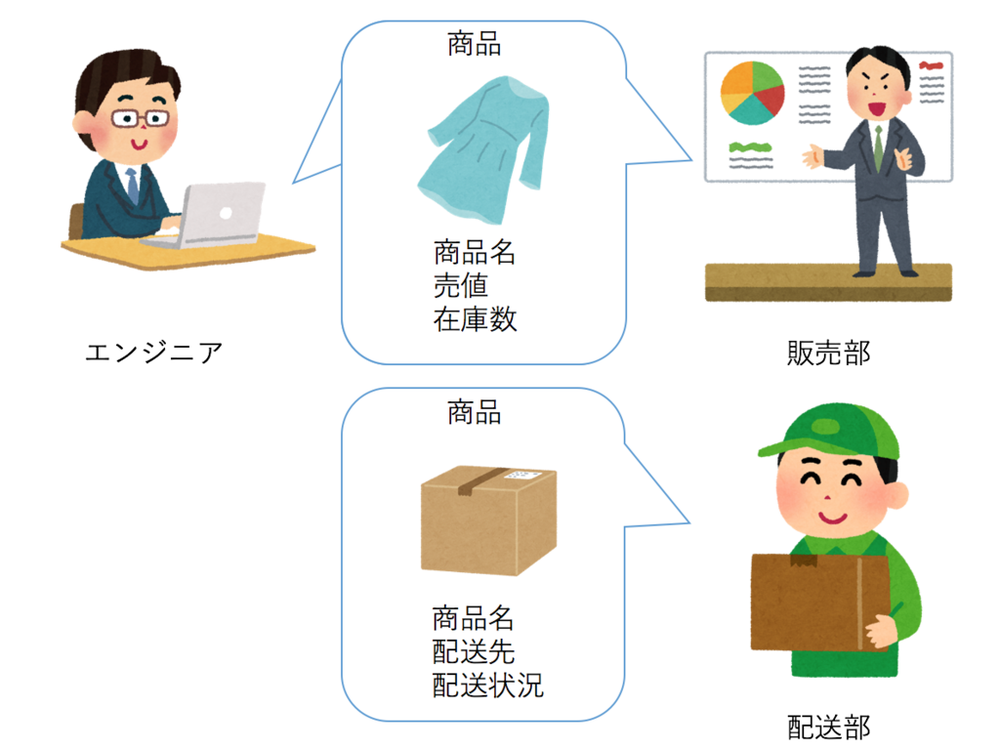

今日は、DDDを紹介していきます。
DDDとは、「ドメインを中心に設計をしていこうね」ということです。

# そもそもドメインって何？
ドメインとは、業務ロジックのことです。
たとえばこのようなものがあります。
- 計算処理
- 機能の名前

## ドメインモデリングにはDDDという手法を使う
DDD(Domain Driven Design)というものがあります。
超魔翻訳すると、「良い名前を付けましょう！」という事です。

## なぜ良い名前を付けたいの？
例を見てみましょう！
### Bad pattern①
- 「ボタンを押すと人が出てきたり、文字がいっぱい出てくる機能」

### Good pattern①
- 「動画機能(youtubeのイメージです)」

### Bad pattern②
- 「ボタンを押すとお金がなくなる機能」

### Good pattern②
- 「ガチャ機能」

### Bad pattern③
- 「文字がいっぱい流れてくる機能」

### Good pattern③
- 「チャット機能(lineのイメージです)」

### Bad patternsはどこが悪い？
- 名前が長い
- 名前が正確ではない
- 名前が重複する可能性がある

### 良い名前を付けるとどんなメリットがあるの？
- 名前を見るだけで何のことかわかる
- 使う言葉を統一できる
- 検索しやすくなる
- コードがシンプルになる(詳細は後述)

## 良い名前を付けよう！
ソフトウェア開発では、名前を付けるタイミングがいくつもあります。
- 変数名
- 定数名
- 関数名・メソッド名
- クラス名
- パッケージ名

それぞれに良い名前を付けよう、ということです。

> 🤖 みんなが共通して使える言葉は、「ユビキタス言語(ubiquitous language)」と言うよ！

# 複雑さ管理の最適化
ソフトウェアエンジニアの仕事はふたつあると言われています。
- 学びの最適化
- 複雑さ管理の最適化(今回はここを見ていくよ！)

良い名前を付けるというのは、複雑さ管理の最適化の話でした。

## 複雑さを軽減するための考え方、手法が存在する
- パッケージ構造
- 原則
- DDD

(ここからは一気に専門用語まみれになります！)

### パッケージ構造
- レイヤードアーキテクチャー


[ドメイン駆動 + オニオンアーキテクチャ概略[DDD]](https://little-hands.hatenablog.com/entry/2017/10/11/075634)　より引用

ソフトウェアには2つの複雑さがあります。
- 技術的な複雑さ
- ドメインロジックの複雑さ

DDDは、この2つを分離することによって、コードの複雑さを軽減しようとしています。

- ヘキサゴナルアーキテクチャー


[ドメイン駆動設計で実装を始めるのに一番とっつきやすいアーキテクチャは何か[DDD]](https://little-hands.hatenablog.com/entry/2017/10/04/231743)　より引用

- オニオンアーキテクチャー


[ドメイン駆動設計で実装を始めるのに一番とっつきやすいアーキテクチャは何か[DDD]](https://little-hands.hatenablog.com/entry/2017/10/04/231743)　より引用


[ドメイン駆動設計で実装を始めるのに一番とっつきやすいアーキテクチャは何か[DDD]](https://little-hands.hatenablog.com/entry/2017/10/04/231743)　より引用

- クリーンアーキテクチャー


[The Clean Architecture](https://blog.cleancoder.com/uncle-bob/2012/08/13/the-clean-architecture.html)　より引用

### 全てドメインが中心になっている
どの構造を見ても、ドメインが中心になっていることが分かりました。
依存関係とは、使って良いパーツと、使ってはいけないパーツがあるよ、という話。
用語がブレているため、今回は下記のイメージで用語を使っていきます。



### 原則
深くは掘り下げませんが、紹介だけします。
- SOLID
- KISS
- YAGNI
- DRY
- PIE

# DDD
## DDDに登場するオブジェクト
- Main
  - Entity(エンティティ)
  - Value Object(値オブジェクト)
  - Service(サービス)
- Sub
  - Aggregate(集約)
  - Factory(ファクトリー)
  - Repository(リポジトリー)

ひとつひとつ見てみましょう。

## Entity(エンティティ)
次の図を見てみてください。


赤ちゃんが成長して大人になり、おじいちゃんになっています。
これは、見た目が変わっているものの、同じ人です。
このようなものを、DDDでは**Entity**と呼びます。
専門用語を使って説明すると、下記のようになります。
- identifier(識別子)を持っている。
- 状態が変わっていても、identifierが同じであれば、同じものとして扱う。

## Value Object(値オブジェクト)
次の図を見てみてください。



お札に書いてある番号はもちろん違います。
ですが、金額が同じであれば、同じものとして扱います。
このようなものをDDDでは**Value Object**と呼びます。
専門用語を使って説明すると、下記のようになります。
- 値が同じであれば、同じものとして扱う。

## Service(サービス)
EntityでもValue Objectでもないもののこと！
たとえば、`UserNoticeService`のようなもの。

## Aggregate(集約)
データベースに保存したい単位のこと！
たとえば、`User`、`Fanclub`のようなもののこと。
ライフサイクルに注意が必要。

## Factory(ファクトリー)
インスタンスの生成が複雑なものは、Factoryに切り出しましょう！
(インスタンスの再生成はここでは行いません。)
たとえば、`UserFactory`、`FanclubFactory`のようになります。

## Repository(リポジトリー)
データベースとのやり取りを行います。
たとえば、このようになります。
```typescript
interface UserRepository {

    function add(user:User):void

    function resolveBy(userId:UserId):User

    function replace(user:User):void

    function remove(user:User):void
}
```

## サンプルコードを見てみよう！(Usecase Layer)
ユーザーの登録をするコードを見てみましょう。
こんな感じになります。
```typescript
class CreateUser {

    @Inject // DI
    const userRepository: UserRepository;

    function handle(input:CreateUserOptions): UUID {
        const mailAddress:MailAddress = new MailAddress(input.mailAddress);
        const password:Password = new Password(input.password);

        const hashedPassword:HashedPassword = new HashedPassword(password);

        const userId:UserId = UserId.create(UUID.randomUUID());

        const user:User = new User(userId, mailAddress, hashedPassword)

        userRepository.add(user);

        return userId.value;
    }
}
```
ユーザーを検索するコードも見てみましょう。
```typescript
class FindUser {

    @Inject // DI
    const userRepository: UserRepository;

    function handle(input: FindUserOptions): User {
        const userId:UserId = new UserId(input.userId);
        return userRepository.resolveBy(userId);
    }
}
```
(passwordに関しては扱い方が特殊なため、イメージだけ掴んでもらえればと思います！)

## Bounded Context(境界づけられたコンテキスト)
次の図を見てみてください。


[境界づけられたコンテキスト 概念編 - ドメイン駆動設計用語解説 [DDD]](https://little-hands.hatenablog.com/entry/2017/11/28/bouded-context-concept)　より引用

同じ「商品」という言葉を使っていますが、人によってイメージするものが全く異なっています。
この場合、前提によって使い方を分けることによって対応します。
- 販売コンテキスト
- 配送コンテキスト

このような考え方のことを**Bounded Context(境界づけられたコンテキスト)**と言います。

## Microservice Architecture
> マイクロサービス アーキテクチャは、サービスのコレクションとしてアプリケーションを開発するアプリケーション アーキテクチャの一種です。マイクロサービス アーキテクチャ ダイアグラムとサービスを個別に開発、デプロイ、管理するためのフレームワークを提供します。

[マイクロサービス アーキテクチャとは](https://cloud.google.com/learn/what-is-microservices-architecture?hl=ja)　より引用

> 🤖 超魔翻訳すると、大きいシステムをバラバラにして小さくしたほうが扱いやすいじゃん！ということ！

Bounded Context(境界づけられたコンテキスト)ごとに、バラバラにします！
Microservice Architectureはいくつかの問題を抱えているため、Modular Monolithが推奨されています！

# まとめ
- ドメインとは、業務ロジックのこと
- 良い名前を付けよう！
- 複雑さ管理の最適化
- パッケージ構造
- 依存関係
- DDD
- Microservice Architecture

# 参考資料
[ドメイン駆動 + オニオンアーキテクチャ概略[DDD]](https://little-hands.hatenablog.com/entry/2017/10/11/075634)
[境界づけられたコンテキスト 概念編 - ドメイン駆動設計用語解説 [DDD]](https://little-hands.hatenablog.com/entry/2017/11/28/bouded-context-concept)
[Ready for changes with Hexagonal Architecture](https://netflixtechblog.com/ready-for-changes-with-hexagonal-architecture-b315ec967749)
[The Clean Architecture](https://blog.cleancoder.com/uncle-bob/2012/08/13/the-clean-architecture.html)
[The Onion Architecture : part 1](https://jeffreypalermo.com/2008/07/the-onion-architecture-part-1/)
[マイクロサービス アーキテクチャとは](https://cloud.google.com/learn/what-is-microservices-architecture?hl=ja)
[エリック・エヴァンスのドメイン駆動設計](https://www.shoeisha.co.jp/book/detail/9784798126708)
[実践ドメイン駆動設計](https://www.shoeisha.co.jp/book/detail/9784798131610)
[単体テストの考え方/使い方 プロジェクトの持続可能な成長を実現するための戦略](https://book.mynavi.jp/ec/products/detail/id=134252)
[マイクロサービスアーキテクチャ 第2版](https://www.oreilly.co.jp/books/9784814400010/)
