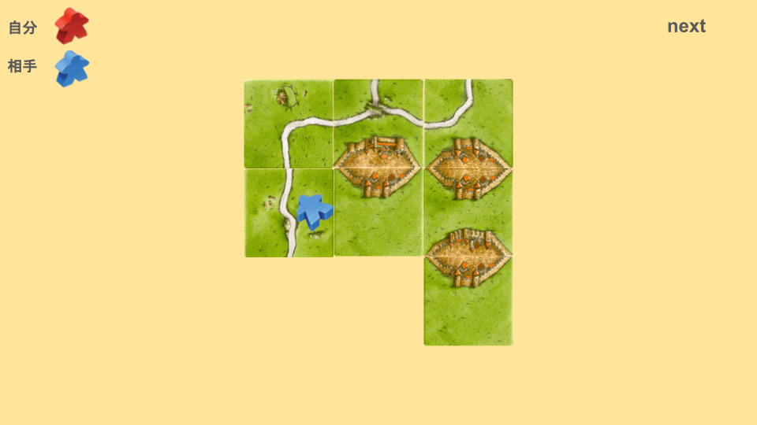

相乗りを諦めることで手数を稼ぐ手法を「捨て」と呼びます。
特に、ゲーム終了時までミープルが返ってこない草原は、捨てを常に考えるようにしましょう。

9点草原程度であれば、捨てられることが多いようです。
これは、[相乗り(あいのり)](0fbfa626776044e6820a17dfba44cb05.md) をしないことによってミープル有利を維持し、別の場所で得点を稼ぐことが目的です。
また、[相乗り(あいのり)](0fbfa626776044e6820a17dfba44cb05.md) するよりも、[先置き(さきおき)](5729032ddd6e4389bdc6d73813356889.md) できる9点草原を取ったほうが、手数を節約できます。
