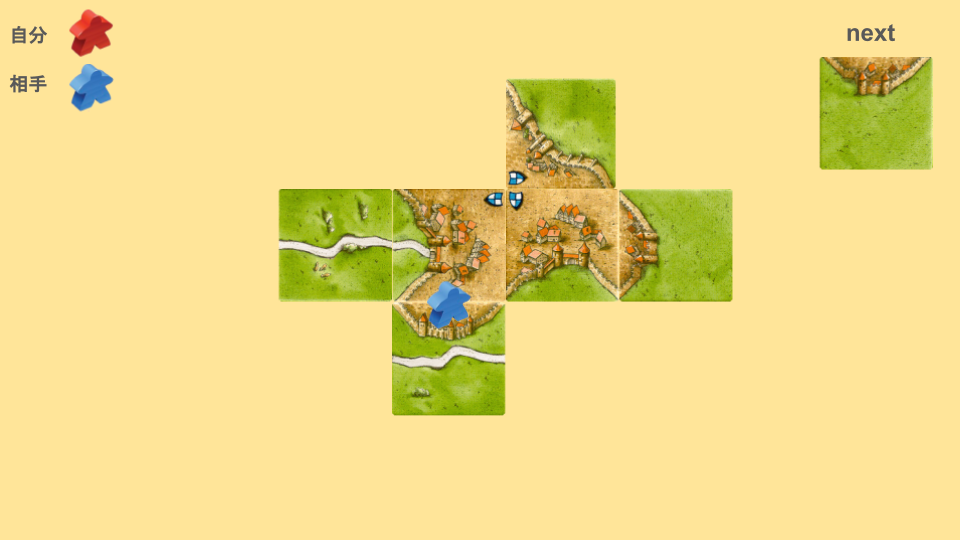
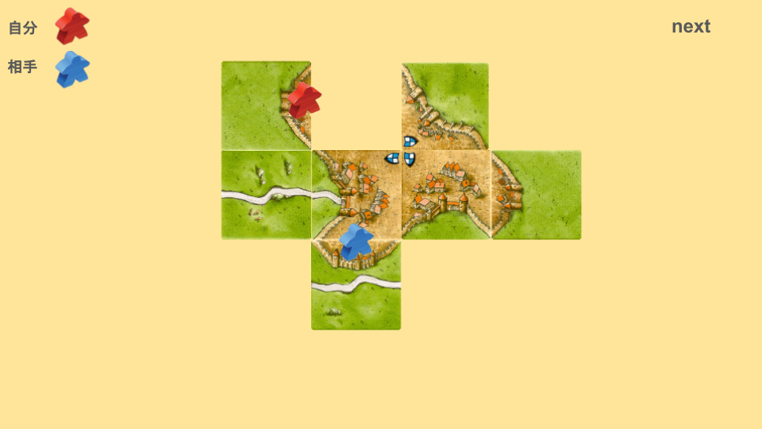
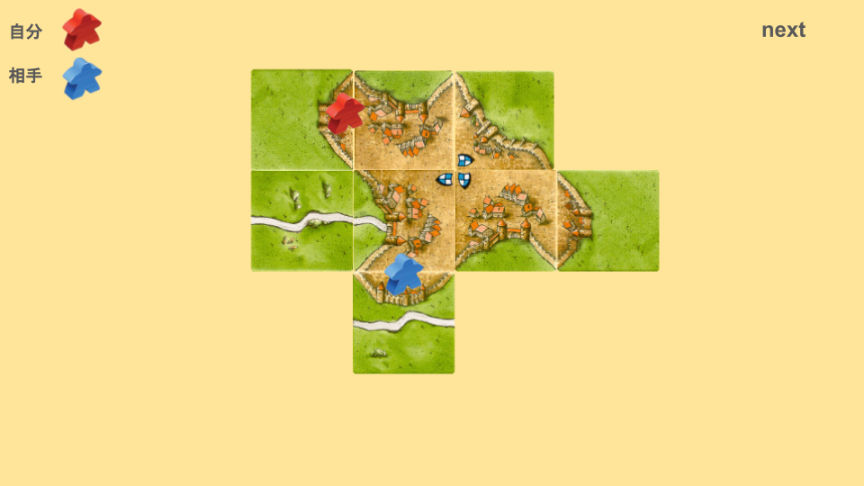
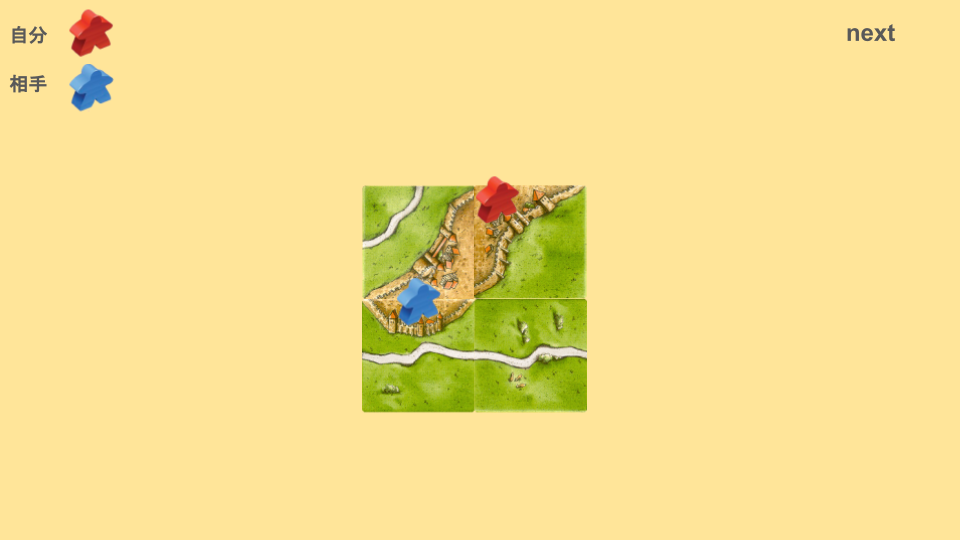
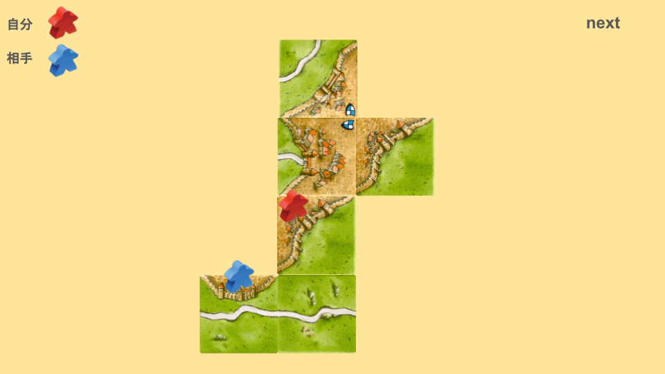
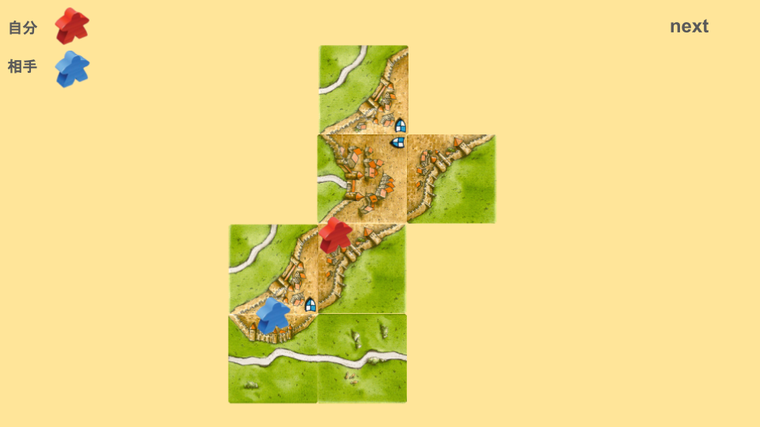

# 相乗りとは
次の画像を見てください。

相手の大都市が完成しそうになっています。
この場合、どのように配置しますか？

次のように配置することを「相乗りを仕掛ける」と言います。

ここで三辺か三辺アリを引くと、晴れて「相乗り」の完成です。

都市完成ですが、お互いのミープル数が同じなので、相殺となります。

元々の状態を改めて見てみましょう。

この時点で、相手は8点を獲得しています。
二手とミープルひとつを使って相乗りをすることで、相手の8点を0点にすることができました。
一手あたり4点という計算になるので、かなり良い交換と言えます。
# 悪い相乗り
次の画像を見てください。

相手のミープルが即座に返ることを妨害していますが、それが肯定されるのは、中盤以降のミープルが減ってきたタイミングのみです。
序盤では、この相乗りは悪手です。なぜなら、自分の得点を増やすことができないからです。

この相乗りを成功させたパターンを考えてみましょう。

この場合、自分は二手とミープルひとつを使い、相手の1点とミープルひとつを打ち消しました。
つまり、一手損となります。

自分の都市を成長させたパターンも考えてみましょう。

自分側の都市を伸ばすことで点数を稼いでいますが、相手から簡単に相乗りできる状態になっているため、相手に有利トレードをされる可能性が非常に高いです。

つまり、自分の都市を伸ばすことも実質的にできないような状態になっています。
