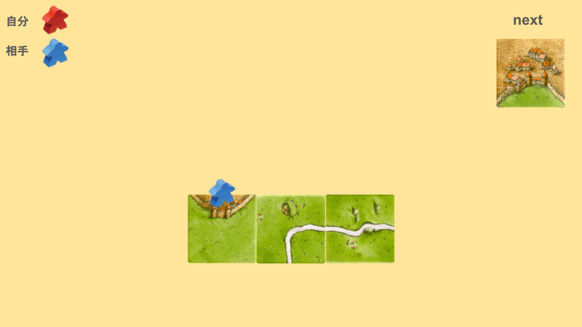
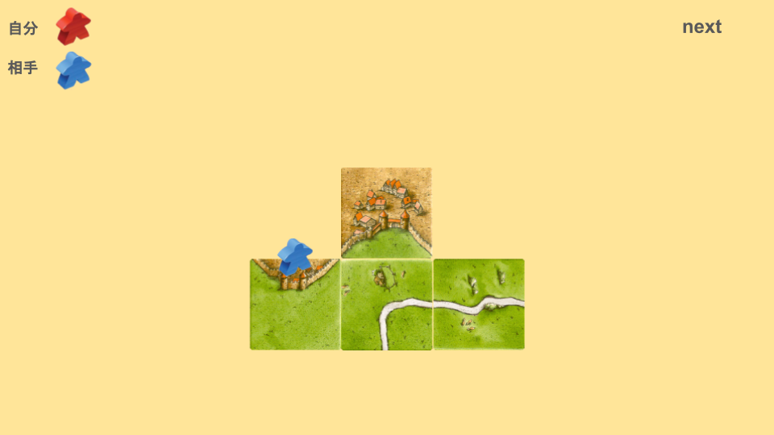
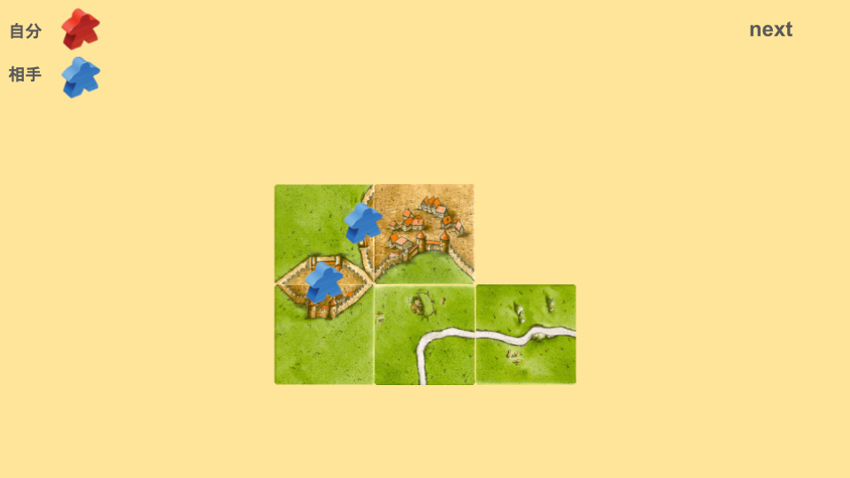
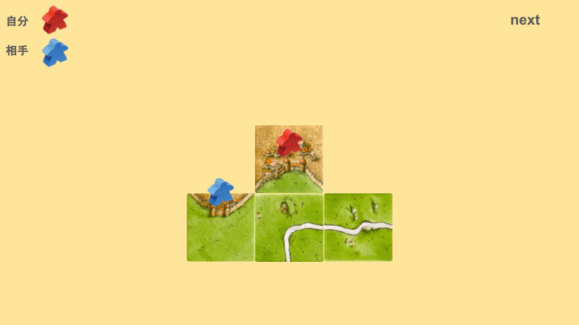
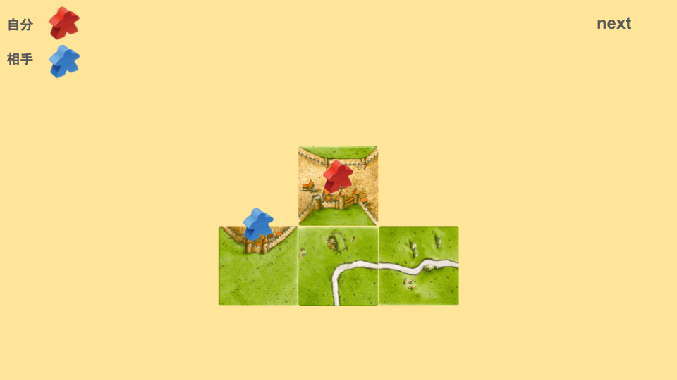

# 座り込みとは
次の画像を見てください。

この場合、どのように配置しますか？

次のように配置することを「座り込み」と言います。

このように配置すると、都市の完成まで少なくとも三手必要になります。
特に、タイルやミープル数が少なくなっている中盤以降で有効です。

ただし、セパレートで避けられることもあります。

これを避けるために、特に序盤では座り込み時にミープルを置くことをおすすめします。

# 注意点
土管でも同じようなことができますが、三辺よりも拡張できないため、ミープルを置くことをおすすめします。

