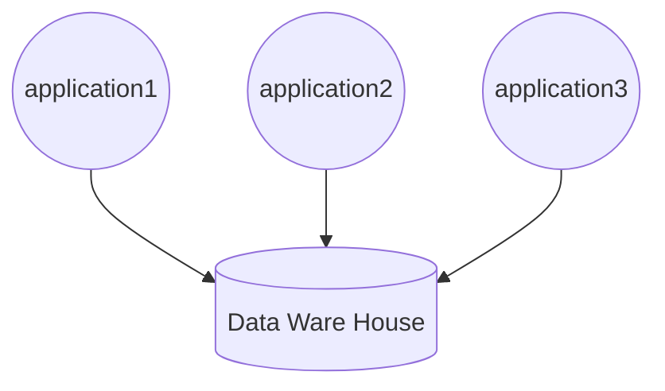
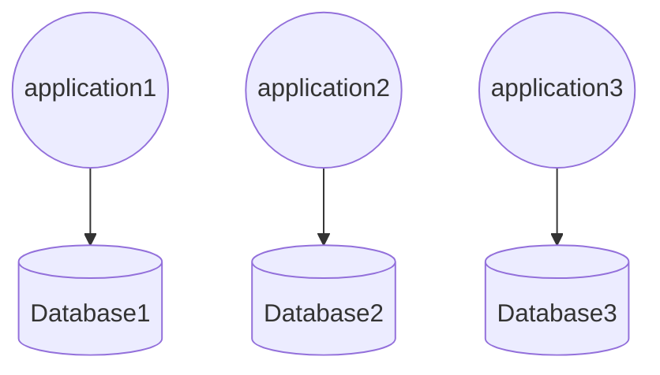

データモデルには汎用的なものと専門的なものがあります。
ここではそれぞれのメリット・デメリットについて考えていきます。

## 汎用的なデータモデル
ユーザー情報のような、どのアプリケーションからも利用できるようなデータを保存するのに優れたデータモデルです。
DWHのようなものを作る際に使われます。

このデータモデルのメリットは、システム全体でそのデータがDRYになることです。
ひとつのデータは一箇所にのみ保存されているので、システム全体でそのデータを使いまわすことができます。
ただし、使い方を間違えると「神データベース化」してしまうため注意が必要です。
DDDで言う「境界づけられたコンテキスト」を跨ぐデータモデルのことを指します。

## 専門的なデータモデル
そのアプリケーションに特化したデータを保存するのに優れたデータモデルです。
マイクロサービスアーキテクチャーを採用する時に使われます。

このデータモデルのメリットは、アプリケーションごとの同音異義語をそれぞれ独自に扱えることです。
DDDで言う「境界づけられたコンテキスト」を跨がないデータモデルのことを指します。

## 追記
いくつかデータモデルに関する情報を収集したところ、汎用的なデータモデルがあるとアプリケーションがそのデータに依存したがる傾向があるようです。
これだとアプリケーションがデータモデルに依存する形になってしまうため、専門的なデータモデルを用いて(または開発者が規律を取り戻すことで)依存関係を逆転させなければいけません。
