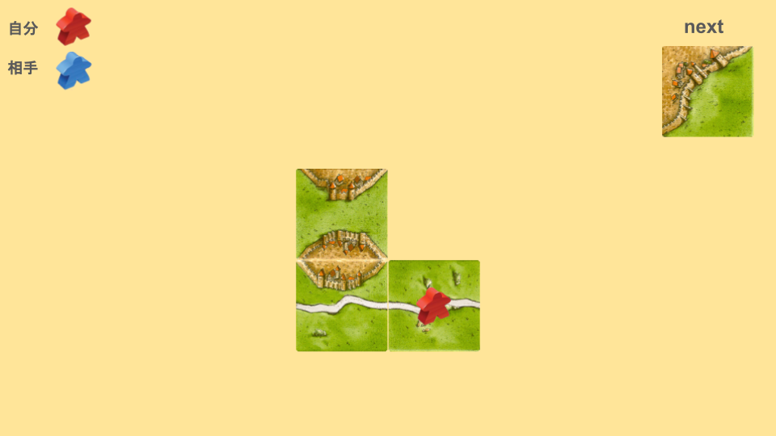
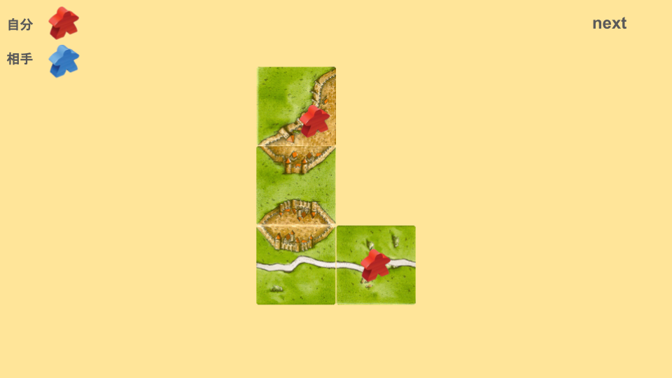
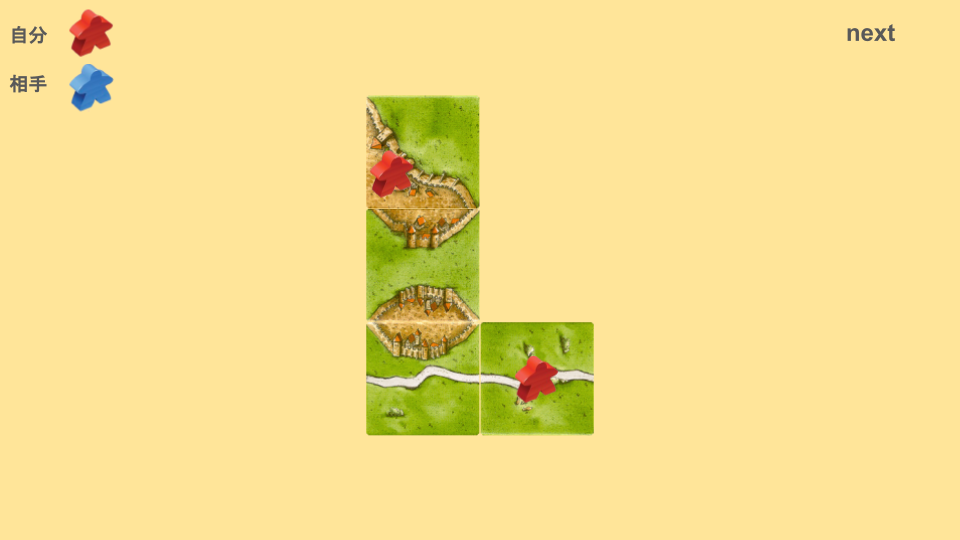
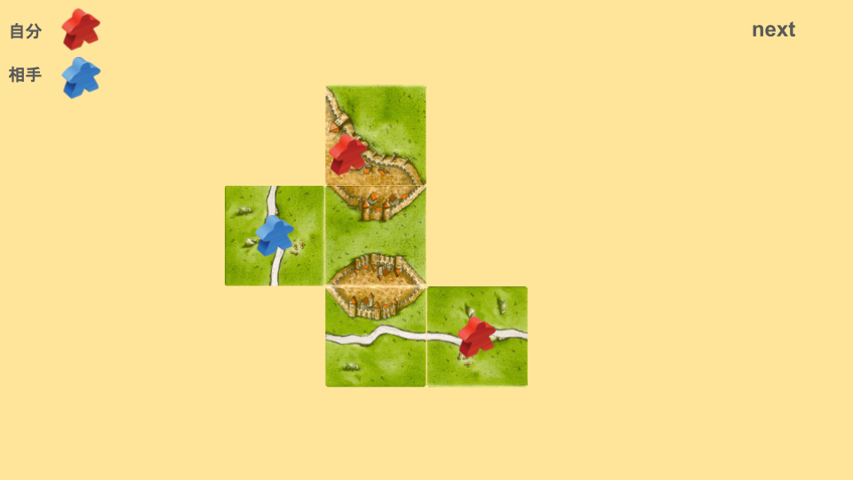

# 問題
次のような場合、どのように配置しますか？

# 答え

都市を取りにいくところまでは、共通認識だと思うのですが、なぜこの向きの配置をするのか、逆向きに配置した場合を見てみましょう。

実は、この場合だと大きく損をしてしまう可能性があります。

これは、相手に[ぶっさし 相手都市](ee2e55ac0fa74398a74bac0fdaf1f129.md) と[相乗り(あいのり)](0fbfa626776044e6820a17dfba44cb05.md) を一手で両方やられてしまっています。
このような、相手の良い手を事前に潰すのが狙いです。

もう一度、正解パターンを見てみましょう。

この場合であれば、相手の良い手を妨害することができます。
