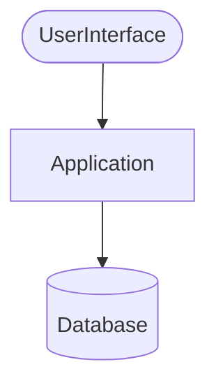
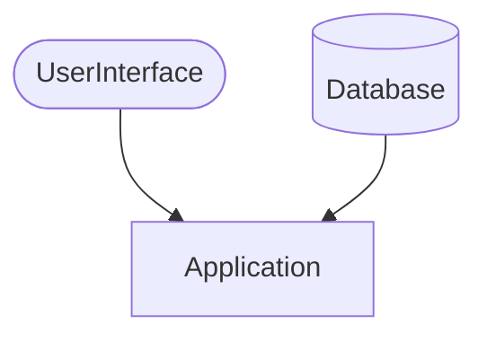

## とある人の話
その人は、プログラマーになるためにソフトウェア開発の勉強をし、実務はほぼ未経験だったのですがやっとの思いでソフトウェア開発会社に入社することができました。
これはまだ入社したての、とある日の話です。

「今、この画面に表示している一覧の情報をCSVファイルとしてダウンロードできるようにしてほしい。」

その画面を見てみると、法人の顧客が商品をいつ、どれくらい買ったのかがわかる、というものでした。
なるほど、そこまで難しくなさそうです。
一応いくつかの質問をしてみました。

1. 何故CSVファイルが必要なんですか？
   「顧客がそのCSVファイルを元に何かの処理をするらしいんだ。うちのシステムを連携させてやることもできるけど、それには時間がかかるから今はCSVをダウンロードできる状態にしてほしい。」
2. このデータはどこを参照して取得しているものなんですか？
   「取引の履歴を保存しているテーブルがあるんだ。そのテーブルを検索して、それをそのままCSVファイルに書き込んでくれればできるはずだよ。」

なるほど、やっぱり簡単そうです。

「じゃあよろしくね！リリース予定は数ヶ月先だし、そんなに急がなくても大丈夫だから。」

まずは、この一覧画面を表示するために叩いているWebAPIを見てみました。
運が良ければ、中身の処理を流用してCSVの出力ができると思ったからです。
コントローラーでは一つのサービスを呼び出しているだけだったので、次はサービスの中身を見てみます。

「おっと、このサービスは複雑だな…」

データベースから取得した複数のデータをサービスのあちこちで変換をしているようでした。

「うーん、取得したデータを変換して返しているようだけれど、いまいち何をやっているのかわからないな。まあ、データを取得する部分を見てみるか。もっと簡単に実装できるかもしれないし。」

いくつかあるデータを取得するメソッドの内のひとつを見てみました。

```java
public List<Map<String,List<Map<String,Object>>>> select(
String searchCondition1,
String searchCondition2,
String searchCondition3,
String searchCondition4,
String searchCondition5,
String sortOrder1,
String sortOrder2,
String sortOrder3
){
  //数百行のSQLを呼び出す処理
}
```

SQLでは複数のテーブルをいくつかの条件で結合しているようでした。

「困ったな、中身の処理が複雑で何をやっているのかよくわからないし、このメソッドは使えなさそうだ。」

他のデータを取得するメソッドを見てみたのですが、どれも同じようなシグネチャーでした。

「メソッドのシグネチャーが複雑だし中身の処理も複雑そうだけど、SQLを見てみると同じようなテーブルを同じような条件で結合しているみたいだから、テーブル設計を見てみたらもしかしてもっとシンプルなSQLで済むかもしれないな。取引の履歴を保存しているテーブルがある、という話だったよな…。そこから検索するだけだから、こんなに複雑な処理は必要ないと思うな。」

テーブル設計を見たところ、取引の履歴を保存しているテーブルが複数存在していることが分かりました。
しかも、それぞれのテーブルで少しずつ保存しているデータが違い、画面に表示していたデータを取得するには全てのテーブルを参照する必要がありそうでした。

「うーん、取引の履歴を取得する処理を自分で実装するのは難しそうだ。コントローラーが呼んでいるサービスを直接呼び出して、その結果をCSVに詰めればいいや。」

```java
public List<Map<String,List<Map<String,Object>>>> execute(
List<String> searchConditionList,
List<String> sortOrderList
){
	//とてつもなく複雑な処理
}

```

サービスの中身ではsearchConditionListのgetメソッドを使ってselectメソッドを呼び出していたため、どうやらsearchConditionListの並び順には意味があるようです。

「検索条件を入れてこのサービスを呼び出したいんだけど、このメソッドに検索条件を正しく入力するのはすごい難しそうだ。」
「そうだ、このWebAPIを叩いているフロントのコードを参考にしてみよう。」

```typescript
var data1:string[] = [input1,input2,input3,input4,input5]
var data2:string[] = [input6,input7,input8,input9,input10]
function api(data1:string[],data2:string[])
:List<Map<string,List<Map<string,any>>>> {
    //APIを呼び出す処理
}
```

「どうやらフロントの処理を参考にするのは難しそうだ。再利用できないのは仕方ないとして、どうやってCSVに書き出す処理を実装しようかな…。」

どこを見ても処理が複雑なため、諦めて0から自分で実装しようとしました。

それから2週間後。

「すみません、一覧画面のデータをCSVファイルに書き出す話なんですが…。」
「うん？完成したの？」
「いえ、この機能を実装するのはかなり大変そうです。問題はいくつもあるのですが、まずはこの画面にとある検索条件を入れてしまうと問題が発生します。何故このようなことが起こるのかというと、バリデーションが間違っているからです。具体的には…」
「ちょっと待って。この機能ってそんなに難しいの？0から処理を実装するとして、あとどれくらい時間が掛かりそう？」
「0からではありません。まずは今あるコードが正しく動いていることを検証しなければいけないので、マイナスからのスタートです。機能の実装を依頼されてから既に2週間経っていますが、ひとまずわかったのは、この機能を実装するコストが異常に高い、ということです。」
「つまり、どういうこと？」
「簡単に言うと、現実的なコストではこの機能は実装できない、ということです。」
「なるほど…。とりあえず間違っててもいいから動くものって作れない？」
「動くものを作ろうとした結果、異常なコストが掛かるということがわかったのでそれは無理です。コンパイルエラーにならないコードを書くことはできますが、完全に嘘の処理を書くことになりますね。ただ、そんなことはやりたくはないのでどうしてもと言うなら他の人に頼んでください。」
「そうなんだ…。とりあえず他の人に頼んでみるよ。ありがとう。」

数か月後、あの後どうなったのか聞いたところ、『ロックスター』に頼んだことで一か月で実装ができたらしいです。
勿論コードカバレッジは0%ですが…。

### 大量の問題
この話では大量の問題がいくつも同時に降りかかってきてしまい、その問題の解決ができませんでした。
ひとつの問題が複数の問題を発生させ、複数の問題が更に複数の問題を起こしていました。
テストコードが無い、デプロイ頻度が少なすぎる、CI/CDをしていない、型安全ではない、処理内容が不明確、データモデルが悪い、等々。
その結果、簡単な機能追加のはずが、とてつもないコストが掛かってしまいました。(しかも、レガシーコードが増えてしまいました)

### どうしてこうなったのか
ソフトウェア開発に必要な知識がチームや会社全体で不足しているのは一目瞭然ですが、それを抜きにして調査をしてみました。
その結果、依存関係に問題があることがわかりました。



アプリケーションがデータベースに依存する形になっています。
本来はデータベースがアプリケーションに依存するべきです。



更に調査を進めたのですが、データモデルが無駄に複雑なことがわかりました。
データモデルの複雑さをORMで全て吸収しようとした結果、再利用性の低いコードが増え、テスト容易性も下がっていました。
ドメインロジックがSQLのjoin句やwhere句に記述されており、もはや何のためにその条件が存在しているのかすらわからない状態でした。
これに知識不足が重なり、大量の問題が発生してしまいました。

### もしデータモデルがシンプルだったら
TDD、DDD、CI/CD等を実践することは現代においては必須になっています。
データモデルが多少良かったとしても、ソフトウェアの品質は低いままでしょう。
しかし、データモデルがシンプルであったならば、リファクタリングが容易になったことは間違いありません。
特に、データベースに依存する形になっているシステムにとっては、コードがシンプルであることよりも威力があるかもしれません。

### 何故インピーダンスミスマッチは酷くなるのか
インピーダンスミスマッチが酷くなる原因のひとつは、ドメインモデリングとデータモデリングを別の人が行っている、ということです。

> 💡 インピーダンスミスマッチとは、元々は電気電子の分野で使われる言葉でしたが、近年ではデータベースとオブジェクト指向プログラミングの間のギャップのことを指す言葉としても使われています。
> この記事では後者の意味としてインピーダンスミスマッチという言葉を使います。

特に、昔作られたデータモデルからデータを取り出そうとした場合、現在のドメインモデルと乖離している可能性があり、複雑な処理を挟まなければならない、ということがよくあります。
既存のデータモデルとドメインモデルの間の翻訳をORMでやらなければいけなくなってしまい、それが原因でバグが発生してしまうこともあります。
運が良ければコンパイルエラーが発生してくれますが、運が悪いと実行時エラーになったり、最悪の場合には何も反応しない場合すらあります。
このようなことが起こらないようにするために、インピーダンスミスマッチはできるだけ無いほうが望ましいです。

### インピーダンスミスマッチを最小限する重要性
このことから、インピーダンスミスマッチを最小限にすることはとても重要だと考えています。
この記事ではインピーダンスミスマッチを抑えるための手法を紹介していきます。
これらの方法を実践し、問題を解決していくことを少しでも手助けできれば幸いです。

### インピーダンスミスマッチを諦める
インピーダンスミスマッチを諦めることも場合によっては必要です。
既存のシステムがあまりにも変更容易性に乏しい場合には直接データベースを操作することを諦め、Web APIからアクセスしてしまったほうが良いかもしれません。
その場合でもインピーダンスミスマッチが無くなる訳ではありませんが、被害箇所を抑えることはできます。
