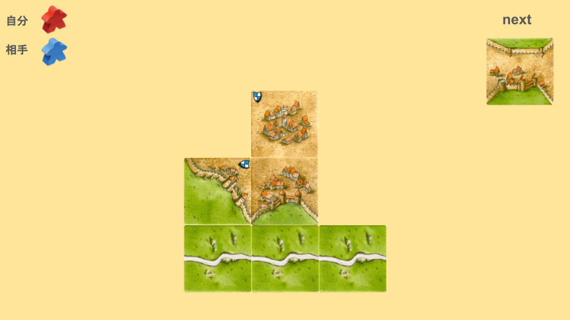
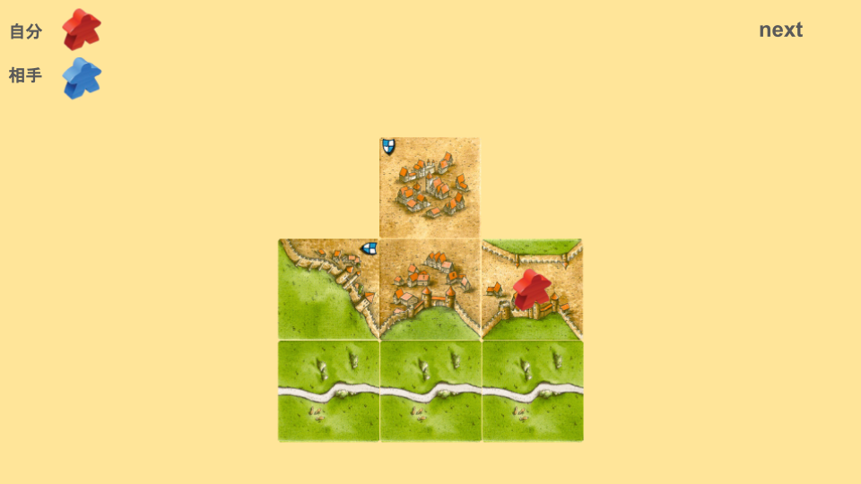
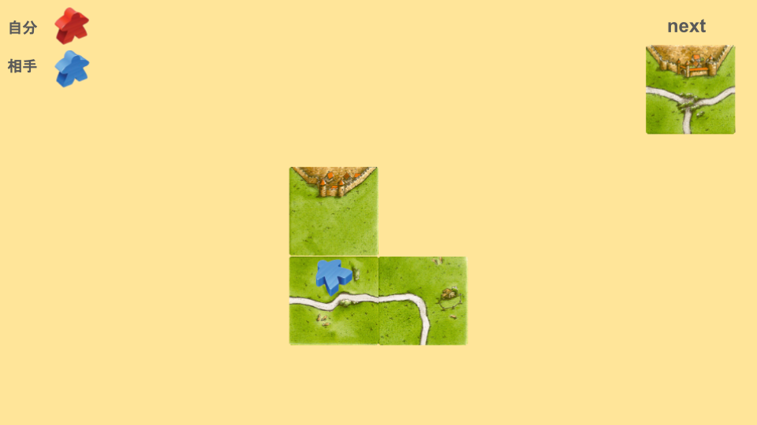
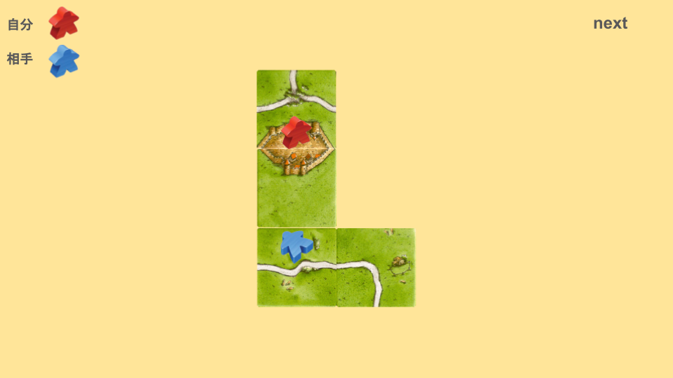

# 先置きとは
次の画像を見てください。

この場合、どのように配置しますか？

次のように配置することを「先置き」と言います。

ページ を取ることで、相手の点を防ぎながら、自分の点を稼ぐ手法です。
実際に獲得した点数にプラスして、妨害したことによる点差分も得をしています。

特に、終盤の取られたら負け、というタイミングで有効です。
また、草原の先置きは序盤から有効です。
# 相手草原の中立都市のパターン
特殊な場合の説明をします。
次の画像を見てください。

この場合、どのように配置しますか？

この場合、必ず次のように配置してください。

もし自分が都市を完成させなかった場合、相手には都市完成の4点と、草原3点の合計7点取られてしまいます。
しかし、自分が都市を完成させた場合、自分の都市完成で4点、相手の草原3点で合計+1点という計算になります。
この一手には、+1点と-7点の差分である、8点分の価値があります。
