# 後手都市草系
## 一辺

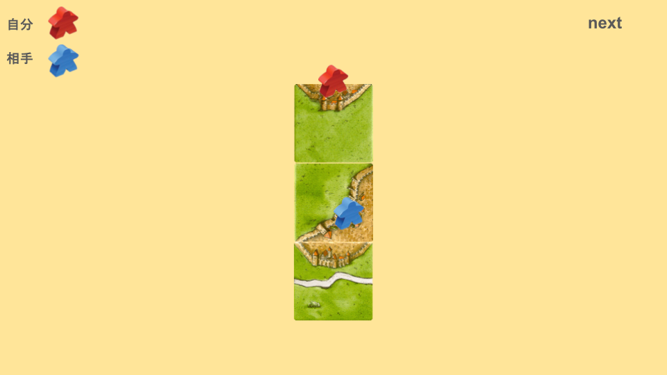

## 二辺

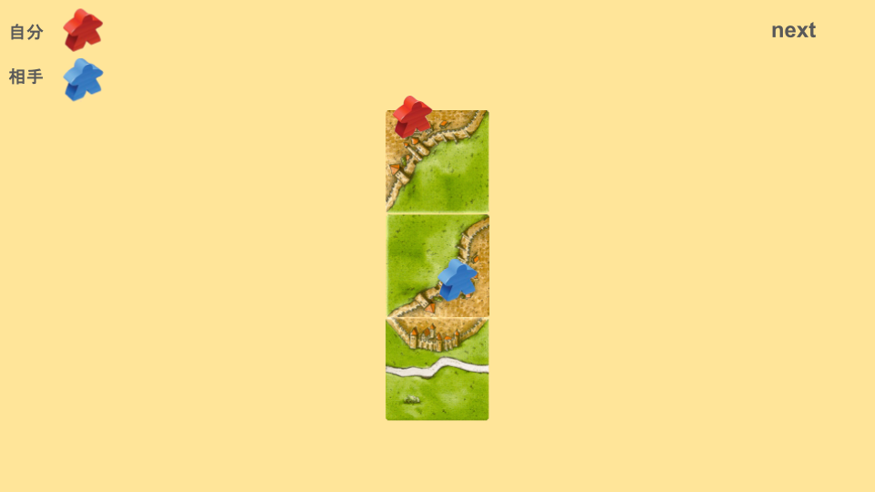

## 三辺

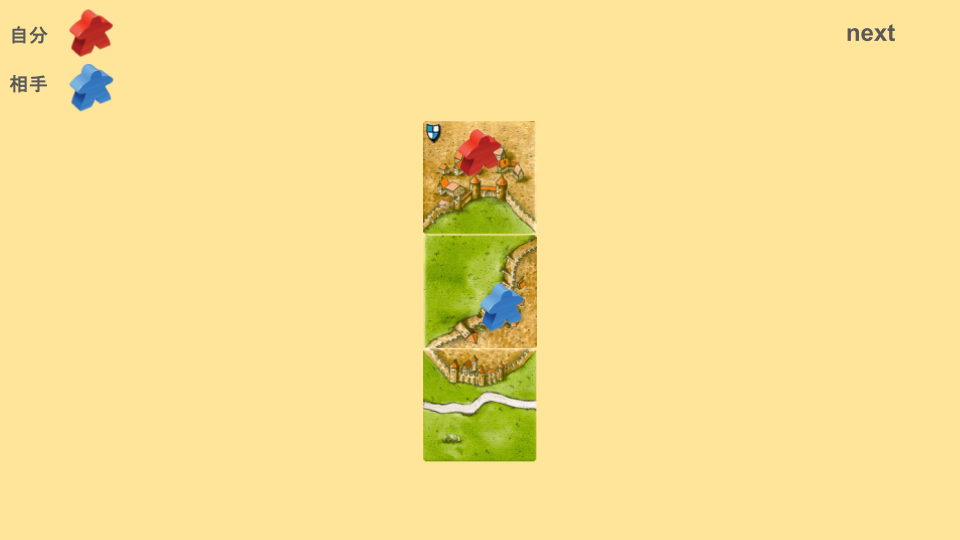

## 土管

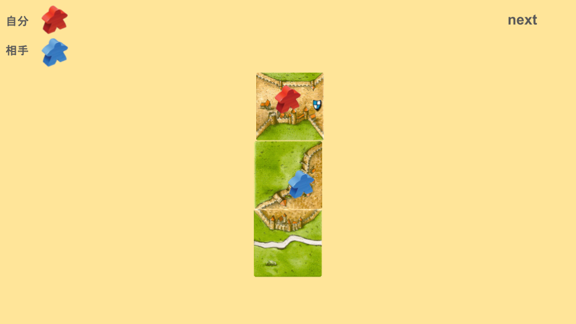

## ジブラルタル

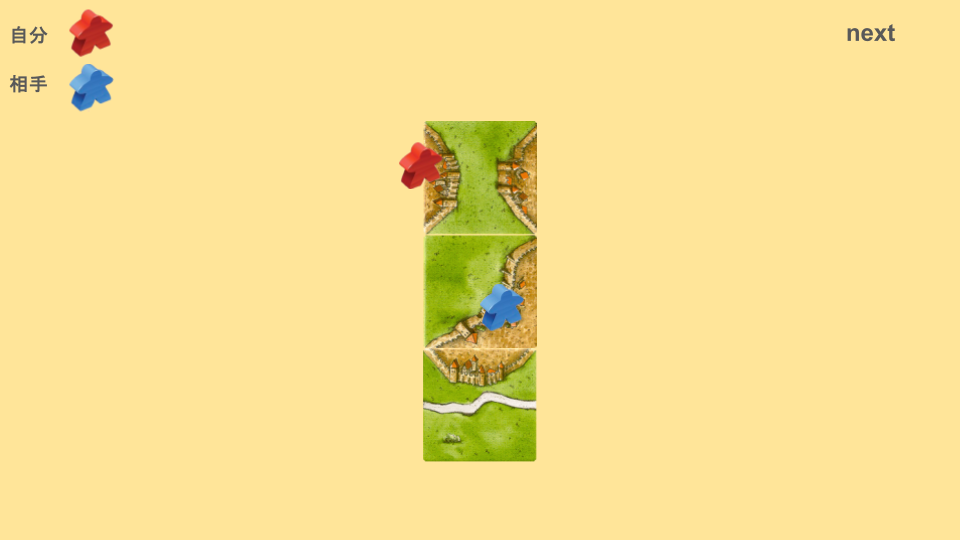

## セパレート

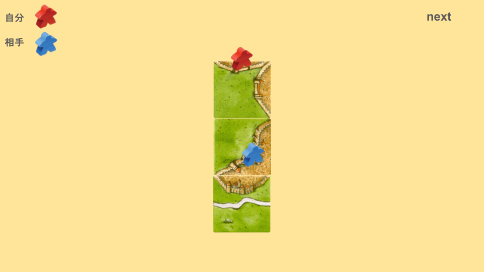

# 後手道付き都市系
## 一辺三叉

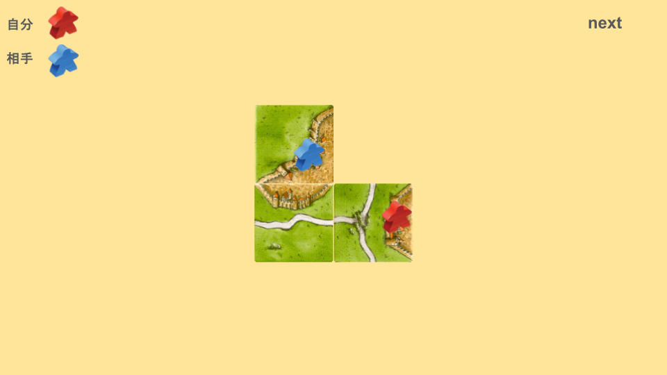

## 二辺アリ

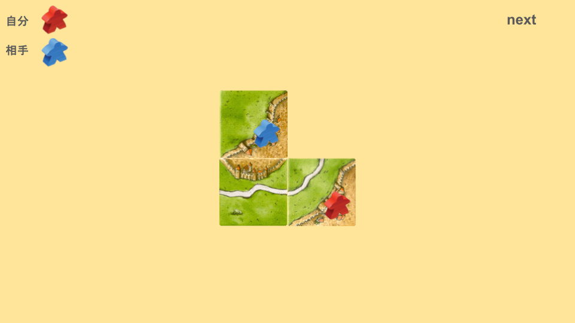

## 三辺アリ

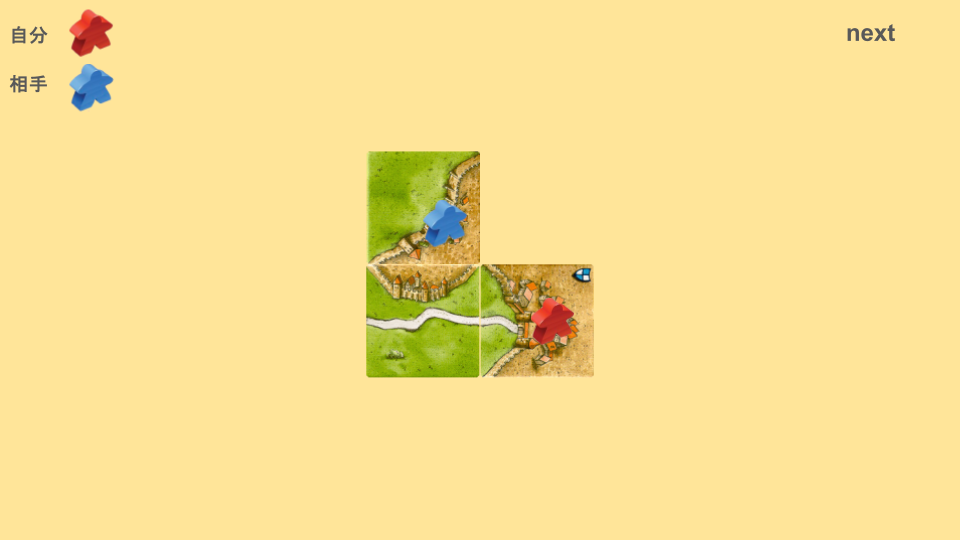

## 一辺アリ

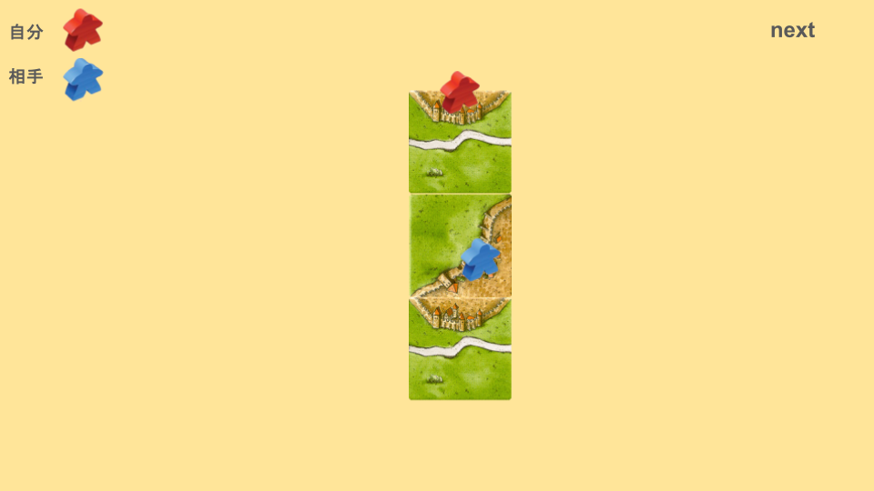

## ライト

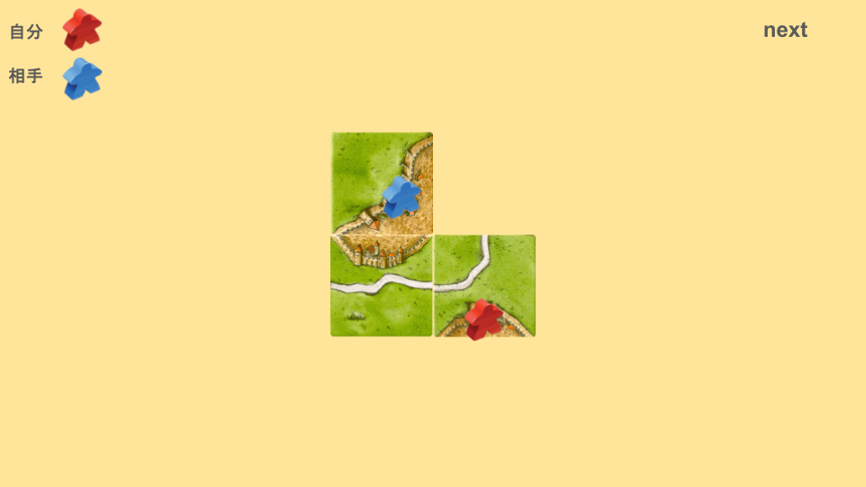

## レフト

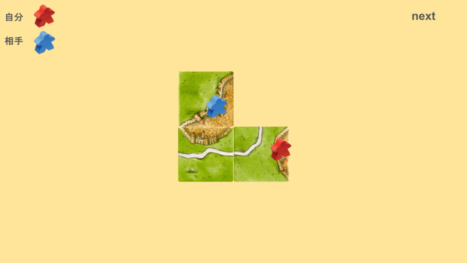

# 後手草道系
## ストレート

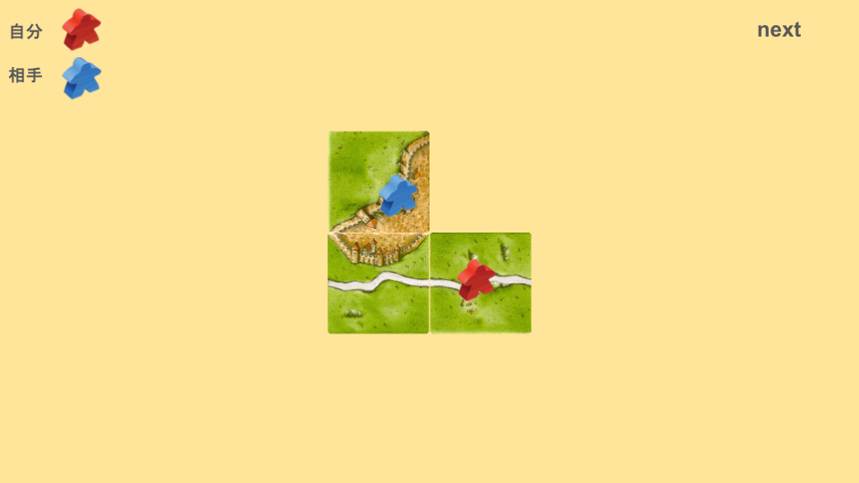

## カーブ

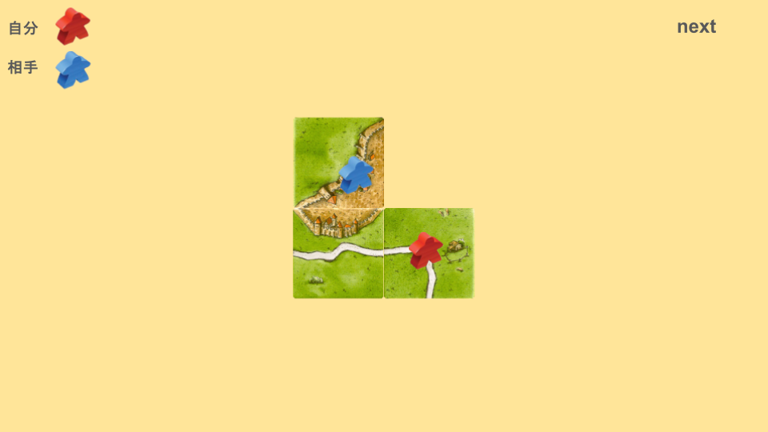

## 三叉

## 道付き修道院

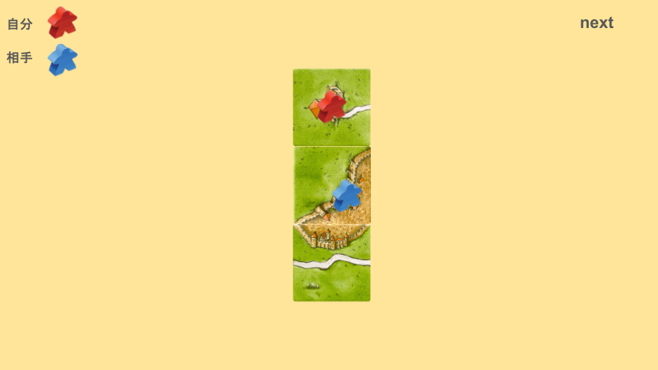

# 後手全種系
## 修道院

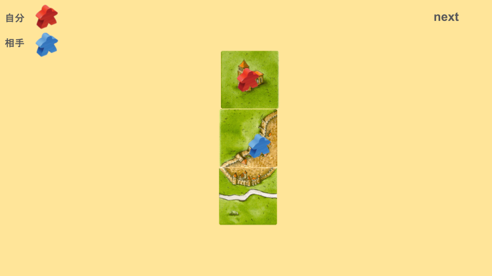

## オールシティ

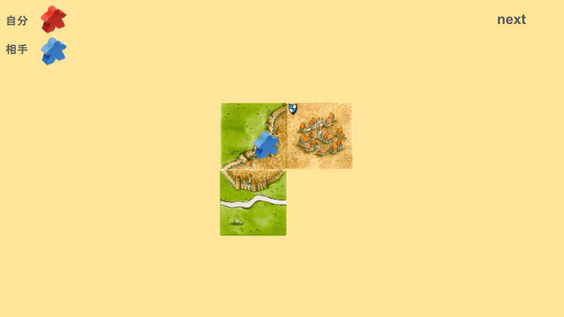

## 十字

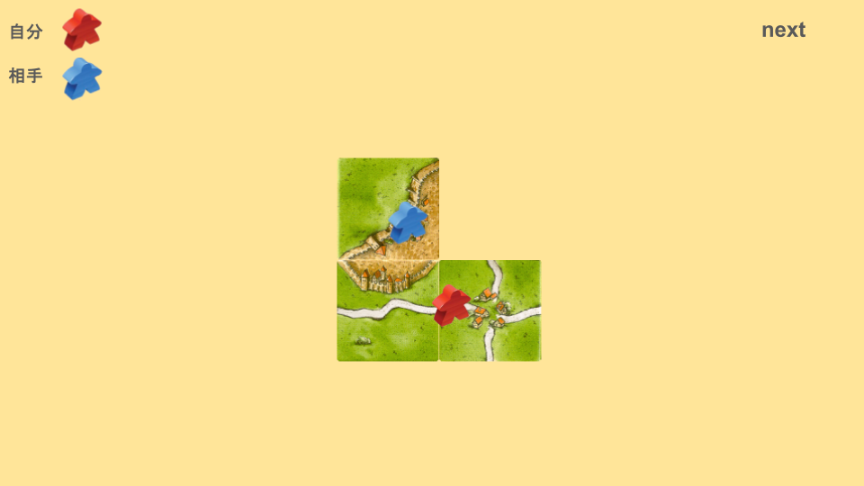
