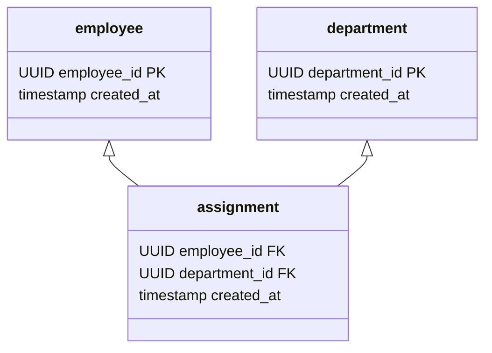
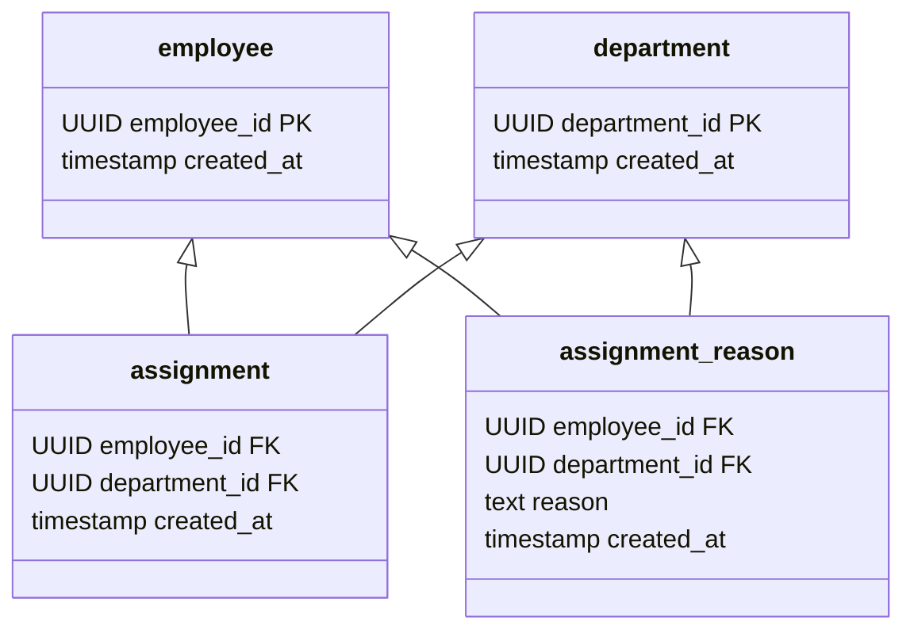
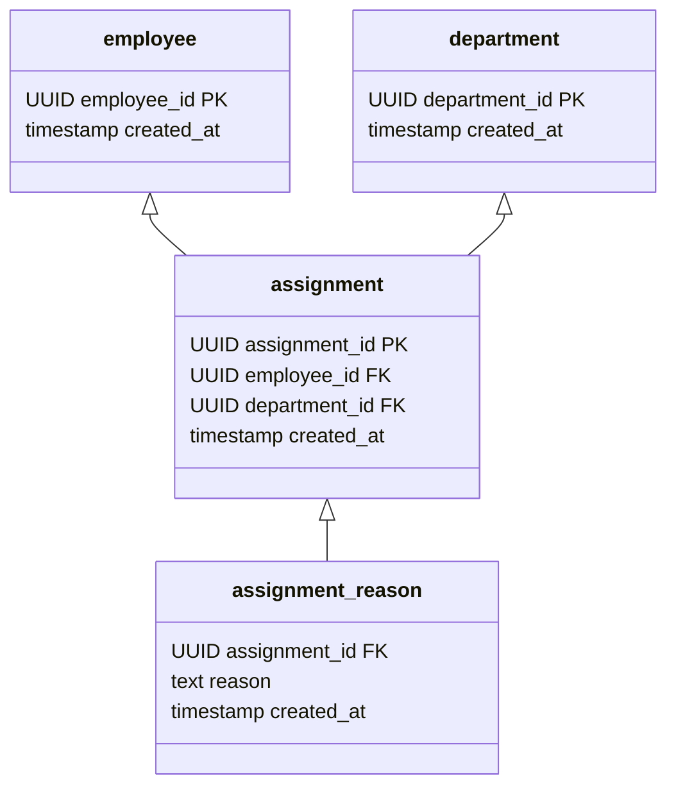

社員Repositoryにのみ焦点を当てて実装方法を見てきましたが、次は依存関係のある複数のRepositoryについて見ていきます。
まずは下記を見てください。



社員、部署、配属をモデリングしたものです。
ここで「配属理由」というvalueテーブルを追加したいとします。
するとこのようになりました。



配属理由valueテーブルがemployee_idとcompany_idのふたつのidに依存するようになってしまいました。
「valueテーブルはひとつのidテーブルにしか依存しない」というルールを破ってしまいました。
では、配属理由テーブルが配属テーブルに依存するように修正してみましょう。



配属テーブルに配属idを追加し、配属理由テーブルが配属idに依存するようにしました。
これをすることで「idテーブルでは依存関係を表現する」「valueテーブルでは値を表現する」という整理をすることができました。
idテーブルとvalueテーブルのルールを守ると、このようにデータの責務が明確になり、凝縮度が高まります。

データモデリングはこれで一旦終わりにし、Repositoryを作っていきます。

### ライフサイクルごとにRepositoryを作る
ライフサイクルとは、それが生まれてから死ぬまでの期間のことです。
プログラミングの業界では特にインスタンスの生成から破棄までの期間のことを言います。
イミュータブルデータモデルではデータの破棄はしないため、データの生成に焦点を当てます。

簡単に言うと、idを生成する単位でRepositoryを作っていきます。

```kotlin
interface EmployeeRepository {

    fun resolveBy(employeeId: UUID): Employee

    fun add(employee: Employee)

    fun replace(employee: Employee)

    fun remove(employeeId: UUID)
}

data class Employee(
    val employeeId: UUID,
    val name: String
)

interface DepartmentRepository {
    fun resolveBy(departmentId: UUID): Department

    fun add(department: Department)

    fun replace(department: Department)

    fun remove(departmentId: UUID)
}

data class Department(
    val  departmentId: UUID,
)

interface AssignmentRepository {

    fun resolveBy(assignmentId: UUID): Assignment

    fun add(assignment: Assignment)

    fun replace(assignment: Assignment)

    fun remove(assignmentId: UUID)
}

data class Assignment(
    val assignmentId:UUID,
    val employeeId: UUID,
    val departmentId:UUID,
		val reason:String,
)
```

DepartmentRepositoryはEmployeeRepositoryと同じ構造になるため、ここではAssignmentRepositoryに注目してみましょう。
resolveByでassignmentIdを受け取っていますが、そのようなユースケースは存在するでしょうか。
「配属idで配属した人と部署が知りたい」のようなユースケースが存在する場合は必要ですが、配属idで検索しないのであれば不要です。
代わりにこのようなシグネチャーにします。

```kotlin
fun resolveBy(employeeId:UUID,departmentId:UUID):Assignment

fun remove(employeeId:UUID,departmentId:UUID)
```

もしドメインモデルとして配属idというものが出てこないのであれば、データモデル内で完結させるためにAssignmentオブジェクトも変更したほうが良いでしょう。

```kotlin
// assignmentIdを削除
data class Assignment(
    val employeeId: UUID,
    val departmentId:UUID,
		val reason:String,
)
```

このような、データモデル都合で生成したidのことをヘルパーidと呼びます。

### ヘルパーid
ヘルパーidというのはデータモデルをシンプルにするために使われるものであって、検索時のキーとして使われるものではありません。
そのため、Repositoryのシグネチャーにヘルパーidが出てくることはありません。

AssignmentRepositoryでemployeeIdとdepartmentIdを受け取る形にしているため、データの依存関係も表現できています。
