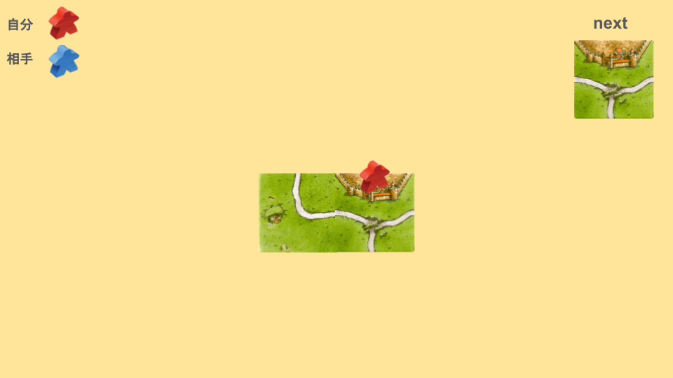
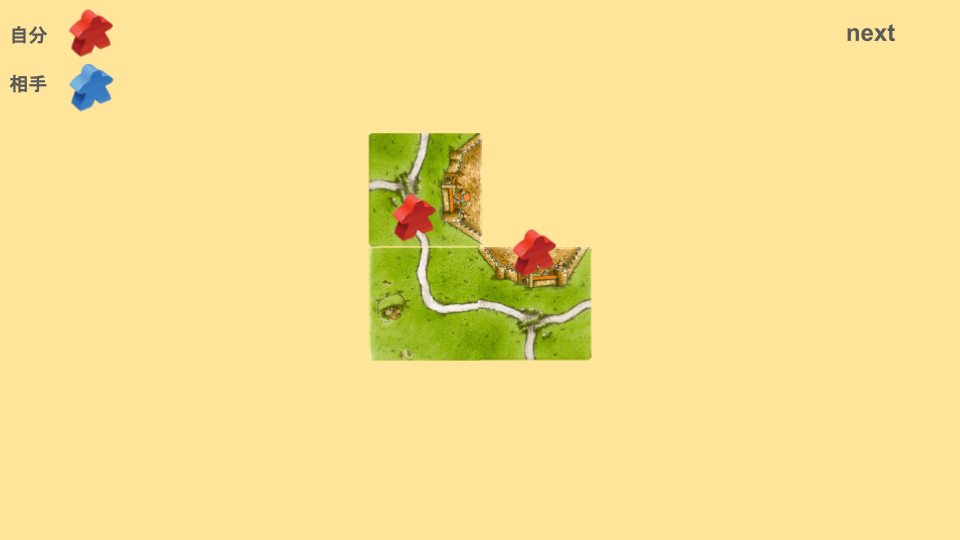
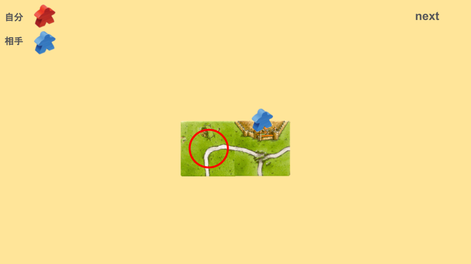
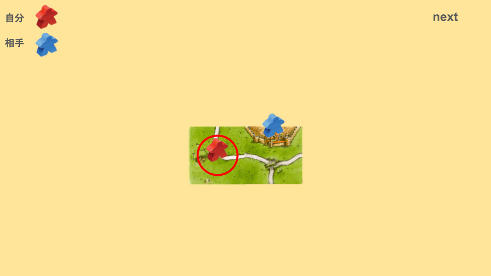

# 斜め取りとは
次の画像を見てください。

この場合、どのように配置しますか？

次のように配置することを「斜め取り」と言います。

道で点を取りながら、土台を無効化しながら、二辺系での都市リーチをかけています。

相手の都市に土台(ページ )を置くときは、[斜め取り(ななめどり)](6a882f2babfa404c91a6a6320d00057d.md) の裏目や、[ぶっさし 自分都市](78b52e321f3545b0aecb6301ad858708.md) があるため、できるだけ相手の都市の方向に道を伸ばさないようにしましょう。

このように配置するのがおすすめです。

序盤であれば、次のように配置するのもおすすめです。

[ぶっさし 相手都市](ee2e55ac0fa74398a74bac0fdaf1f129.md) を狙った一手です。
