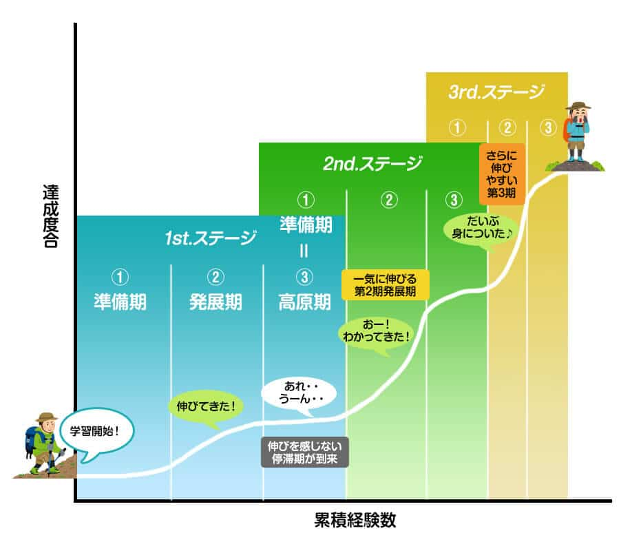
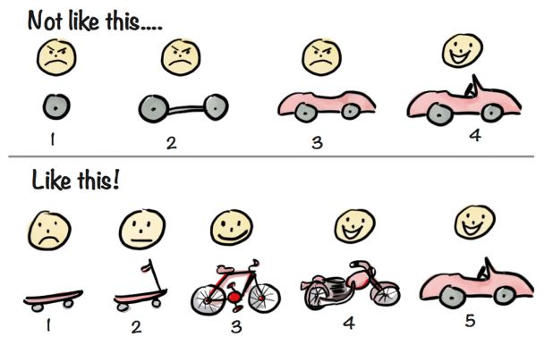
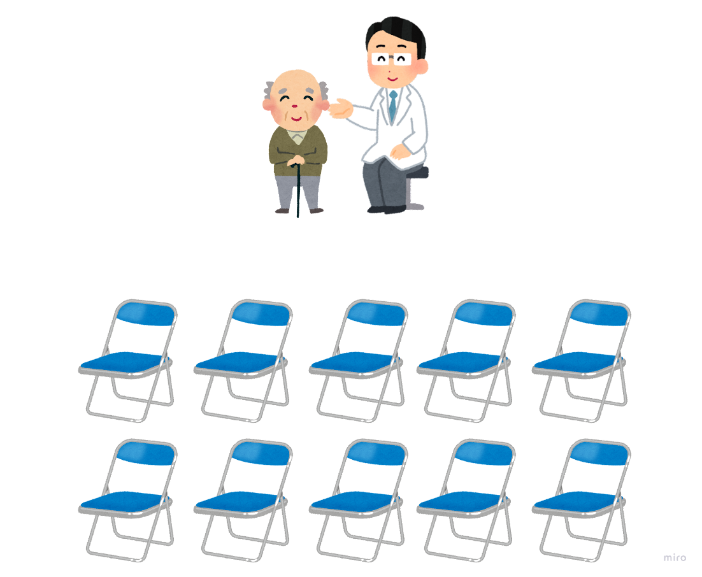
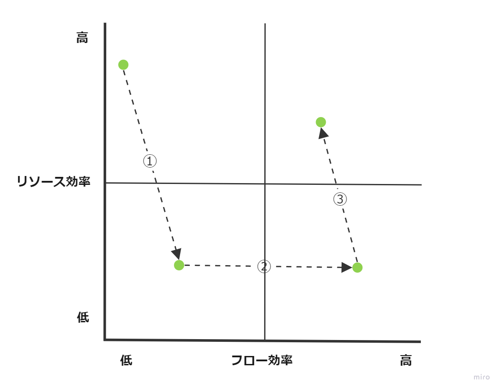

# 効率良く働く 利益を最大化する働き方

# 今日の議題

- はじめに
- 学びを最適化する
- 「効率が良い」って何？
- まとめ

# はじめに

ヒューマンエラー、不正行為、非人道的行為などのニュースが後を絶えません。
これは、最近だけの話なのでしょうか？
いいえ、このようなことは昔から繰り返し行われています。

## 人類は失敗し続けている

人類は、数百年前、数千年前から同じような失敗を繰り返し続けています。
どうして失敗はなくならないのでしょうか？

## 失敗は避けられない

失敗は誰でもする可能性があり、これを全て防ぐのは、非常に難しいと考えられます。
ただし、失敗から学ぶことで、失敗を減らすことはできます。
つまり、昔の事例から学ぶことは非常に重要、ということです。

## 失敗を利用する

失敗は避けられないことを逆手にとって、失敗を利用する、という考え方があります。
これは、失敗時のコストを極限まで減らしながら「わざと」失敗することによって、コスト以上の学びを得よう、という考え方です。
これを繰り返すことで、コストを抑えながら、学び続けることができます。
学び続けることで、改善を促し、利益を最大化させることができるようになります。

## 目的

学びの重要性を知ろう！

# 学びを最適化する

より効率よく学びを得るために、「学びの最適化」が重要になってきます。
学習曲線というものがあります。

[学習曲線 UX TIMES](https://uxdaystokyo.com/articles/glossary/learning-curve/)　より引用

この学習曲線の山を早く登ることを**学びの最適化**と呼んでいます。

## 学びの最適化をするための考え方

学びの最適化をするために、重要な考え方があります。
ある物語を見てみましょう。

### パターン１

> 🤖 今日から新規アプリを作るプロジェクトの立ち上げだ！
> 僕はプロジェクトマネージャーとして、絶対にこのプロジェクトを成功させなくてはならない
> そのために、入念に計画してからアプリを作ろう！
> **品質を作り込む**って考え方があるしね！

3ヶ月後

> 🤖 よし、やっと計画し終わった！
> スケジュールも、エンジニアの体制も、十分に整ったぞ！
> これだけ準備していれば、**成功間違いなし**だ！

更に6ヶ月後

> 🤖 今日は新規アプリのリリース日だ！
> 打ち上げするために**お店も予約**しておいたし、計画は完璧だ！

> 🐶 プロジェクトマネージャー、お疲れ様です
> 実は、伝えなければいけないことがあります…

> 🤖 どうしたの？打ち上げは18時からやる予定だよ

> 🐶 いや、打ち上げはできないかもしれません
> 今アプリを使おうとしたら**動いてないんです！**
> ちょっと調べてみたら、**実はまだ一回も起動に成功したことがない**らしいんです！

> 🤖 え！？
> 6ヶ月も**時間があったのに**起動したことがないの！？

> 🤖 完璧な計画をしたのに、どうしてこんなことになってしまったんだろう…

### パターン2

> 🤖 今日から新規アプリを作るプロジェクトの立ち上げだ！
> 僕はプロジェクトマネージャーとして、絶対にプロジェクトを成功させなくてはならない
> そのために、まずは小さいアプリを作って実験してみよう！
> **スモールスタート**って考え方があるしね！

1週間後

> 🤖 よし、とりあえず事前登録だけできるようになったぞ！
> どれくらいニーズがあるのか確かめるために、**早速リリースしてみよう**！

更に1週間後

> 🤖 さて、どれくらい事前登録する人がいたのかな
> 確かめてみよう…

> 🤖 あれ、事前登録している人が**全くいないぞ！**
> これはもしかしたら僕たちの立てた仮説が間違っているみたいだ

> 🤖 よし、このプロジェクトは**諦めよう**！

### 何が起こったのか

パターン1では、9ヶ月とそれにかかるお金を使い、動かないソフトウェアを作ってしまいました。
**動かないソフトウェアには価値はありません。**
パターン2では、2週間とそれにかかるお金を使い、**動くソフトウェア**を作りました。
それを使って実験したところ、**価値がないこと**がわかりました。
価値がないことは同じですが、どちらの方が時間やお金を節約できたでしょうか。
これが、学びを最適化する理由です。
**学びの最適化をするためには素早い実験が欠かせません。**
「**緻密な計画よりも素早い実験」ということです。**

## 学びの最適化をするための手法

学びの最適化をするために、重要な手法があります。

- ひとつの仕事を小さく分割する
- 「動く」単位で分割する
- 「ふりかえり」をする

それぞれ、見てみましょう。

### ひとつの仕事を小さく分割する

ひとつの仕事を小さくすると、細かくフィードバックを得られるようになります。
実際流れは次のようになります。

1. 仕事を小さく分割する
2. ひとつずつ仕事を完了させる
3. そこで得られたフィードバックを元に改善する
4. 1 ~ 3を繰り返す

このように、できるだけ**素早く失敗**することによって学びを最適化していきます。

### 「動く」単位で分割する

仕事の分割のやり方も重要なポイントです。

[Ow.ly @henrikkniberg](https://ow.ly/i/659WS)　より引用

どちらも少しずつ仕事を進めています。
上では最後まで動いていませんが、下では最初から動いています。
下の例の方が早い段階から動いているため、フィードバックを得やすいです。
つまり、小さくてもいいから動く、という単位で仕事を分割していった方が学びを最適化させやすい、と言えます。

### 「ふりかえり」をする

ふりかえりというのは、いわゆる反省会のようなもののことです。
ふりかえりはポジティブに進めることが重要です。
なぜなら、失敗を弾劾するのではなく、失敗から学びを得たいからです。
また、ふりかえりの手法や参加者のスキルによって、どれくらい学べるか、も変わってきます。
つまり、学びを最適化するのに最も重要なのは、ふりかえり、と言えます。
よく使われる手法を一つだけ紹介します。

### ＋／Δ(プラス／デルタ)

これは、良かったこと(＋)と、改善したいこと(Δ)を話し合って、アイディアを出す手法です。
下記のような感じになります。

- よかったこと
  - ○○さんのおかげで助かった！
  - 新しいやり方を試してみたら、時間を短縮できた！
- 改善したいこと
  - 初めてでやり方を間違えてしまった
    - ミスに気付けるように、複数人で働くようにしよう！

手法自体はかなりシンプルなので、お試しでやってみることをおすすめします！

## 学びの最適化の落とし穴

学びの最適化をしていくと、改善方法として、倫理的に問題のある方法を考案してしまうことがあります。
たとえば、次のようなものです。

- 「うちのサービスではまだできないけど、できるということにして営業しよう。この方が契約につながりやすいし。」
- 「本当は追加で費用がかかるけど、それを説明せずに契約してしまおう。これで売上が上がった！」
- 「本当はそんなにサポートできないけど、サポートが手厚いということにして契約してしまおう。契約も取りやすくなるし、売上も上がるし、いいことづくめだ！」

このような、倫理的に問題のある方法は止めなければいけません。
少しでもおかしいと思ったら、声を上げるようにしましょう！もしかしたら、他の人は気付いていないかもしれません。
これは、複数人で働いた方が良い、という考え方にもつながります。
また、顧客に損をさせない、**顧客重視**、という考え方が重要になります。

# 「効率が良い」って何？

どういうことか、次の例を見てみましょう。

## ある日のふりかえりにて

> 🤖 どうやら、うちのチームは効率が悪いみたいだ。
> どのような改善をしたら良いと思う？

> 🐶 もしかしたら、何もしていない隙間時間が多いのかもしれません。
> 効率を上げるために、隙間時間を減らす改善をしたほうが良いと思います。
> 具体的には、隙間時間を作らないために、ひとりひとりが複数の仕事を担当したほうが良いと思います。
> こうすれば、ひとつの仕事で暇な時間ができても他の仕事をできるので、効率が上がると思います！

> 🤖 なるほど。一理あるね。
> 他に意見のある人はいる？

> 😺 もしかしたら、ひとつの仕事を終わらせる時間が長すぎるのかもしれません。
> 効率をあげるために、ひとつの仕事に集中したほうが良いと思います。
> 具体的には、ひとつの仕事を終わらせる時間を減らすために、複数人がひとつの仕事を担当したほうが良いと思います。
> こうすれば、次の仕事に素早く取り掛かることができるので、効率が上がると思います！

> 🐶 それをやってしまうと、何もしない隙間時間が増えて、暇な人が増えない？
> しかも、複数人でひとつの仕事を担当するなんて、効率が悪すぎてできないよ。
> そんなことをやってしまったら、人を増やしても効率が上がらないんじゃないの？
> 何もしない隙間時間を減らしたほうが、よっぽど効率が上がると思うけど。

> 😺 いくら人を増やしたり隙間時間を減らしたりしても、仕事を終わらせることができないのであれば効率は上がらないんじゃないかな。
> こんなことをやるよりも、複数人でひとつの仕事を素早く終わらせたほうがよっぽど効率が上がると思うけど。

> 🤖 効率を上げるための話をしているのに、どうしてこんなに意見が食い違うんだろう…。

## 実は、「効率」は2種類ある！

ふたりの意見がこんなにも食い違っていたのは、異なる種類の「効率」について喋っていたからです。

- リソース効率
- フロー効率

それぞれ、どういうものなのか、見てみましょう。

### リソース効率

労働者の働く時間を最大限にする、というアプローチのこと。
病院でたとえます。
リソース効率を上げることになるのは、下記のようなものです。

- 医師の数を増やす。
- 医師の労働時間を増やす。
- 医師の隙間時間を減らす。

もし、医師のおでこにカメラを設置したとしたら、ほとんどの時間は患者を診察している映像になります。

### フロー効率

ひとつの仕事が完了するまでの時間を最小限にする、というアプローチのこと。
病院でたとえます。
フロー効率を上げることになるのは、下記のようなものです。

- 患者の待ち時間を減らす。
- 助けを必要としてる患者の元に、医師・看護師が出向く。
  - ナースコールのイメージ。
  - 患者がナースステーションに行くよりも、素早く、医療サービスを受けられる。

もし、患者のおでこにカメラを設置したとしたら、ほとんどの時間は診察と移動している映像になります。

## どっちの効率を優先したほうが良いの？

先ほどの例を改めて見てみましょう。

- リソース効率
  - 医師のおでこにカメラを設置したとしたら、ほとんどの時間は患者を診察している映像になる。
- フロー効率
  - 患者のおでこにカメラを設置したとしたら、ほとんどの時間は診察と移動している映像になる。

このような場合、**顧客重視(患者目線)**で改善したほうが良い、と言われています。
つまり、**フロー効率を改善したほうが良い**、ということです。

## フロー効率を上げながら、リソース効率もあげればいいんじゃないの？

これについて、まずはある物語を見てみましょう。

### ある病院の物語

👨🏻‍⚕️ こんにちは！私は医師です。
より多くの患者さんを助けるために、仕事のやり方を改善したいと考えています。

👨🏻‍⚕️ まず、今のやり方を見てみましょう。

👨🏻‍⚕️ この方法だと、次の患者が来るまで、医師は待たなければいけないですね。
医師の待ち時間はムダなので、改善してみます。

👨🏻‍⚕️ 医師の隙間時間を減らすために、次の患者さんを用意しておこう。
もしかしたら次の患者さんの診察はすぐ終わってしまうかもしれないから、その次の患者さんも用意しておこう。
てことは、次の次の次の患者さんも用意しておいた方がいいな…。
…

👨🏻‍⚕️ 患者さんをたくさん並ばせました！
これで医師のムダな待ち時間をなくすことができました。

👩🏻‍⚕️ すみません！患者さんからのクレームが来てます！
データを確認してみたら、**待ち時間が100倍になっていました！**

👨🏻‍⚕️ 何！
どうやら、医師目線で改善をした結果、患者目線ではサービスが悪化してしまったようだ。
これは改善しないといけないね。
**元のやり方に戻そうか。**

### つまり、どういうこと？

医師の隙間時間を減らすためには、次の患者を待たせる必要がでてきます。
そうすると、患者の待ち時間は増えてしまいます。
つまり、リソース効率を上げようとすると、ほとんどの場合、フロー効率が下がります。

## てことは、人を増やす意味はないってこと？

いいえ、そうとも言い切れません。
実は、フロー効率とリソース効率は両立することができます。
「矛盾してるじゃん！」と思った方もいるかもしれませんが、まずは次の図を見てみてください。

先ほどまでは、①の話をしていました。
このタイミングでは、リソース効率を上げようとすること自体が問題として扱われる可能性があります。
ただし、③では話が変わってきます。
③では、「できるだけフロー効率を落とさずに、リソース効率を上げる」という視点になります。
人を増やし、やり方やスキルを横展開することによって、リソース効率を上げていきます。
ここでの注意点は、「一足飛びで右上には行けない」ということです。
この図で言うと、**U字**に改善を進めていかなければうまくいかない、ということです。

# まとめ

- 失敗を利用する
- 学びを最適化
- ひとつの仕事を小さく分割する
- 「動く」単位で分割する
- 「ふりかえり」をする
- リソース効率・フロー効率

# 参考資料

- [失敗の科学](https://d21.co.jp/book/detail/978-4-7993-2023-5)
- [アジャイルなチームをつくる ふりかえりガイドブック 始め方・ふりかえりの型・手法・マインドセット](https://www.shoeisha.co.jp/book/detail/9784798168791)
- [This is Lean 「リソース」にとらわれずチームを変える新時代のリーン・マネジメント](https://www.shoeisha.co.jp/book/detail/9784798169521)
- [トヨタ生産方式　脱規模の経営をめざして](https://www.diamond.co.jp/book/9784478460016.html)
- [継続的デリバリーのソフトウェア工学　もっと早く、もっと良いソフトウェアを作るための秘訣](https://bookplus.nikkei.com/atcl/catalog/22/12/01/00531/)
- [人が増えても速くならない ～変化を抱擁せよ～](https://direct.gihyo.jp/view/item/000000003071)
- [エクストリームプログラミング](https://www.ohmsha.co.jp/book/9784274217623/)
