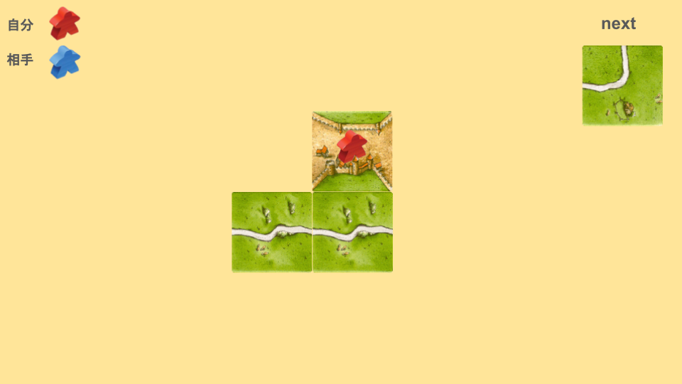
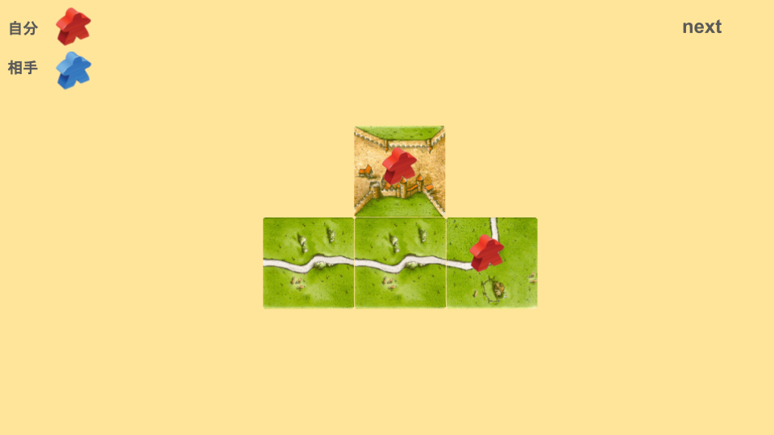
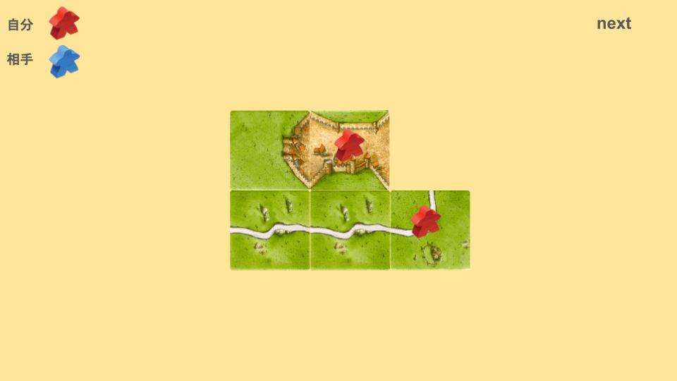

# ぶっさしとは
次の画像を見てください。

この場合、どのように配置しますか？

次のように配置することを「ぶっさし」と言います。

ポイントは、自分のミープルを道に置くことです。
これをすることで、該当するタイルを引けたとき、より獲得点数を増やすことができます。

特に序盤では、得点を稼ぐために、自分の都市が完成リーチ状態でもぶっさしをすることがあります。

ただし、ゲーム中盤以降は自滅行為になることが多いため、残りタイルに注意が必要です。
