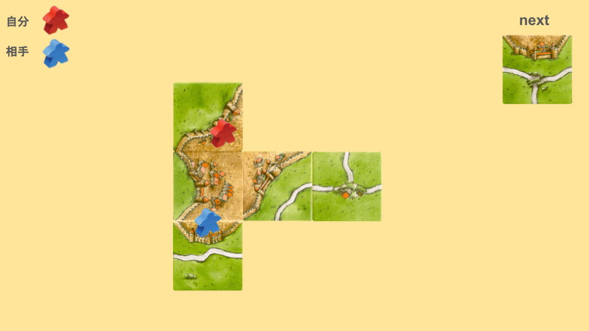
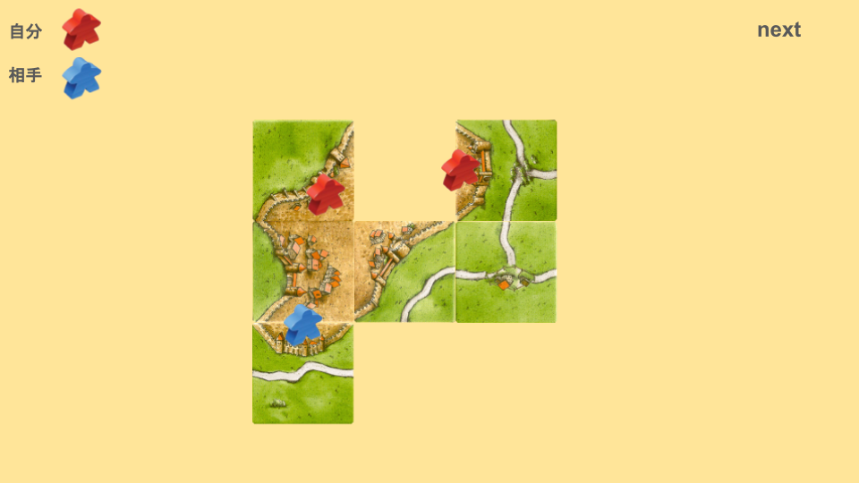
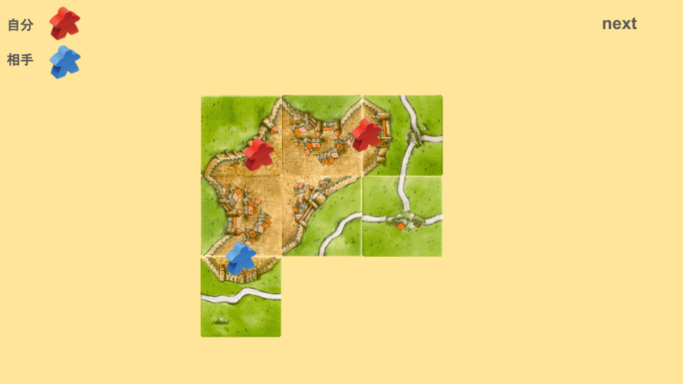

# 乗っ取りとは
次の画像を見てください。

相乗りが成功して、相殺されている状態です。
この場合、どのように配置しますか？

次のように配置することを「乗っ取りを仕掛ける」と言います。

ここで三辺か三辺アリを引くと、晴れて「乗っ取り」の完成です。

相手の手数とミープルを消化させ、かつ相手の得点を0点にしています。
乗っ取りは点数効率がかなり良いので、かなりおすすめの技です。

また、相手に乗っ取りをされないようにタイルを配置することも重要です。
