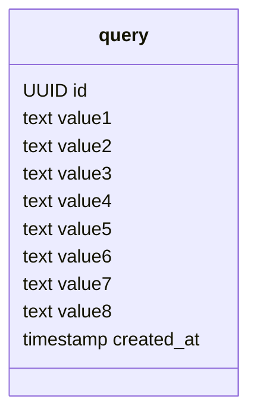
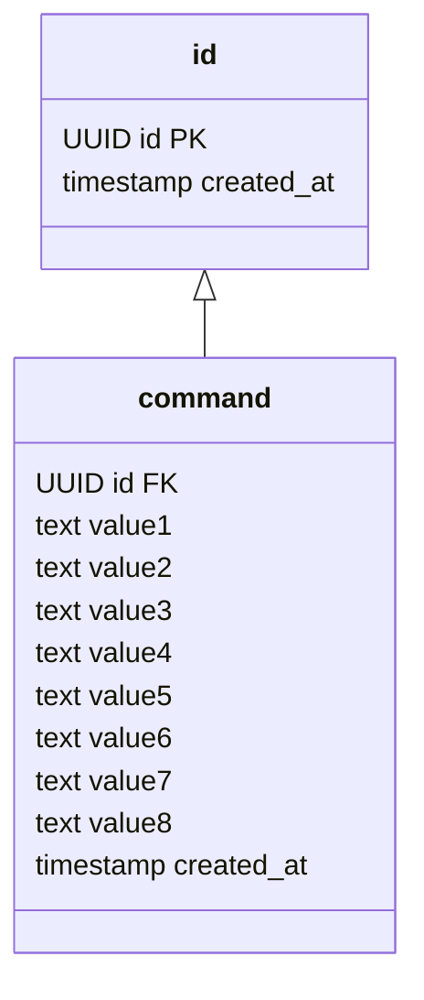

## CQRSとは
副作用のある操作(command)と副作用の無い操作(query)は分離しよう、という設計思想のことです。
SQLで言えば、insert、update、deleteが副作用のある操作、selectが副作用の無い操作です。

イミュータブルデータモデルでは副作用のある操作はinsertしか使わないため、複数のテーブルに分割する必要がありました。
insertする時は問題にはなりませんが、複雑な検索条件(何かの一覧を検索してソートする、等)の場合、SQLの発行回数がかなり多くなってしまいます。
このように複雑な検索をしようとしている場合は、query用に専用のテーブルを用意したほうがパフォーマンスも良くなり、コードもシンプルになります。

実は、同じ仕組みでcommand用のテーブルを作ることもできます。

この仕組みでも、updateとdeleteは使っていないためイミュータブルデータモデルと呼べます。
ただし、データの重複が酷くなってしまうため、前述したとおり別のテーブルとして分割したほうが良いでしょう。
しかし、データの重複を許容できるのであれば十分選択肢に入ります。
この仕組みのことを**全分insert**と呼びます。
一方で、別のテーブルとして分割した場合の仕組みのことを**差分insert**と呼びます。

全分insertを採用した場合は、query用のテーブルを作る必要は無くなりますが、代わりにデータの重複が相当発生します。
差分insertを採用した場合は、query用のテーブルを作る必要はありますが、データの重複が最低限で済みます。
