基本的な考え方は、次の画像の通りです。

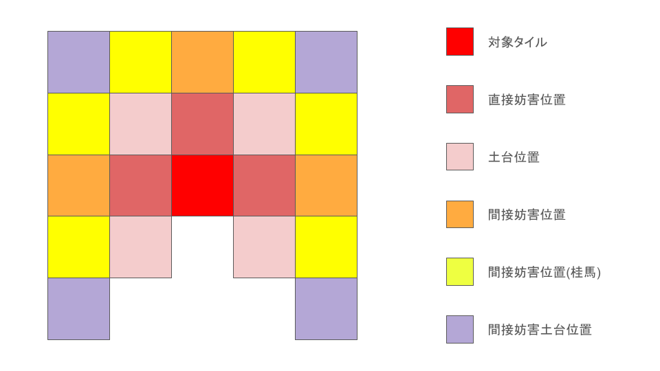

ひとつずつ説明していきます。
# 対象タイル
破壊対象、または防御対象のタイルのことです。
実際のタイルだと、この赤丸の部分です。

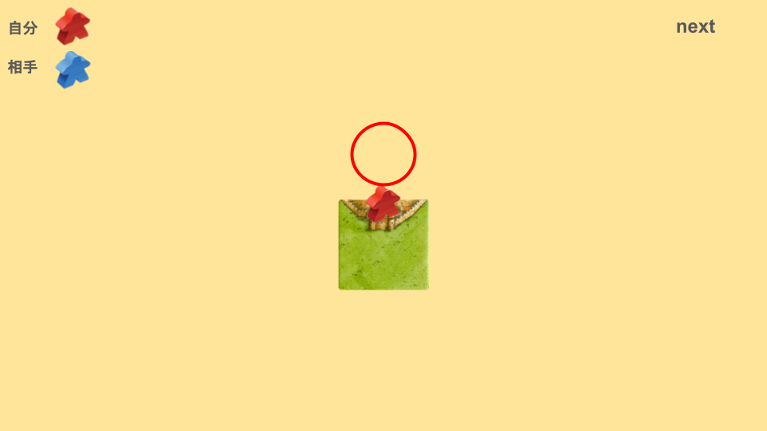

# 直接妨害位置
対象タイルを妨害するタイルを置く位置のことです。
実際のタイルだと、この赤丸の部分です。

対象タイルを破壊するためには、直接妨害位置を全て埋める必要があります。
ただし、残りタイル枚数が少なくなってくると、3箇所全てを埋めなくても破壊できることがあります。
# 土台位置
直接妨害位置にタイルを置くために必要になる位置のことです。
また、間接妨害の役割もあります。
間接妨害とは、次の一手で妨害や破壊ができることです。
実際のタイルだと、この赤丸の部分です。

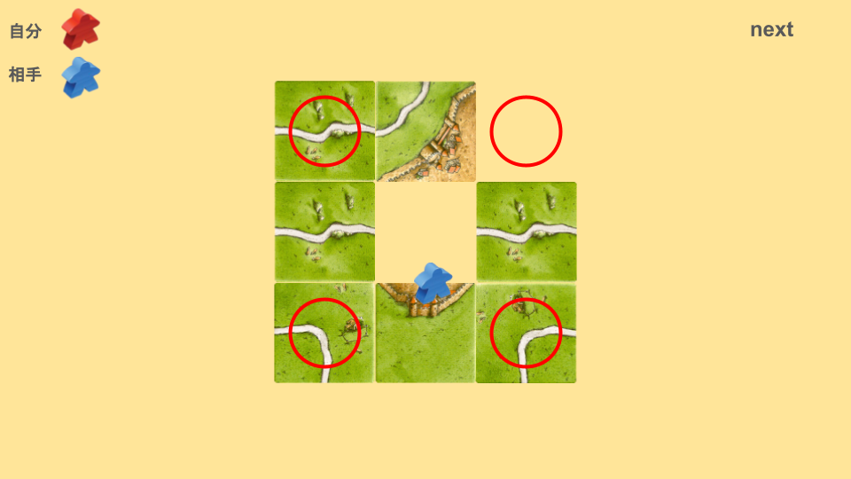

# 間接妨害とは
ここで、間接妨害についても実際のタイルを見てみましょう。

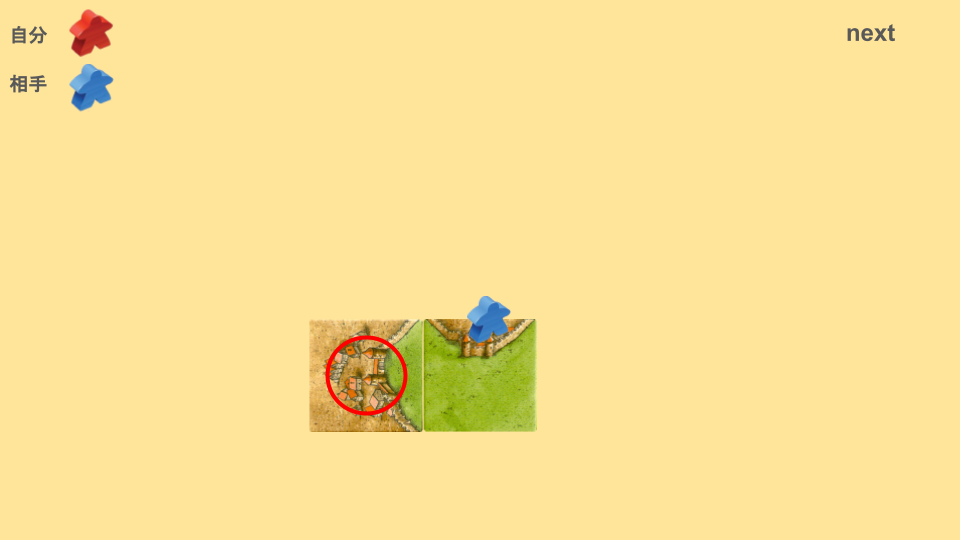

この一手は、間接妨害です。
次の一手で、次のようにタイルを配置すると非常に強力な妨害ができます。

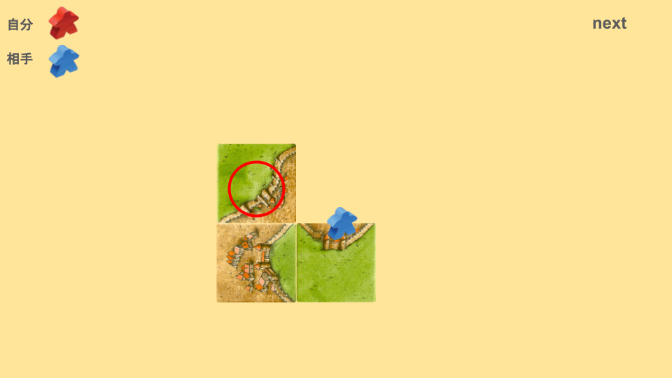

セパレートを置かれると拡張を回避されてしまいますが、セパレート破壊をすることもできます。

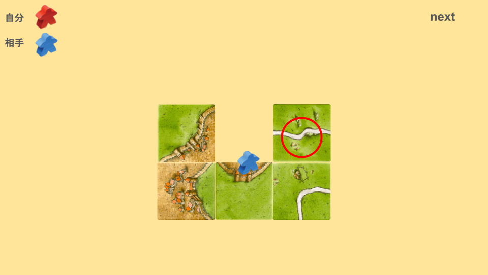

これでセパレート破壊ができました。
# 間接妨害位置
間接妨害ができる位置は、土台位置以外にもあります。
実際のタイルで見てみましょう。

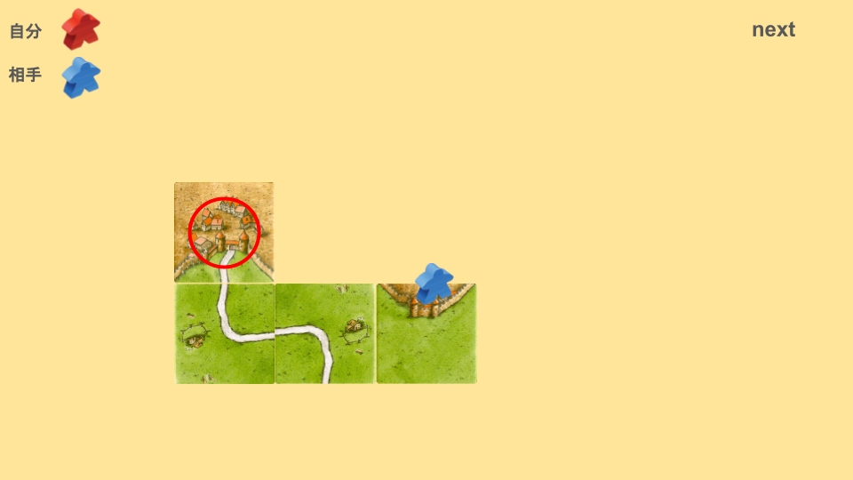

次の一手で、次のようにタイルを配置すると非常に強力な妨害ができます。

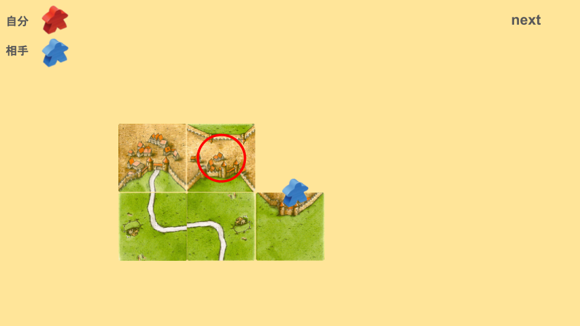

配置場所を迷った場合、間接妨害位置を取りにいくことはかなり重要です。
# 間接妨害位置(桂馬)
[タイルの関連性と影響範囲](8a1f8ae2509c4e46b8a0d789dc3984d0.md) よりも少し離れた位置にあるのが間接妨害位置(桂馬)です。
実際のタイルで見てみましょう。

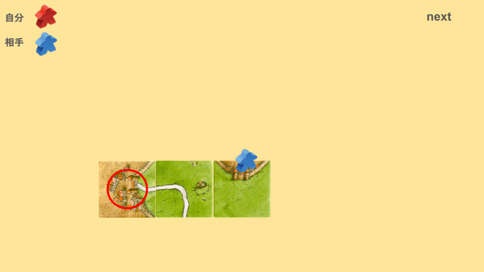

次の一手で、次のようにタイルを配置すると非常に強力な妨害ができます。

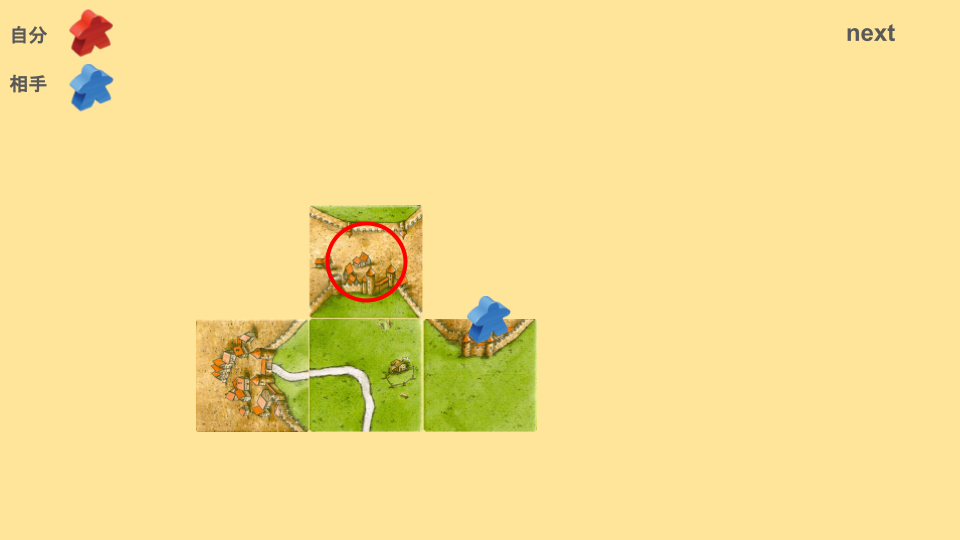

配置場所を迷った場合、間接妨害位置(桂馬)を取りにいくことはかなり重要です。
# 間接妨害土台位置
かなり遠いため、まったく関係のないタイルのように見えます。
実際のタイルで見てみましょう。

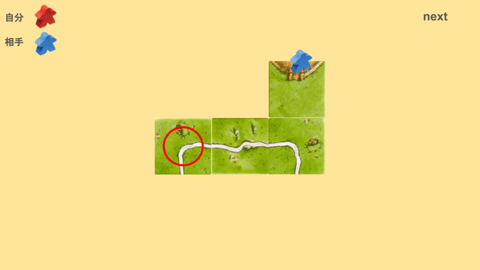

[タイルの関連性と影響範囲](8a1f8ae2509c4e46b8a0d789dc3984d0.md) をするために必要なので、あまり良い選択肢がない場合にはアリかもしれません。
