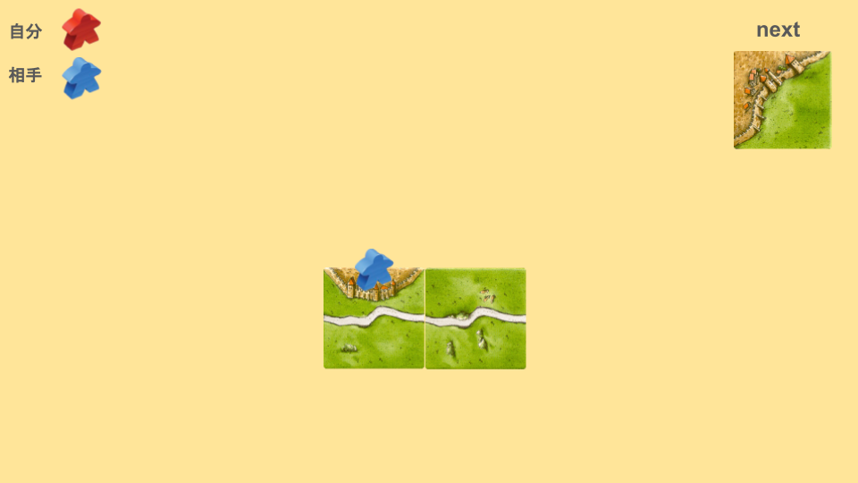
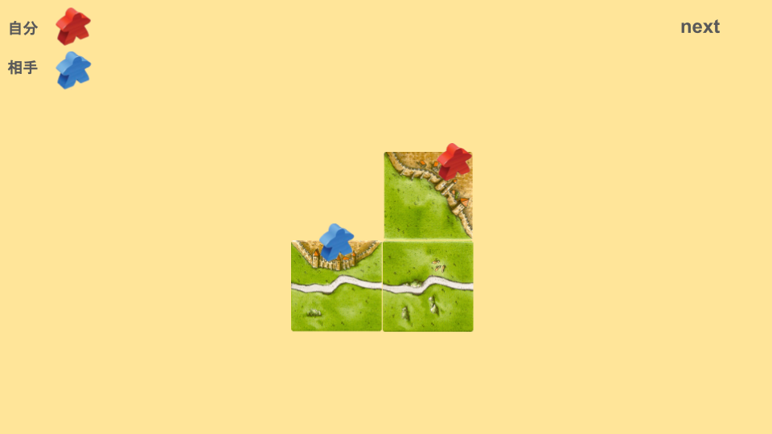
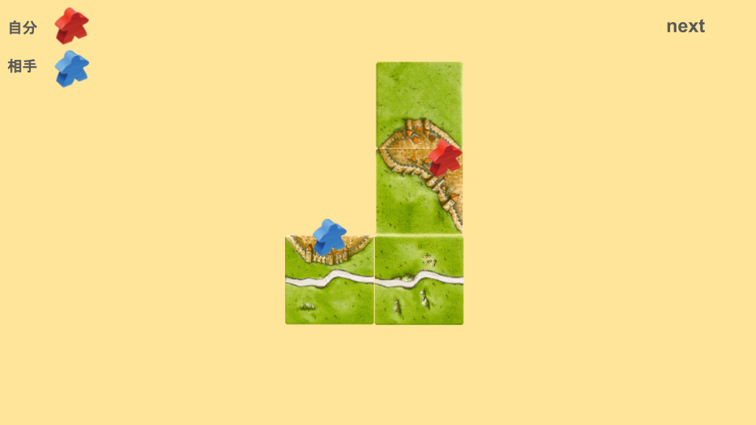
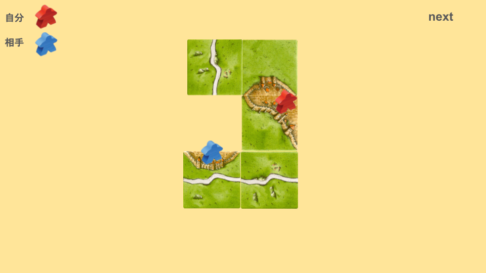
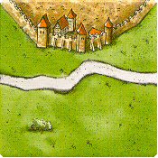
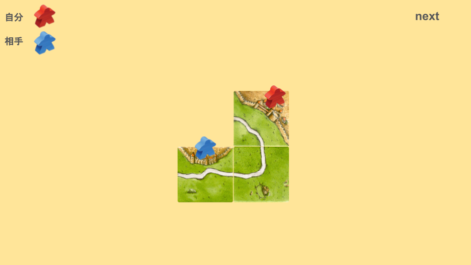
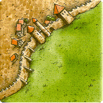
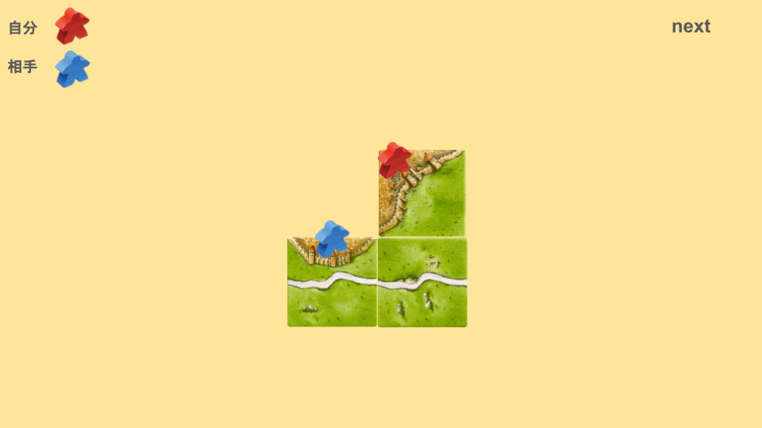
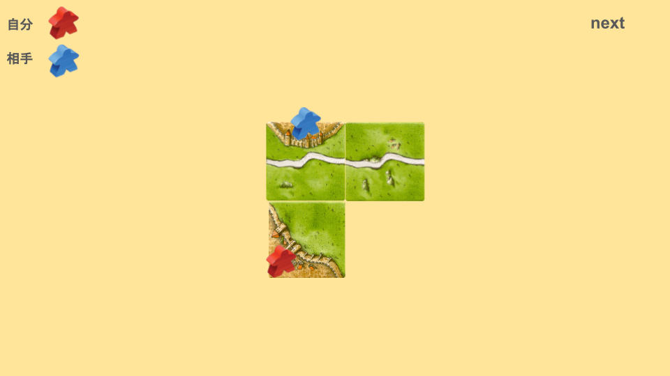

# 腰掛とは
次の画像を見てください。

この場合、どのように配置しますか？

次のように配置することを、「腰掛(こしかけ)」と呼びます。

なぜこの一手が良いと言われるのかを説明していきます。

この一手の後、次のように進めていきます。

一辺を自分の都市に置いたタイミングで、相手の都市を攻撃するための土台になっています。
カルカソンヌでは手数に限りがあるため、複数の意味を持った一手は強力と言われます。
腰掛は、複数の意味を持つ一手を生み出すための技です。
これは二辺アリでも同じようなことができます。

また、二辺で腰掛をするだけでも、相手が配置できるタイルはかなり減ります。

- 一辺アリ x3
- 一辺三叉 x3
- レフト x3
- 二辺アリ x5
- 三辺アリ x5

合計19枚

二辺アリで腰掛をした場合、相手が配置できるタイルは二辺の時よりも減ります。

- 一辺 x5
- ライト x3
- ジブラルタル x3
- 土管 x3
- セパレート x2
- 二辺 x5
- 三辺 x4

合計25枚
# 腰掛をしなかった場合
他のパターンにはどのようなものがあるでしょうか。
## 相乗り

これは、一手とミープルを使って、相手の一手とミープルを道連れにしています。
(弱い相乗りのため、相手も自分も、都市を付ける一手を打ったら一手損になります。)
ミープル有利のタイミングでは、「相乗りをすることによって、相手のミープルを返さない」という戦法もありますが、序盤であればあるほど、効果が薄くなります。なぜなら、ミープルに余裕があるからです。
また、セパレートを引かれた場合、相手のミープルは返るのに、自分のミープルは返ってきません。
他にも、自ら相乗りにいっているため、この都市を成長させることの意味があまりなくなってしまっています。
## その他

別の場所に都市を作るのも選択肢としてはありますが、できるだけ相手の都市を妨害するようにタイルを配置したほうが良いです。
