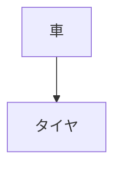
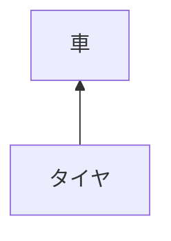
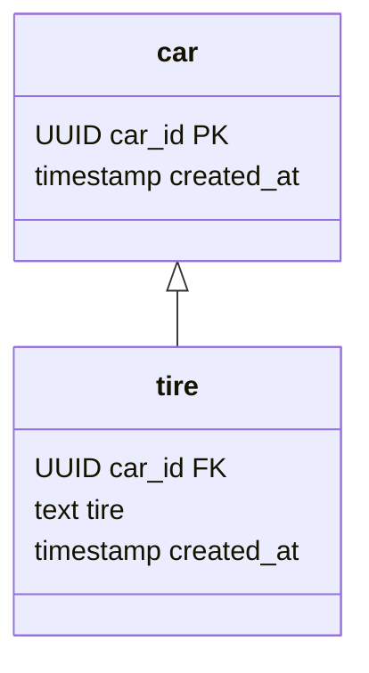
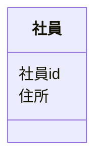

インピーダンスミスマッチを抑える実装方法について触れてきました。
ここではインピーダンスミスマッチが酷くなってしまう原因について見ていきましょう。

## 改めて、インピーダンスミスマッチとは
「データベースとオブジェクト指向プログラミングの間のギャップのこと」と前述しました。
しかしこれが正しい表現だとは考えていません。
何故ギャップが発生しているのかがよくわからず、誤解を招く表現だと感じています。

改めて定義しなおしてみましょう。

> **インピーダンスミスマッチとは、ドメインモデルとデータモデルの依存関係の違いのこと。**

依存関係の違いとは何なのか、見てみましょう。
車とタイヤについて考えます。



このモデルは次のことを表現しています。
「車はタイヤが無ければ存在できない」
タイヤが無ければ車は走ることができません。つまり、この依存関係は正しいと言えそうです。
では、次の例ではどうでしょうか。



サンプル1とは依存関係が逆になっています。
「タイヤは車が無ければ存在できない」
車が存在しなければタイヤは必要とされません。つまり、この依存関係も正しいと言えそうです。
同じモデル(車とタイヤ)を扱っているのに、依存関係の向きが逆でも成立してしまっています。
このことから「モデルが同じでも視点によって依存関係が変わる」と言えます。

サンプル1をコードにすると下記のようになります。

```kotlin
class Car private constructor(
    val carId: UUID,
    val tire: Tire,
) {

    companion object {

        fun create(carId:UUID,tire: Tire): Car {
            return Car(carId,tire)
        }
    }
}
```

タイヤを受け取って車を返すファクトリーメソッドはサンプル1と同じ依存関係がある、と言えます。
サンプル2についても見てみましょう。



このように、車とタイヤを保存するデータモデルはサンプル2と同じ依存関係がある、と言えます。

### 依存関係の違いを吸収する
上記の例では、サンプル1の依存関係はドメインモデル、サンプル2の依存関係はデータモデルに当たります。
この依存関係の違いはCarRepositoryを作り、そこで吸収します。

```kotlin
interface CarRepository {

    fun add(car: Car)

    fun resolveBy(carId:UUID):Car
}
```

CarRepositoryによってドメインモデルとデータモデルの依存関係の違いを隠すことができました。
もしTireRepositoryとCarRepositoryを作っていたとしたらどうなったでしょうか。

```kotlin
interface TireRepository {

    fun add(tire: Tire)

    fun resolveBy(tireId:UUID):Tire
}
```

ユースケースはこのようになりました。

```kotlin
@Service
class CreateCar(
    private val tireRepository: TireRepository,
    private val carRepository: CarRepository,
) {

    fun handle(input: CreateCarInputData) {
        val carId = UUID.randomUUID()
        val tire = Tire.create(carId,input.tire)
        tireRepository.add(tire)

        val car = Car.create(
            carId = carId,
            tire = tire,
        )
        carRepository.add(car)
    }
}

data class CreateCarInputData(
    val tire:String,
)
```

このコードは車を保存する前にタイヤを保存しようとしてしまっているため、外部キーエラーで失敗します。(idの依存関係の問題があるため、事前にcarIdを生成しなければならなくなっています)
そのため、依存関係が違う部分はRepositoryの中に閉じ込める必要があります。

```kotlin
@Service
class CreateCar(
    private val carRepository: CarRepository,
) {

    fun handle(input: CreateCarInputData) {
        val tire = Tire.create(input.tire)

        val car = Car.create(
            tire = tire,
        )
        carRepository.add(car)
    }
}

data class CreateCarInputData(
    val tire:String,
)
```

このユースケースでは依存関係の問題がないためidの生成を各factoryメソッドに委譲できました。
TireがcarIdを保持しないようにドメインモデルを変更しTireRepositoryを使うパターンも考えられます。(車とタイヤのライフサイクルは異なる、というモデリング)

## 意味の違うモデル
インピーダンスミスマッチとは依存関係の違いだけでしょうか。
実は、意味の違いもインピーダンスミスマッチに含まれます。

> **インピーダンスミスマッチとは、ドメインモデルとデータモデルの依存関係や意味の違いのこと。**

意味の違いは、特に汎用的なデータモデルを利用しようとすると発生します。
汎用的なデータモデルはQuery Service用に作ることをおすすめしていますが、実際にはRepositoryでも使われてしまっています。
社員の住所について考えてみましょう。



社員の住所を**共通データベース**から取得しようとしています。
丁度同じようなデータモデルがあったため、共通データベースからデータを取得し**社員管理システム**に保存しました。
さて、これで本当に問題ないでしょうか。

社員管理システムでは住民票に記載されている現在住んでいる住所を想定していましたが、共通データベースには**本籍地**が住所として保存されていました。
本籍地とは戸籍を登録、管理している場所のことで、実際に住んでいる場所とは異なる可能性があります。
つまり、同じ住所という言葉で呼んでしまったがばっかりに意味の違いを吸収できませんでした。

DDDでは、境界づけられたコンテキストを分けることによってこの問題を解決しています。
つまり、データモデルでもドメインモデルと同じように境界づけられたコンテキストで分割する必要があります。
これができていない場合、インピーダンスミスマッチはより酷くなります。

## まとめ
インピーダンスミスマッチについて改めて考えてみました。
インピーダンスミスマッチを抑えるには依存関係と意味の違いをうまく吸収する必要があります。
