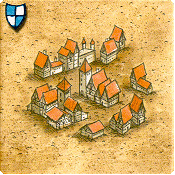
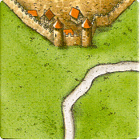
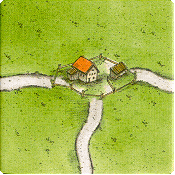
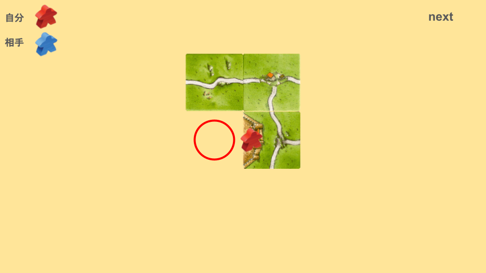
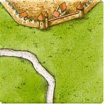
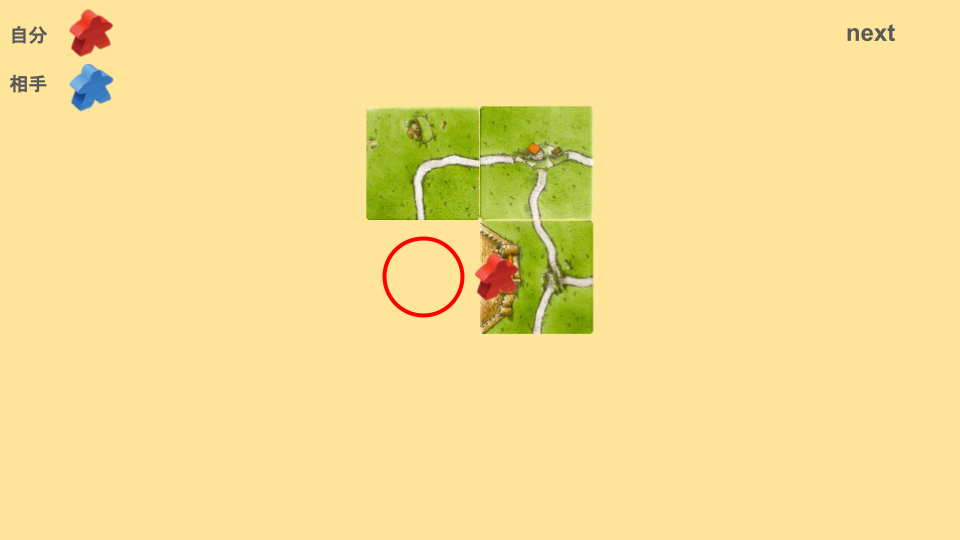
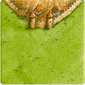
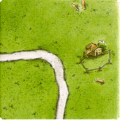

タイルの種類や枚数を覚えたとしても、すべてを数えきるまでの時間がかかりすぎることがあります。
これを克服するために、「タイルのグルーピング」という考え方を使います。
これは、用途や形状によって、複数種類のタイルを更にひとまとめにして、数えやすくする、という方法です。
最終盤面で残りタイルを探すときや、中盤戦での破壊や防御に使える考え方です。
# 目次
# 修道院系(計6枚)
修道院 x4

道付修道院 x2

グルーピングの中でも数えやすい部類のため、残りタイルを探すとき、最初に数えることをおすすめします。
# 三叉系(計8枚)
三叉 x4

一辺三叉 x3

十字 x1

# 三辺系(計8枚)
三辺 x4

三辺アリ x3

オールシティ x1

# 二辺系(計10枚)
二辺 x5

二辺アリ x5

# 一辺アリ系(計10枚)
一辺アリ x4(内1は初期タイル)

ライト x3

レフト x3

# 特殊都市系(計8枚)
セパレート x2

ジブラルタル x3

土管 x3

# 終点系(計13枚)
道を完成させるのに必要なタイルです。
中盤戦以降で、道にミープルを置くかどうかを考えるときに使えます。
三叉 x4

一辺三叉 x3

十字 x1

道付修道院 x2

三辺アリ x3

# カーブ都市系(計14枚)
ループに都市を当てられたときに、ループが完成するのに必要なタイルです。
ライト x3

レフト x3

一辺三叉 x3

二辺アリ x5

# 道なし都市系(計24枚)
一辺に草原を当てられたときに、都市に接続できるタイルです。

数が多いため、このグルーピングを使うタイミングは少ないかもしれませんが、中盤戦の一部で、相手の都市を妨害する際に使えることがあります。
一辺 x5

ジブラルタル x3

土管 x3

セパレート x2

二辺 x5

三辺 x4

レフトかライトのどちらか3枚が接続できます。
レフト or ライト x3

# 道あり都市系(計18枚)
一辺に道を当てられたときに、都市に接続できるタイルです。

数が多いため、このグルーピングを使うタイミングは少ないかもしれませんが、中盤戦の一部で、相手の都市を妨害する際に使えることがあります。
一辺アリ x4(内1は初期タイル)

一辺三叉 x3

二辺アリ x5

三辺アリ x3

レフトかライトのどちらか3枚が接続できます。
レフト or ライト x3

# グルーピング無し
これらのタイルは、枚数が多いためそれぞれ数えましょう。
枚数が多いタイルは、数える優先順位を低くすることで、数える時間を短縮することができます。
一辺 x5

ストレート x8

カーブ x9

# 参考
[How To Count Tiles In Carcassonne](https://www.youtube.com/watch?v=ScZ2HqXoIqM&list=WL&index=2)
[タイル一覧とタイルの呼び方](afeeb3688b834244952ee21d10f5e3af.md)
