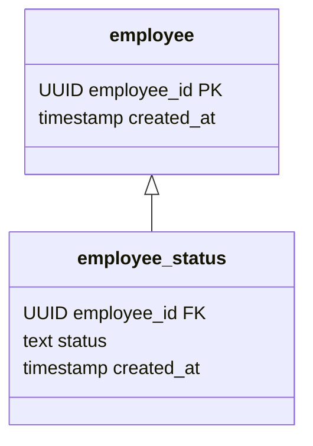
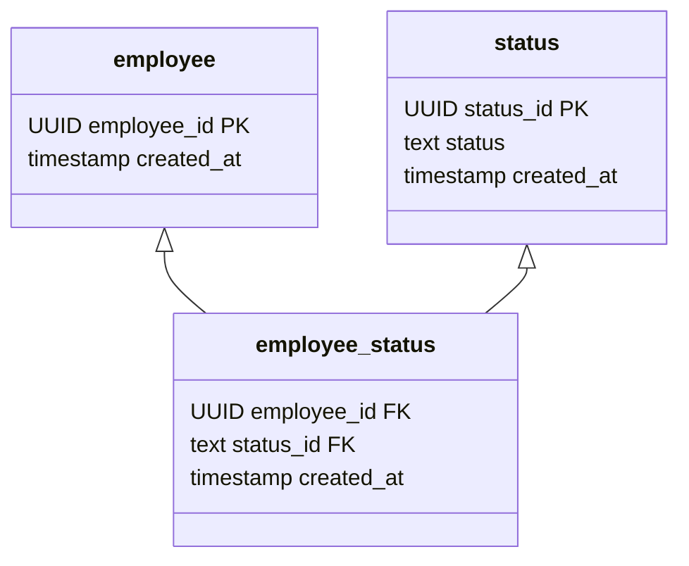
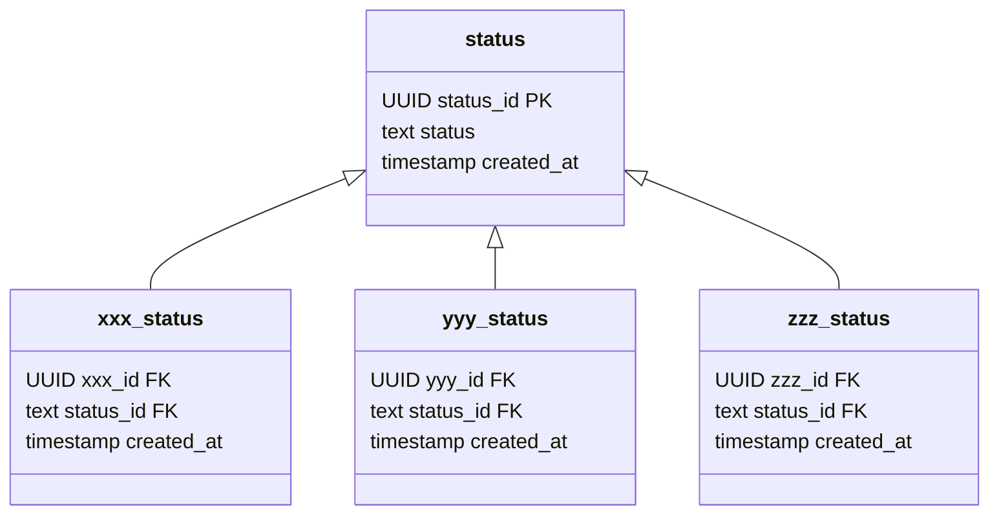

[Repositoryの実装](bd29acd19fd1467782968a407df90fec.md)ではRepositoryの実装方法と分割の方法を見てきました。
Repositoryの分割はドメインモデルと密に関わっているのですが、その部分を省いて説明していたため、ここではドメインモデルに焦点を当てて説明をしていきます。

## Repositoryを分割する単位
[Repositoryの実装](bd29acd19fd1467782968a407df90fec.md)ではライフサイクル単位、役割単位、状態単位で分割する例を見ましたが、DDDでは集約の単位で分割するように言われています。
集約はほとんどの場合ライフサイクル単位で分割されます。
Repositoryを分割するということはドメインモデルを集約単位で分割するということであり、ひとつの集約が複数のRepositoryを使うことはありません。
つまり、Repositoryを分割したら集約も分割され、それによって専用のエンティティが作られることになります。
ここで言いたいのは、Repositoryを優れた単位で分割するにはドメインモデルを進化させる必要がある、ということです。

[Repositoryの実装](bd29acd19fd1467782968a407df90fec.md)で説明した実装方法を用いれば、たとえRepositoryを分割する単位が変わったとしてもテーブル構造を変更する必要はありません。valueテーブルを参照するRepositoryが変わるだけです。
Repositoryを簡単に変更できるため、ドメインモデルの進化のスピードとデータモデルの進化のスピードのズレが少なくなり、インピーダンスミスマッチを抑えることができます。

## ドメインモデルを信用する
テーブル定義をするときに過度な制約(主にcheck制約)をしていることがありますが、これにはいくつかの問題があります。

- 制約が重複する
  簡単な例を挙げると、文字数制限がこれに当たります。
  値オブジェクトで文字数制限をしているにも関わらず、テーブル定義でも同じ制約を定義しています。
  更に問題なのが、値オブジェクトで指定している文字数とテーブル定義で指定している文字数が異なることがある、ということです。
  値オブジェクトの文字数制限をある程度柔軟に変更できるようにするため、テーブル定義では広めの文字数制限をすることがよくあります。
  これはユースケースとは異なる制約をデータモデルに課していることになり、意図が伝わりづらくなっています。

- 制約が足りない
  テーブル定義でいくら制約を強くしても不正なデータが混入する可能性があります。
  値オブジェクトやエンティティで行っているドメインロジックレベルの検証をテーブル定義で行うのは実質的に不可能なため、いくらテーブル定義で制約を強めたところで不正なデータをinsertすることはできてしまいます。

このような問題から、ドメインモデルを完全に信用し、テーブル定義では最低限の制約のみを設けるようにする、というパターンを検討する余地は十分にあります。
例外として、ドメインモデルを別のチームが作っている場合等、信用できない時には(しぶしぶ)過度な制約を用いなければいけないでしょう。
勿論、ドメインモデルとデータモデルを別のチーム(人)が作る場合は、インピーダンスミスマッチが酷くなることを覚悟しなければいけません。

## 定数はドメインモデルで定義する
[Repositoryの実装](bd29acd19fd1467782968a407df90fec.md)でこのようなenumが登場していました。

```kotlin
enum class EmployeeStatus {
    ACTIVE_DUTY, // 現役
    RETIRED, // 引退
    ;
}
```

この記事で紹介している手法ではEmployeeStatusが保存されるテーブルはvalueテーブルに分類されます。
employee_statusテーブルはemployeeテーブルにのみ依存します。



しかし、下記のように定義することもできます。



制約がより強いため一般的にはこの実装方法が良いとされていますが、本当にそうでしょうか。
この構造の問題は、statusが汎用的になってしまっている点です。
極端に表現するとこのようになります。



これは無駄な依存関係が発生する可能性があることを指しています。
statusの共通化はできていますが、意味の共通化はできていません。
これはインピーダンスミスマッチがより酷くなる原因になります。
そのため、statusはvalueとして扱ったほうが、より専門的で依存関係の少ないシンプルな構造にできます。
ここではstatusと言っていますが、区分やコード値と言われるものも同じです。

この問題を解決するために、定数はドメインモデルでenumとして定義します。
異常値がinsertされていた場合は定数に変換するタイミングで例外が発生するようにします。
この手法を用いると、アプリケーション起動時に必要になるシードデータもほとんど不要になります。
このように、ドメインモデルを信用することで、データの汎用化や依存関係を最小限に抑えることができるようになります。

## ドメインモデルから見たinsert
[Repositoryの実装](bd29acd19fd1467782968a407df90fec.md)では差分insertを用いていましたが、ドメインモデルから見たら差分insertも全分insertも意識していません。
差分insertはデータの重複を最小限にしたいというデータモデル起因の話であり、ドメインモデルは関知していません。
つまり、ドメインモデルが必要としている振る舞いとデータモデルが必要としている振る舞いがわずかですが異なっており、ふたつの設計思想が存在している、ということです。

[Repositoryの実装](bd29acd19fd1467782968a407df90fec.md)では触れていませんでしたが、差分insertをする場合は差分insertをするためのプロダクトコードとテストコードが必要になります。
つまり、差分insertをする場合はその分コードが煩雑になる、ということです。
もしデータの重複を許容できるのであれば全分insertを用いたほうがコードがシンプルになります。
画像ファイルや動画ファイルといった容量が大きいデータのみ差分insertする、ということも考えられます。

[【コラム】ユースケースからエンティティを抽出する](963e913f06a74544a3884cd9f2b8e284.md)

## まとめ
ドメインモデルを信用することで実装が単純になる例を見てきました。
ですが、専門的なデータモデルを構築しているのであれば、どのパターンを用いたとしても影響範囲をひとつのRepositoryの中に閉じ込めることができます。
何よりも、専門的なデータモデルを構築することが重要です。
