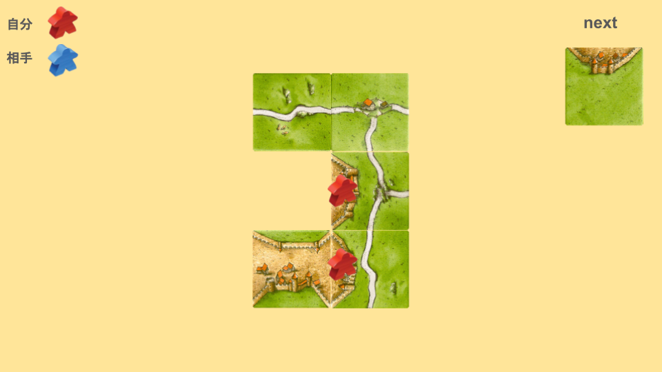
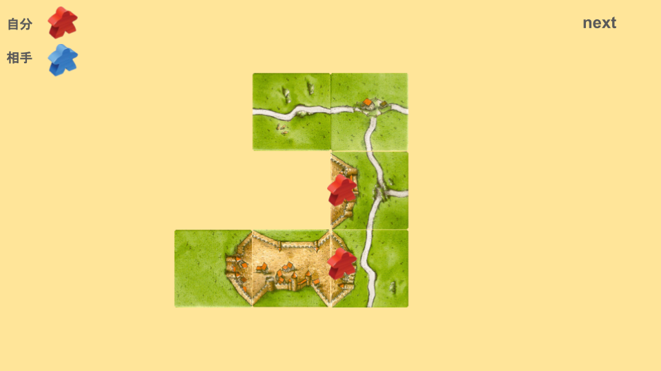
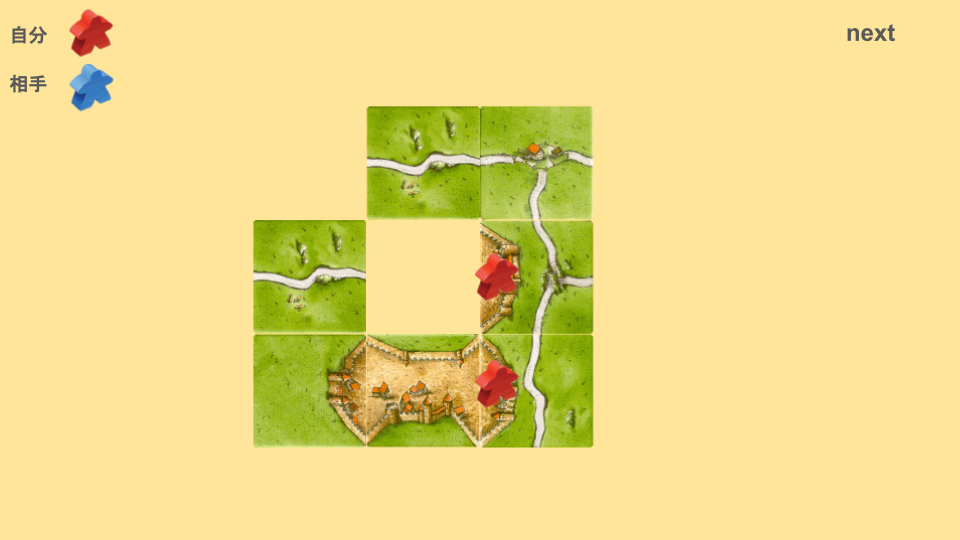
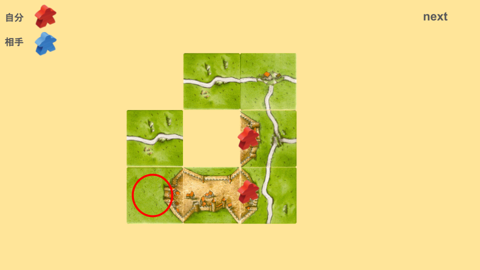
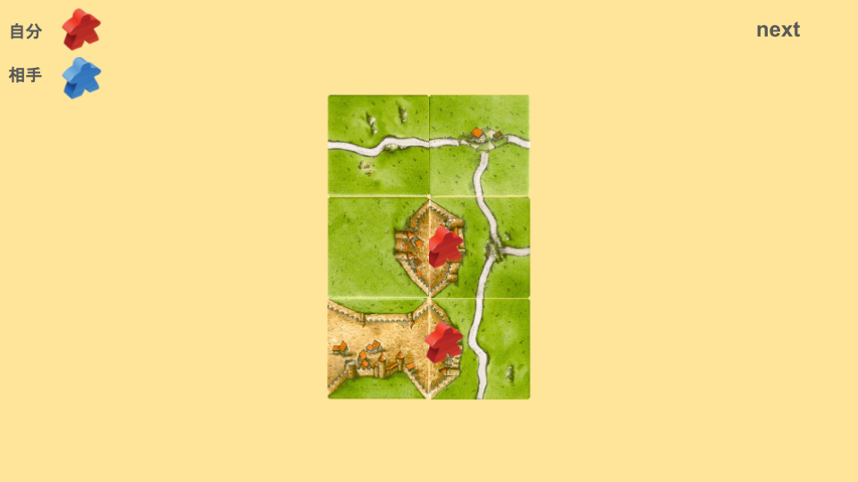
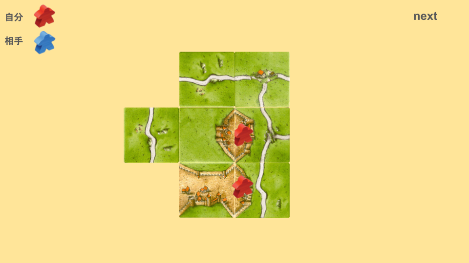

# 足場避けとは
次の画像を見てください。

自分の都市ふたつが完成リーチになっています。
このような場合、どちらの完成を優先しますか？

まず、下側の都市の完成を優先させた場合を見てみましょう。

実は、この手は悪手です。

もし、次のようにタイルを置かれたらどうなるでしょうか。

道を刺されるだけで、簡単に破壊されてしまいます。

下側の都市を完成させた一手で相手の足場を作ってしまいました。

これを回避するために、上側の都市を優先させて完成させたほうが良いです。

これであれば、即座に破壊されることはありません。

このように、相手の足場にならないようにタイルを配置していくことを足場避けと呼びます。
足場避けをするために、点数効率を捨てることがあります。

また、足場避けは破壊の回避だけではなく、相乗りの回避や乗っ取りの回避にもつながるため、必須の技となっています。
