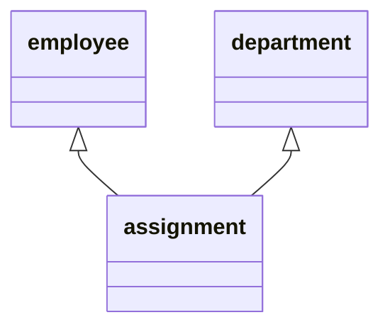
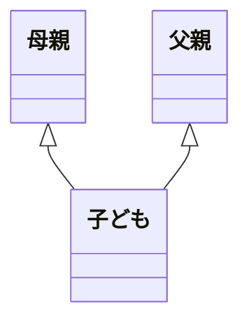
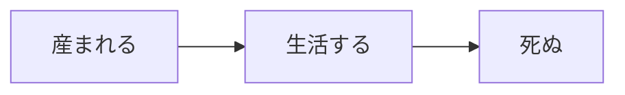

ここでは一般的に使われているものの意図的に使わなかった言葉とその理由を紹介しています。

## eventとresource
TMという手法があります。
そこでは「日時」と続けられる言葉(請求、配属)はevent、それ以外(社員、会社)はresourceとして定義されています。
この記事では当初はeventとresourceに分割して説明をしようとしていたのですが、いくつかの問題が発生しました。
それは、eventとresourceでも全く同じ構造になってしまう場合がある、ということです。
idテーブルの依存関係を考えた時に、同じ構造なのにeventとresourceに分割して考えるのは無理があり、仮にeventとresourceに分割して考えたとしても得られるものがあまり無いことを発見しました。

この例では配属(assignment)のみがeventですが、全く同じ構造のresourceも存在します。

この例では全てresourceになってしまっています。
このことから、resourceとはeventによって生成されたもの、と考えることができます。

この例では「産まれる」と「死ぬ」がeventで、「生活する」がresourceに分類されます。
つまり、焦点を当てるべき問題領域によってeventなのかresourceなのかが変わる、ということです。
この問題を説明するのはこの記事の対象外と感じたため、eventとresourceという言葉を使いませんでした。

## マスターテーブルとトランザクションテーブル
この言葉は実務上よく使われていますが、定義が曖昧でした。
この言葉を使っている人にどのように使い分けているのか聞いたことがあるのですが、下記のような回答でした。
「複数のアプリケーションが参照できる共通のデータが格納されているテーブルのこと」
ですが、同じ構造でマスターテーブルと呼ばれていないものがあったため、もう一度質問したのですが、明確な回答を得ることはできませんでした。
調査を進めた結果、バッチ処理で利用される共通のデータが格納されているテーブルのことを指していることが分かりました。
つまり、その会社では同じ構造でもバッチ処理で参照されるものをマスターテーブル、それ以外をトランザクションテーブルと呼んでいました。
このように、使われ方によって名前が変わるような言葉は説明に適さないと思い、マスターテーブルとトランザクションテーブルという言葉は使いませんでした。

## 概念設計・外部設計・内部設計・論理設計・物理設計
この言葉は古くから使われているのですが、現代において価値を感じませんでした。
その理由として、モデルをそのまま実装するのがモデル駆動開発の良いところだからです。
概念設計・外部設計・内部設計・論理設計・物理設計という考えでは、同じモデルを別の形で再定義してから実装を進めていました。
この方法だとモデリングしたものをそのまま実装するのが困難になります。
更に問題を感じたのが、この方法を用いていると動かないドキュメントが増えすぎる、という点です。(動くドキュメントとはテストコードのことです)
勿論、動かないドキュメントの価値は認めていますが、増えすぎるのはよくありません。
下記のような動かないドキュメントを見たことがあります。
- 概念設計書
- 外部設計書
- 内部設計書
- 論理設計書
- 物理設計書

これに書かれていた内容はほぼ重複していました。この重複は間違いなく無駄です。
このような問題があるため、概念設計・外部設計・内部設計・論理設計・物理設計という言葉は使いませんでした。
