# タイル一覧

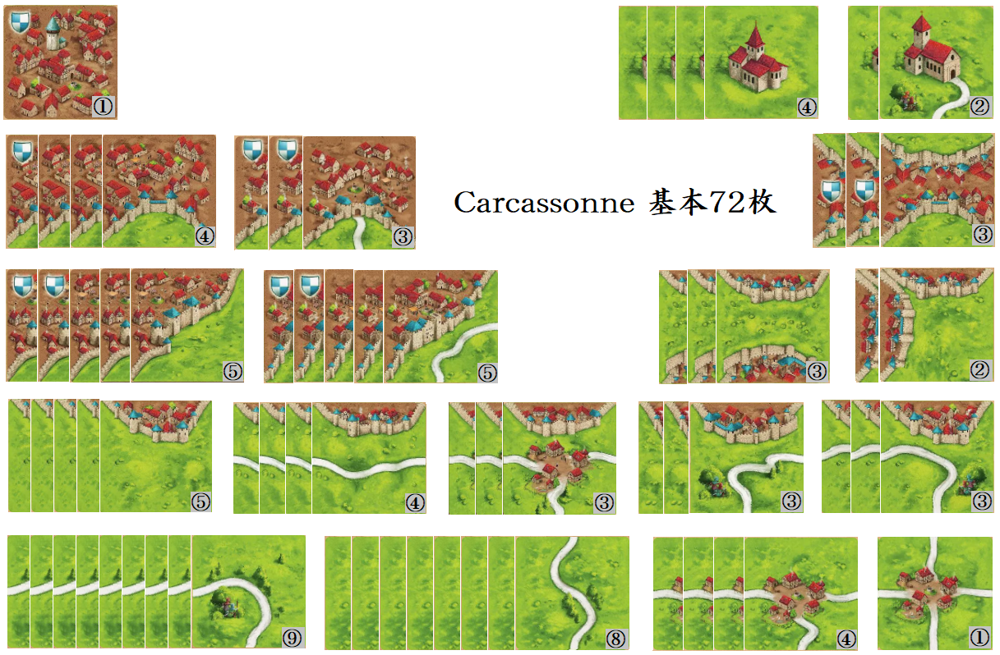

[カタンのすすめ](http://catanblue.blog.fc2.com/blog-entry-27.html)　より引用
# タイルの呼び方
タイルの呼び方は、国や地方によって様々なようです。
そこで、この記事では改めてタイルの呼び方を命名し、その名前を使うようにします。
では、順に見てみましょう。

※タイルの画像は[BGAうぃき](/7c0e3eb1b3e94723ad9cdc2fbd2d8ac1?pvs=25)から引用しました。
## カーブ x9

## ストレート x8

## 三叉(さんさ) x4

## 十字(じゅうじ) x1

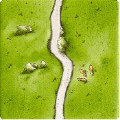

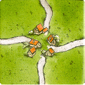

## ジブラルタル x3

## セパレート x2

## 土管(どかん) x3

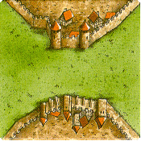

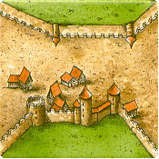

## 一辺(いっぺん) x5

## 一辺(いっぺん)アリ x4(内1は初期タイル)

## 一辺三叉(いっぺんさんさ) x3

## ライト x3

## レフト x3

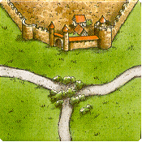

## 二辺(にへん) x5

## 二辺(にへん)アリ x5

## 三辺(さんぺん) x4

## 三辺(さんぺん)アリ x3

## オールシティ x1

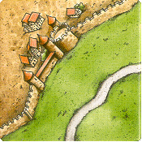

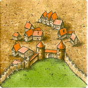

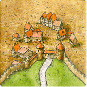

## 修道院(しゅうどういん) x4

## 道付修道院(みちつきしゅうどういん) x2

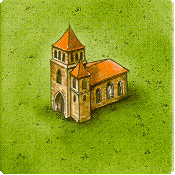

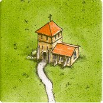
