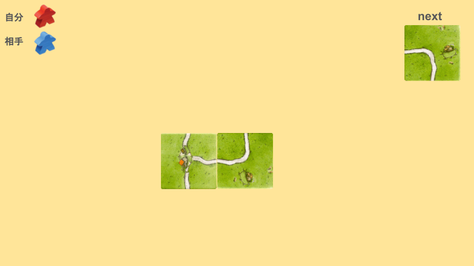
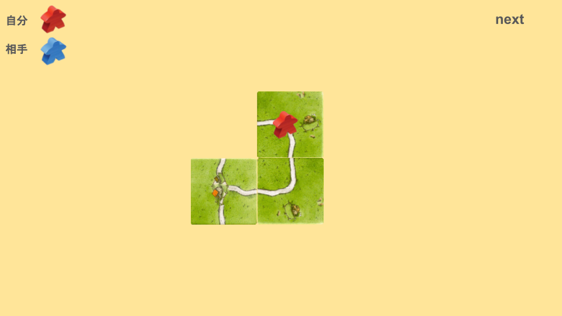
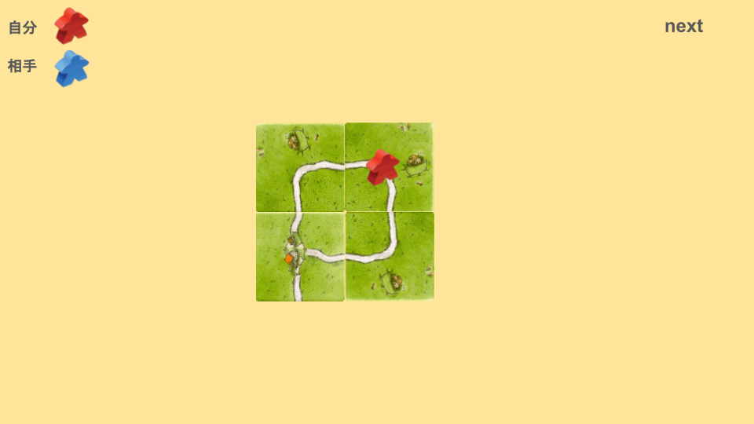
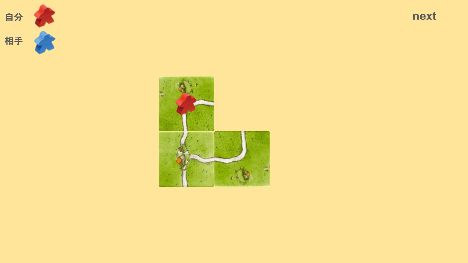
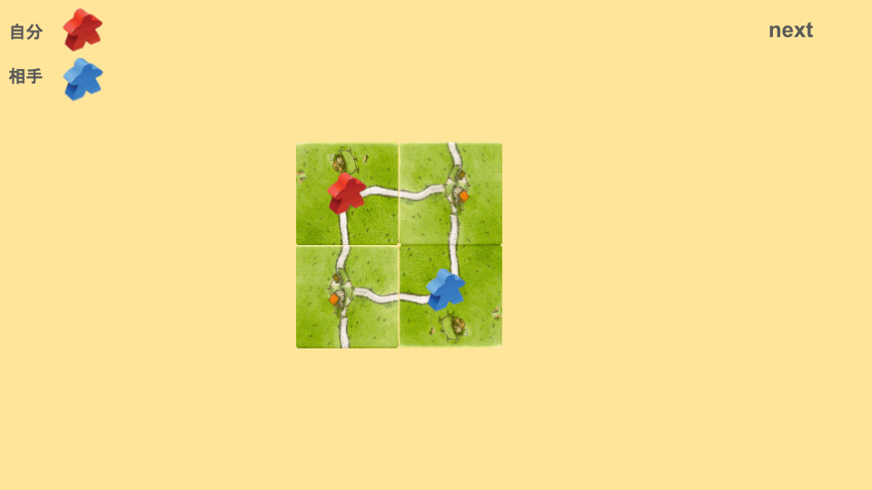
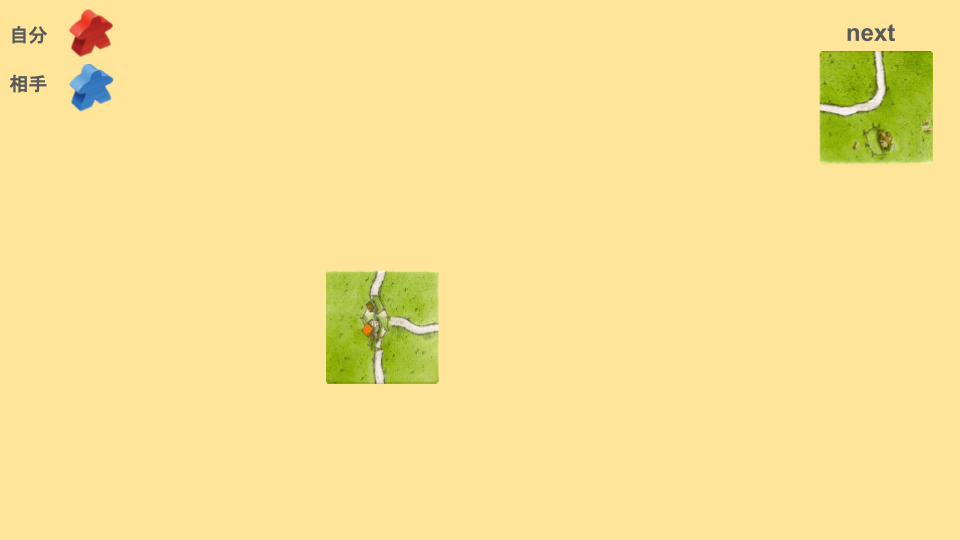
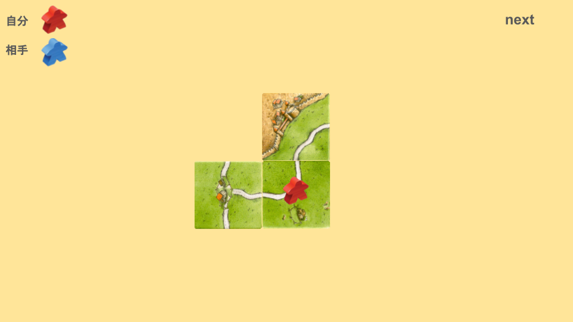

# ループとは
次の画像を見てください。

この場合、どのように配置しますか？

次のように配置することを「ループを狙う」と言います。

もう一枚カーブ系を引けると、ループ完成になります。

ループをすると、終点系がなくても道を完成させることができます。
ページ
# ループの注意点
ループの仕組みはシンプルですが、注意点もあります。
## 長い道にミープルを置く
次の画像を見てください。

もしこのように置いた場合、次のように置かれると、相殺になってしまう可能性があります。

もし長い道を伸ばすように置いていたら、相殺されることはありませんでした。

細かい違いですが、この置き方のほうがより安全に点数を稼げる可能性があります。
## 妨害されにくいタイミングでミープルを置く
次の画像を見てください。

この時、ループを狙うようにカーブを配置しますが、ミープルを置くかどうかが問題です。

このような場合、序盤では積極的にミープルを置いたほうが良いですが、中盤以降の場合、ミープルを置かないほうが良いです。
もしミープルを置いた場合、次のように妨害される可能性があります。

終点系がほとんど残っていないタイミングでこのような妨害をされると、致命的になってしまいます。
ページ

これを回避するために、3枚目のカーブの時点でミープルを置くと妨害されにくいです。

