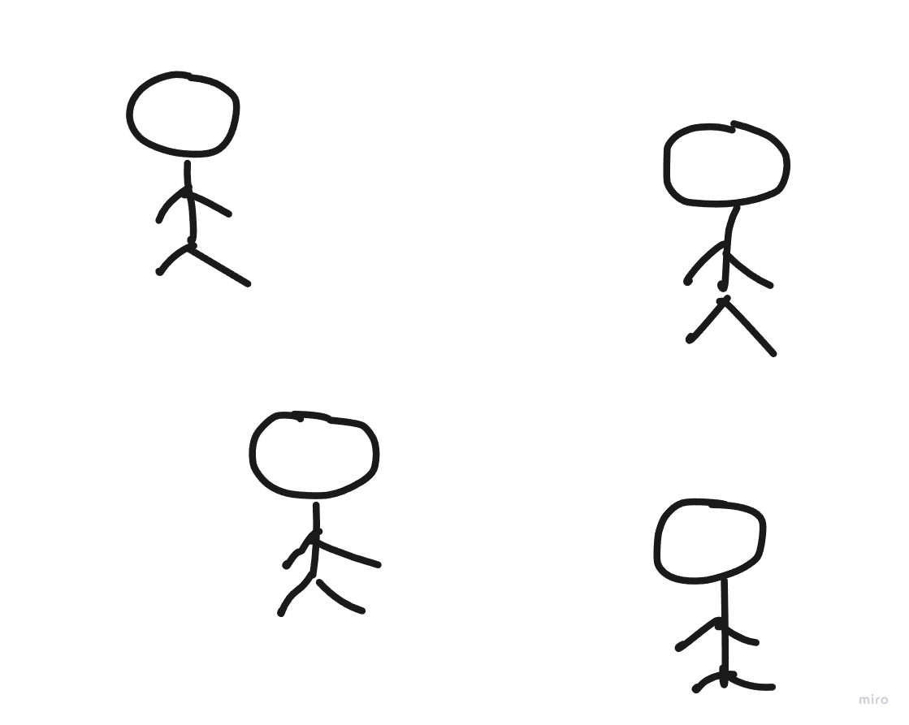
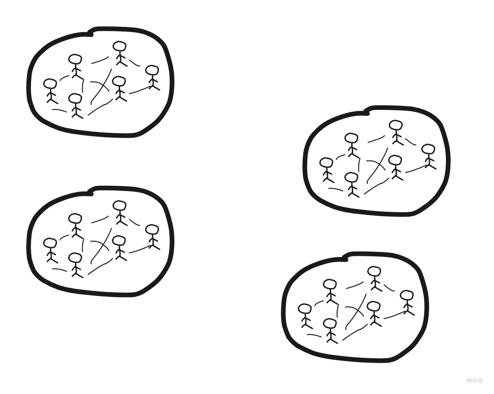
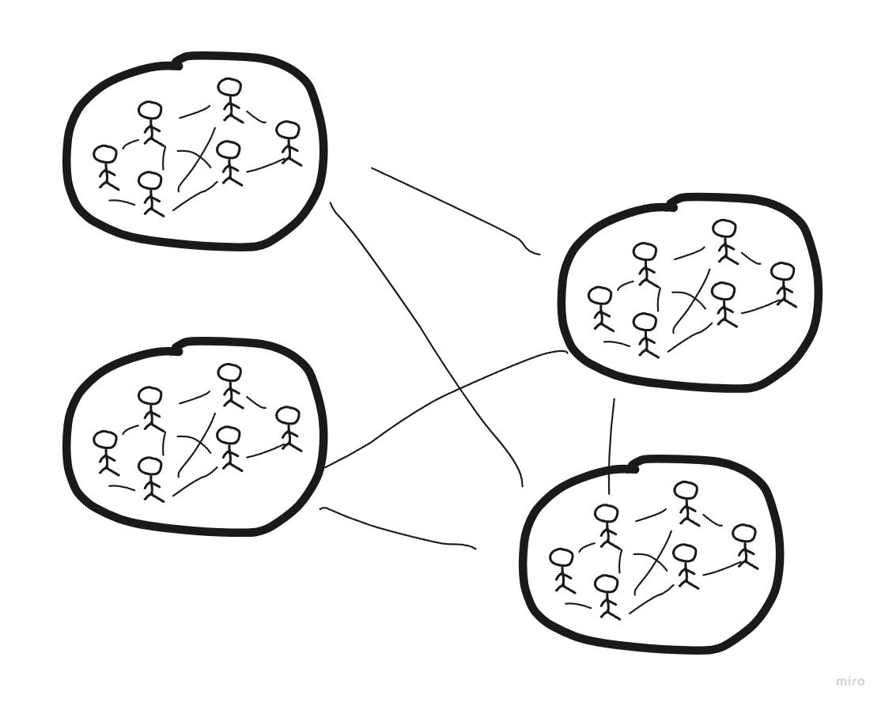
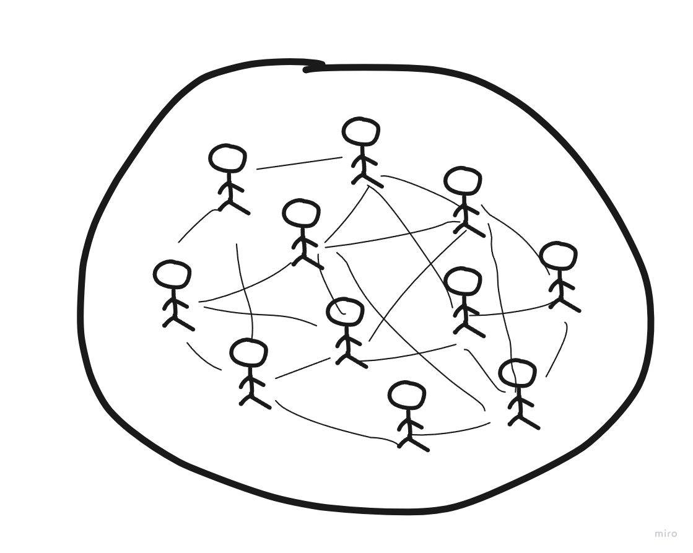
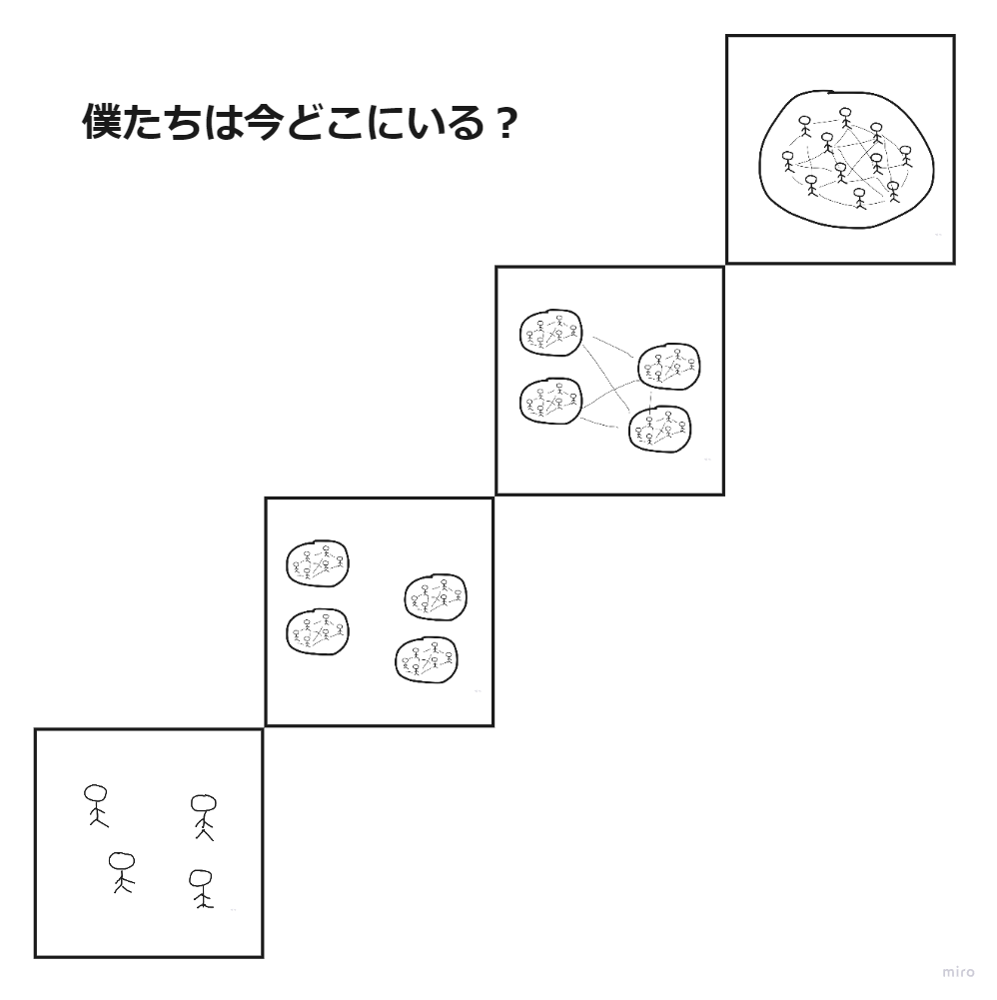

# はじめに

まず、この件について議論してくれた***Nagashima***さん、ありがとうございました。
ここではその議論から導かれた観点を元に、開発チームの構造についてまとめています。

# 構造1、個人

## 説明

人は集まって同じ場所で働いているものの、個人間でのやりとりはほとんどなく、それぞれが別々に働いています。

## 良い点

この構造では、他の人に仕事を邪魔されることはほとんどありません。
一つの仕事に集中でき、いつ働くのかも自由です。

## 悪い点

間違えたことをやっていても、自分では気づけません。
他の人に仕事の邪魔をされることが時々あります。

# 構造2、チーム

## 説明

チームごとに人が集まって同じ場所で働いていおり、チーム内では個人間でのやりとりが頻繁に行われていますが、チーム間ではほとんどやりとりが行われていません。

## 良い点

チーム内で助け合いながら働いており、ひとりのミスを他の人が気付けます。
チームで決定権を持っているものがあり、ある程度自由に働くことができます。

## 悪い点

問題が発生した時に、他のチームにバレないように隠蔽することがあります。
他のチームが何をやっているのか知らないため、局所的な最適化をしてしまうことがあります。

# 構造3、チーム間

## 説明

ほとんどの人はほぼ同じ場所に集まっており、チーム間でもやりとりが行われています。
チームをまたいで働くこともあります。

## 良い点

チーム間でも助け合いながら働いており、他のチームのミスを気付くことができます。
局所的な最適化を避けやすくなります。

## 悪い点

コミュニケーションの最適化を考えるあまり、チーム間でのやりとりを減らす方向に力が働くことがあります。
チーム間で同じルールを適用したいことがあり、チーム内や個人での働き方が制限されることがあります。

# 構造4、組織

> 💡 ここでの組織とは、チームの上のレイヤーの、人々の集団のことを指しています。

## 説明

同じ場所で働くこともあれば、全く異なる場所で働くこともあります。
組織として働いており、コミュニケーションは非常に頻繁です。
チームを結成することもありますが、必要がなくなればすぐに解散します。
各個人が決定権を持っています。

## 良い点

個人であり、チームであり、組織でもあります。
コミュニケーションが推奨されており、ミスやムダに気付きやすくなります。

## 悪い点

管理や評価が非常に難しくなります。
働いていない・仕事が無い場合、即座に解雇されることがあります。

# 組織のレベル

## 今回の議論で得た知見

順に組織のレベルを上げていきたい人、一足飛びに組織のレベルを上げたい人、現状維持をしたい人など、考え方は様々です。
このような階層分けをしたことによって、よりシンプルに説明することができるようになりました。

# 最適な組織構造について

その組織にとって最適な構造は常に変わり続けます。
どの構造がその組織にとって最適なのかは、わかりません。
ただし、重要なのは変化に適応していくことです。

# 注意書き

今回紹介したもので、全ての構造を説明しようとはしていません。
そのため「僕たちは個人とチームの間らへん」というようなこともあり得ます。

# おわりに

内容について修正すべき点や補足などがあればこちらにご連絡いただけると幸いです。

> （Notion の埋め込み（bookmark）は移せませんでした。元ページで見てください）

ページ

# 参考書籍

[ティール組織――マネジメントの常識を覆す次世代型組織の出現](https://amzn.to/3OfQZSX)
[チームトポロジー　価値あるソフトウェアをすばやく届ける適応型組織設計](https://amzn.to/3JWsSWA)
[https://bliki-ja.github.io/TeamTopologies](https://bliki-ja.github.io/TeamTopologies)
[アジャイルリーダーシップ: 変化に適応するアジャイルな組織をつくる](https://www.amazon.co.jp/dp/4320124936)
