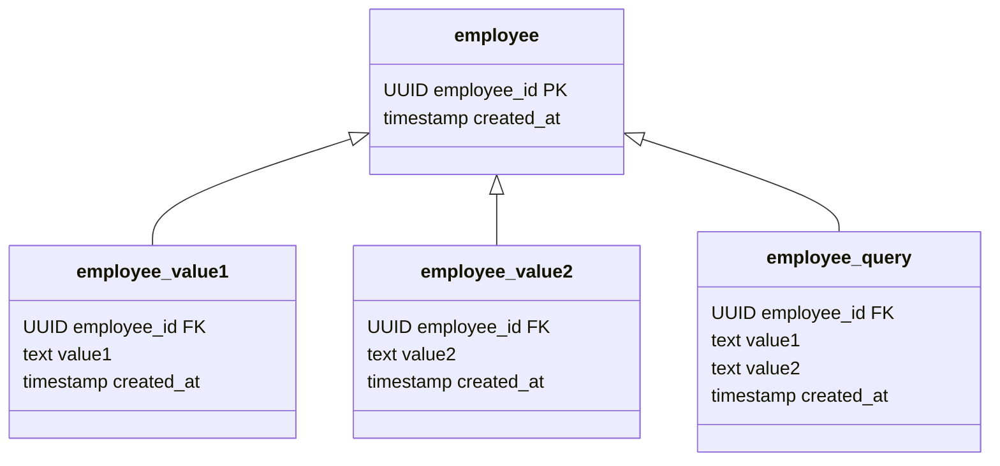
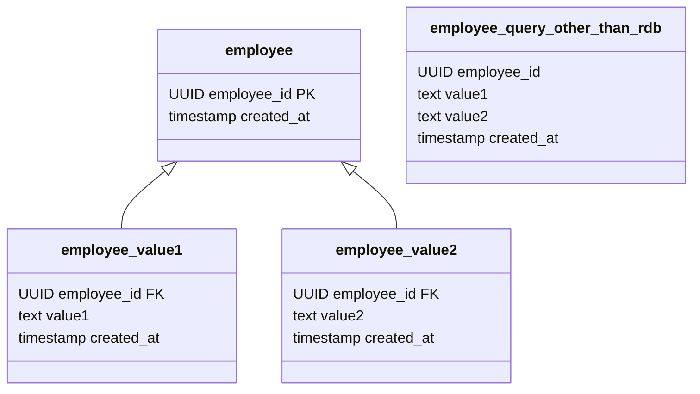

Query Serviceとは、検索に特化したドメインサービスです。
Query Serviceには二種類あります。
下記のテストを見てください。

```kotlin
val employee = Employee.mock()
repository.add(employee)

val expect = listOf(employee)

val actual = queryService.resolveAll()

assertEquals(expect,actual)
```

ここでは、Repositoryを使ってデータを追加したものはQuery Serviceの検索対象になっていることとします。
このテストを失敗するQuery Serviceと、成功するQuery Serviceが存在します。
これはQuery Serviceの実装方法によって変わってきます。



上記の例では、query用のテーブル(employee_query、以降**queryテーブル**)を用意しvalueを保存しています。
これだけ見るとQuery Serviceの必要性は無いように見えますが、複数の社員を検索したり、value(氏名等)から検索するときに便利です。
このパターンではRepositoryが呼び出される度にemployee_queryにデータを追加していきます。
EmployeeQueryDaoに専用のメソッドを作り、Query Serviceそのメソッドを呼び出すようにします。

この実装方法では先ほどのテストは成功します。
これを**時差なしQuery Service**と呼びます。

次に下記の例を見てみましょう。



Query Service用のデータを外部のサービスを使って保存しています。
この場合、最初のテストが失敗する可能性があります。
ネットワークの遅延や、データを追加してから検索できるようになるまでにタイムラグが発生する場合があるからです。
このようなQuery Serviceのことを**時差ありQuery Service**と呼びます。
扱うデータ量が多くなりパフォーマンス上の問題が発生してくると外部サービスを使わざるを得なくなります。(自前で全文検索システムを構築するよりも既にあるサービスを利用したほうが簡単ですよね)
時差があることを考慮していないと、Query Serviceを利用している機能のテストがFlakyになってしまう可能性もあります。
その一方で、大量で複雑なデータをシンプルに扱うことができるようになります。

ユースケースによってどちらのQuery Serviceにするかは選べますが、パフォーマンス上の問題が発生していないのであれば時差なしQuery Serviceを使うことをおすすめします。
これ以降、特に前置きが無かった場合は時差なしQuery Serviceを前提とします。

## queryテーブルの実装方法について
Query Serviceは検索に特化したサービスのため、全てを保存する必要はありません。(Repositoryで全て保存しているため)
このような場合、イミュータブルデータモデルを使う必要はありません。
queryテーブルには検索しやすいようにデータを保存しましょう。

Repositoryを跨いだ検索がしたい場合には、Repositoryごとにqueryテーブルを用意するか、専用のqueryテーブルを作るパターンが考えられます。
どちらでも実装できますが、テストがしやすいと感じるためRepositoryごとにqueryテーブルを用意するほうが好みです。
Repositoryごとにqueryテーブルを用意すると検索用のクエリーでJOINをしなければなりませんが、その複雑性がひとつのクエリーに閉じ込められているため、全体で見るとシンプルな状態を保てていると言って良いでしょう。

複雑なのであれば、ユースケースごとにqueryテーブルを作っても良いと考えています。
しかし、ユースケースが膨らむと同時にqueryテーブルの数が多くなってしまい、データの重複も増えてしまいます。
queryテーブルではできるだけ色々なユースケースに対応できるようにデータを保存しておくことで、queryテーブルの増殖を抑えることができます。
ユースケースが複雑で数も多い場合は外部サービスに頼ったほうが良いでしょう。(この時にはパフォーマンスの問題が発生していることも考えられます)

## まとめ
- Query Serviceは2種類ある
  - 時差なしQuery Service
  - 時差ありQuery Service
- queryテーブルはミュータブルデータモデルでも良く、検索しやすいようにデータを保存する
- ユースケースごとにqueryテーブルを作っても良い
- パフォーマンスの問題が発生したら外部サービスを使う
