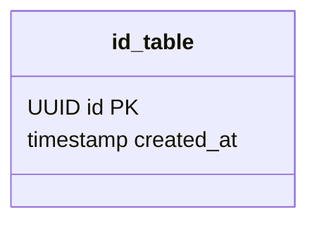
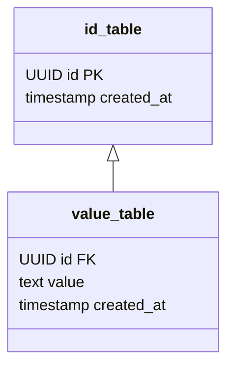
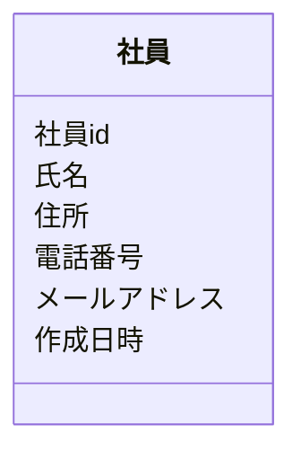

## データは3種類しかない
世界中で保存されているデータの量は年々加速度的に増えていますが、全て3種類に分けて考えることができます。
- id
- value
- created_at

順に説明していきます。

### id
データを一意に特定するためのデータです。
社員番号や会員番号のようなものがidに分類されます。

### value
社員氏名、生年月日、入社日のようなものがvalueに分類されます。
実際に保存したいデータのことを指しています。

### created_at
作成日時のことです。

データモデリングは上記の3種類を組み合わせて使います。

## 基本的なテーブル構造は2種類しかない
3つの要素を使った基本的なテーブル構造は2種類しかありません。
- idテーブル
- valueテーブル

順に説明していきます。

### idテーブル
#### 特徴
- idとcreated_atしか持たない
- idにはPKが付いている
- idテーブルはidテーブルにしか依存しない

idテーブルではprimary制約の担保と、他のidテーブルへの依存関係を表現します。
idはUUIDを使うことをおすすめします。

### valueテーブル
#### 特徴
- idとvalueとcreated_atしか持たない
- 一つのidテーブルにしか依存しない
- valueとなるカラムは一つだけ

valueテーブルでは社員氏名のような値をcreated_atと共に保存します。
idテーブルが中心となり、それにvalueテーブルがぶら下がるような形になります。

## idテーブルとvalueテーブルが必要な理由
insertしか使わない実装の場合、ひとつのidに対して複数のvalueが存在すると不都合が発生します。
まず、idテーブルとvalueテーブルに分割しない例で見ていきましょう。

この場合、insertしか使わないとデータはこのようになります。

| 社員id | 氏名 | 住所 | 電話番号 | メールアドレス | 作成日時 |
| --- | --- | --- | --- | --- | --- |
| 001 | 佐藤　一郎 | 東京都　xxxx | 080-1111-1111 | 1111@xxx.com | 2020/1/1 |
| 001 | 佐藤　一郎 | 神奈川県 xxxx | 080-1111-1111 | 1111@xxx.com | 2020/3/1 |
| 001 | 佐藤　一郎 | 千葉県 xxxx | 080-1111-1111 | 1111@xxx.com | 2020/6/1 |
| 001 | 佐藤　一郎 | 沖縄県 xxxx | 080-1111-1111 | 1111@xxx.com | 2020/9/1 |

住所しか変わっていないのに、氏名、電話番号、メールアドレスをinsertしなおしています。
これは無駄です。住所が変わったのであれば住所だけinsertするようにしたいです。
更に、複数レコードinsertするため社員idにprimary制約を付けられなくなっています。
このような問題が発生するため、idテーブルとvalueテーブルに分割しています。これによって無駄なデータを削減しつつ、idのprimary制約を守ることができます。

> 💡 データベースに保存するのは、保存したいデータと検索に必要なデータのみにしましょう
