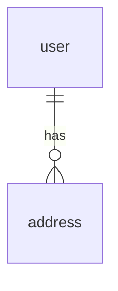
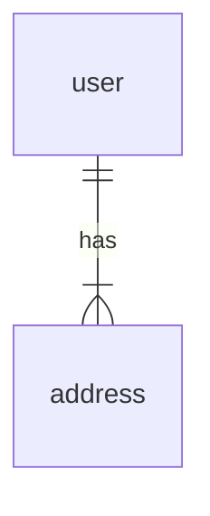

[データモデリングガイド](f2eeb56e874c4c7ca887be1500d57b88.md) では、全体を通して基本的にER図ではなくクラス図を使っていたのですが、これには理由があります。

例として、ユーザーと住所について考えてみましょう。

上記は住所が任意入力の場合を想定しています。
もし住所が必須入力の場合、下記のようになります。

addressの多重度が「0以上」から「1以上」に変わっています。
ですが、任意・必須をRDBMSの機能で実装することはできません。(もし仮に実装できたとしてもこれはドメインロジックのためRDBMSで実装しないほうが良いでしょう)

つまり、多重度はドメインロジックを表現しようとしまっています。
これはドメインロジックが漏れていることと同義であり、かなりまずい状態です。
これを避けるためにER図を使っていません。
その代わりに、より重要である依存関係を表現できるクラス図を使っています。
