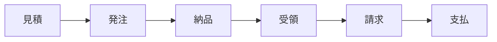
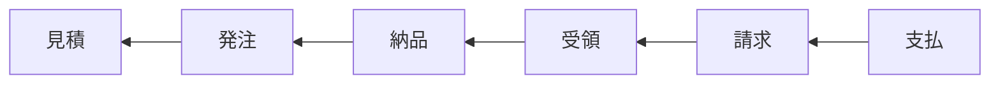
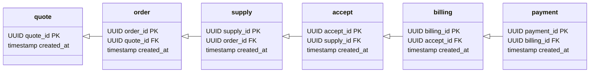

前節ではシンプルな依存関係のRepositoryを見てきましたが、もっと複雑な依存関係を持っていることも多々あります。

上記は処理順を表現しています。
依存関係は処理順の逆になります。

見てもらえるとわかる通り、未来が過去に依存するようになっています。
このルールを守ってモデリングをしていきます。

これにvalueテーブルを追加するとデータモデリングは終了です。
後はそれぞれのRepositoryを作ればokです。

> 💡 今回は例として直前のidに依存する形でデータモデリングしましたが、恐らくorder_idを使いまわすのが適切でしょう。
> ドメインモデルに出てこないidはヘルパーidとして定義しておきます。

このように、idに焦点を当てると簡単にデータモデリングをすることができます。
idの単位でデータモデリングができるとRepositoryを作る単位もわかるので、ドメインモデリングに悩んだら一度データモデリングをしてみるのも手かもしれません。
