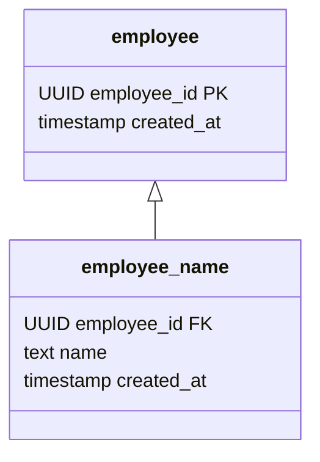
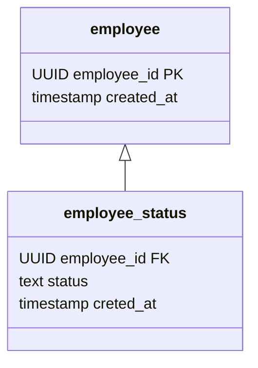

全分insertではQuery Serviceと同じ手法が使えるため、差分insertについて説明をします。
まずは単純な社員(employee)について考えます。



idテーブルがひとつ、valueテーブルがひとつという構造です。
はじめはテーブル単位でinsert、selectを行う処理を書き、後でそれをまとめてRepositoryを作ります。

## EmployeeDaoを作る
DAO(Data Access Object、以降Daoと表記)とは、データを操作するためのオブジェクトのことです。
テーブルひとつに対し、Daoをひとつ作ります。
まずはEmployeeDaoを作ってみましょう。

```kotlin
private class EmployeeDaoTest {

    private val sut = EmployeeDao()

		@Test
    fun `insertしたデータがselectメソッドで検索できること`() {
        val dto = EmployeeDto(
            employeeId = UUID.fromString("34a1b832-2220-4075-a704-669c0e97cbbc"),
            createdAt = LocalDateTime.now(),
        )

        sut.insert(dto)

        val actual = sut.selectOrNull(dto.employeeId)

        assertEquals(dto,actual)
    }
}
```

テストコードをひとつ追加しました。
変数名に使っているsutとは、System Under Testの略でテスト対象システムのことを指しています。
どれがテスト対象になっているのかわかりやすいため、筆者は好んで使っています。

実装の詳細はライブラリーによって変わるためこれ以上立ち入りませんが、createdAtの精度はRDBMSによって変わるためこのテストが成功しない可能性があります。
その場合にはLocalDateTime#nowを直接使うのではなく、ラッパーを用意してそのラッパー内で時間の切り上げを行います。

では、もうひとつテストコードを追加してみましょう。

```kotlin
		@Test
    fun `同じデータがinsertされた場合は例外を投げること`() {
        val dto = EmployeeDto(
            employeeId = UUID.fromString("6b4635ba-b868-457b-9109-fe9fc4db1682"),
            createdAt = LocalDateTime.now(),
        )

        sut.insert(dto)

        assertThrows<IllegalStateException> {
            sut.insert(dto)
        }
    }
```

ここではIllegalStateExceptionを期待値としていますが、実際には一意制約違反の例外が発生します。
投げられる例外は利用するライブラリーやツールによっても変わる可能性があるため、仕様化テストという手法を使って記述したほうが良いでしょう。

> 💡 仕様化テストとは
> 振る舞いが分からないメソッドに対してテストを書き、テストが失敗したらその振る舞い通りにテストを書き換える手法のことです。
> これを行うことで、メソッドの振る舞いをテストコードとして記述することができます。

データが存在しなかった場合のテストコードも追加しておきましょう。

```kotlin
		@Test
    fun `データが存在しなかった場合はnullを返すこと`() {

        val notExistingId = UUID.fromString("d6a6205d-728f-4fed-8c0f-e1f36f185f5b")

        val actual = sut.selectOrNull(notExistingId)

        assertNull(actual)
    }
```

データが存在しなかった場合に例外を投げることも選択肢だと思いますが、Daoのような小さいパーツ単位ではnullを返しておき、Daoを利用する側で投げる例外を変えられるほうがより使い勝手が良くなると考えているため、nullを返しています。

これでEmployeeDaoの実装は終わりです。
EmployeeDaoのシグネチャーはこのようになりました。

```kotlin
fun insert(dto: EmployeeDto)

fun selectOrNull(employeeId: UUID): EmployeeDto?
```

テストコードはこのようになりました。

```kotlin
private class EmployeeDaoTest {

    private val sut = EmployeeDao()

		@Test
    fun `insertしたデータがselectメソッドで検索できること`() {
        val dto = EmployeeDto(
            employeeId = UUID.fromString("34a1b832-2220-4075-a704-669c0e97cbbc"),
            createdAt = LocalDateTime.now(),
        )

        sut.insert(dto)

        val actual = sut.selectOrNull(dto.employeeId)

        assertEquals(dto,actual)
    }

		@Test
    fun `同じデータがinsertされた場合は例外を投げること`() {
        val dto = EmployeeDto(
            employeeId = UUID.fromString("6b4635ba-b868-457b-9109-fe9fc4db1682"),
            createdAt = LocalDateTime.now(),
        )

        sut.insert(dto)

        assertThrows<IllegalStateException> {
            sut.insert(dto)
        }
    }

		@Test
    fun `データが存在しなかった場合はnullを返すこと`() {

        val notExistingId = UUID.fromString("d6a6205d-728f-4fed-8c0f-e1f36f185f5b")

        val actual = sut.selectOrNull(notExistingId)

        assertNull(actual)
    }
}
```

## EmployeeNameDaoを作る
employee_nameテーブルはemployeeテーブルに依存しているため、まずはそれを明示的にするテストを書きましょう。

```kotlin
private class EmployeeNameDaoTest {

    private val employeeDao: EmployeeDao = EmployeeDao()

    private val sut = EmployeeNameDao(employeeDao)

    @Test
    fun `employeeIdが存在しない場合は例外を投げること`() {
        val notExistingEmployeeId = UUID.fromString("34a1b832-2220-4075-a704-669c0e97cbbc")

        val dto = EmployeeNameDto(
            employeeId = notExistingEmployeeId,
            name = "佐藤",
            createdAt = LocalDateTime.now(),
        )

        assertThrows<IllegalStateException> {
            sut.insert(dto)
        }
    }
}
```

前述したとおり期待する例外は変える必要がありますが、これで依存関係をテストコードとして記述することができました。
このテストではDaoを直接初期化していますが、DIコンテナを使ってインスタンスの初期化をしても良いです。

次に、最新のレコードを検索するテストを追加してみましょう。
テストが失敗しないように、EmployeeDaoを使って事前にemployeeIdを追加する処理も追加します

```kotlin
    companion object {
        val addedEmployeeId: UUID = UUID.fromString("67b789c1-3f36-4300-9219-da3f18f22c16")
        val addedEmployeeDto = EmployeeDto(
            employeeId = addedEmployeeId,
            createdAt = LocalDateTime.now(),
        )
    }

    @BeforeEach
    fun setup() {
        employeeDao.insert(addedEmployeeDto)
    }

    @Test
    fun `insertしたデータがselectメソッドで検索できること`() {
        val dto = EmployeeNameDto(
            employeeId = addedEmployeeId,
            name = "佐藤",
            createdAt = LocalDateTime.now(),
        )

        sut.insert(dto)

        val actual = sut.selectLatestOrNull(addedEmployeeId)

        assertEquals(dto,actual)
    }
```

employee_nameはvalueテーブルのため、idひとつにつき複数のvalueがinsertされます。
最新の一件のみを検索する、というテストも追加してみましょう。

```kotlin
		@Test
    fun `複数件insertされていた場合、selectメソッドで最新のデータが返ってくること`() {
        val dto1 = EmployeeNameDto(
            employeeId = addedEmployeeId,
            name = "佐藤",
            createdAt = LocalDateTime.of(2020, 1, 1, 1, 1),
        )
        sut.insert(dto1)

        val dto2 = EmployeeNameDto(
            employeeId = addedEmployeeId,
            name = "田中",
            createdAt = LocalDateTime.of(2020, 1, 1, 1, 2),
        )
        sut.insert(dto2)

        val actual = sut.selectLatestOrNull(addedEmployeeId)

        assertEquals(dto2, actual)
    }
```

createdAtをLocalDateTime#nowを使わずに明示的に宣言していますが、テストが成功するのであればLocalDateTime#nowを使っても構いません。
プロダクトコードではLocalDateTime#nowを頻繁に利用するはずなので、テストコードでも出来る限りプロダクトコードと同じような記述をしたほうが良いでしょう。
ただし、LocalDateTime#nowを使うことによってテストが壊れやすくなる可能性もあります。(このような壊れやすいテストのことはFlaky Testと呼びます)
まずはLocalDateTime#nowを使い、テストが失敗するようになったら、失敗の原因によってはLocalDateTime#ofを使う、というやり方が良いでしょう。

[【コラム】時間を扱う](5649bd8b6b3f4ea783b2666306c031f2.md)

最新の一件を取得するコードは書けましたが、特定の日時時点のデータを取得するselectメソッドも必要です。
それでは、特定の日時時点のデータを取得する、というテストも追加してみましょう。

```kotlin
		@Test
    fun `複数件insertされており、かつ日時の指定をした場合、selectメソッドで指定された日時時点の最新のデータが返ってくること`() {
        val dto1 = EmployeeNameDto(
            employeeId = addedEmployeeId,
            name = "佐藤",
            createdAt = LocalDateTime.of(2020, 1, 1, 1, 1),
        )
        sut.insert(dto1)
        val dto2 = EmployeeNameDto(
            employeeId = addedEmployeeId,
            name = "田中",
            createdAt = LocalDateTime.of(2020, 1, 1, 1, 2),
        )
        sut.insert(dto2)
        val dto3 = EmployeeNameDto(
            employeeId = addedEmployeeId,
            name = "中村",
            createdAt = LocalDateTime.of(2020, 1, 1, 1, 3),
        )
        sut.insert(dto3)

        val searchDateTime = dto3.createdAt.minusSeconds(1)

        val actual = sut.selectOrNull(
            employeeId = addedEmployeeId,
            time = searchDateTime,
        )

        assertEquals(dto2, actual)
    }
```

テストコードの行数が長くなってしまいましたが、やっていることは複数件のinsertと、指定した日時時点の最新の一件を取得する、ということだけです。

後は、データが存在しなかった場合のテストも追加しましょう。

```kotlin
		@Test
    fun `データが存在しなかった場合はnullを返すこと`() {
        val actual = sut.selectLatestOrNull(addedEmployeeId)

        assertNull(actual)
    }
```

これでEmployeeNameDaoの実装は終わりです。
シグネチャーはこのようになりました。

```kotlin
fun insert(dto: EmployeeNameDto)

fun selectLatestOrNull(employeeId: UUID): EmployeeNameDto?

fun selectOrNull(employeeId: UUID,searchDateTime: LocalDateTime): EmployeeNameDto?
```

テストコードはこのようになりました。

```kotlin
private class EmployeeNameDaoTest {

    private val employeeDao: EmployeeDao = EmployeeDao()

    private val sut = EmployeeNameDao(employeeDao)

    companion object {
        val addedEmployeeId: UUID = UUID.fromString("67b789c1-3f36-4300-9219-da3f18f22c16")
        val addedEmployeeDto = EmployeeDto(
            employeeId = addedEmployeeId,
            createdAt = LocalDateTime.now(),
        )
    }

    @BeforeEach
    fun setup() {
        employeeDao.insert(addedEmployeeDto)
    }

    @Test
    fun `insertしたデータがselectメソッドで検索できること`() {
        val dto = EmployeeNameDto(
            employeeId = addedEmployeeId,
            name = "佐藤",
            createdAt = LocalDateTime.now(),
        )

        sut.insert(dto)

        val actual = sut.selectLatestOrNull(addedEmployeeId)

        assertEquals(dto,actual)
    }

    @Test
    fun `employeeIdが存在しない場合は例外を投げること`() {
        val notExistingEmployeeId = UUID.fromString("34a1b832-2220-4075-a704-669c0e97cbbc")

        val dto = EmployeeNameDto(
            employeeId = notExistingEmployeeId,
            name = "佐藤",
            createdAt = LocalDateTime.now(),
        )

        assertThrows<IllegalStateException> {
            sut.insert(dto)
        }
    }

		@Test
    fun `複数件insertされており、かつ日時の指定をした場合、selectメソッドで指定された日時時点の最新のデータが返ってくること`() {
        val dto1 = EmployeeNameDto(
            employeeId = addedEmployeeId,
            name = "佐藤",
            createdAt = LocalDateTime.of(2020, 1, 1, 1, 1),
        )
        sut.insert(dto1)
        val dto2 = EmployeeNameDto(
            employeeId = addedEmployeeId,
            name = "田中",
            createdAt = LocalDateTime.of(2020, 1, 1, 1, 2),
        )
        sut.insert(dto2)
        val dto3 = EmployeeNameDto(
            employeeId = addedEmployeeId,
            name = "中村",
            createdAt = LocalDateTime.of(2020, 1, 1, 1, 3),
        )
        sut.insert(dto3)

        val searchDateTime = dto3.createdAt.minusSeconds(1)

        val actual = sut.selectOrNull(
            employeeId = addedEmployeeId,
            time = searchDateTime,
        )

        assertEquals(dto2, actual)
    }

		@Test
    fun `データが存在しなかった場合はnullを返すこと`() {
        val actual = sut.selectLatestOrNull(addedEmployeeId)

        assertNull(actual)
    }
}
```

[【コラム】配列を扱う](e26e371001f44692b2b3fa4a1cafc372.md)

## EmployeeDaoFacadeを作る
Daoを作ってきましたが、これらのDaoをまとめるためにFacadeパターンを使います。
EmployeeDaoとEmployeeNameDaoをまとめるEmployeeDaoFacadeを作っていきます。

> 💡 今回はvalueテーブルがひとつしかありませんが、実際にデータモデリングを行うとvalueテーブルがいくつもあるのが普通です。
> 複数のDaoを毎回呼び出すのは手間が掛かるため、Facadeパターンを使って処理をまとめたほうが、後々Repositoryを作るのが簡単になります。

Daoではselectとinsertしか使いませんでしたが、これはイミュータブルデータモデル特有のものです。
DaoFacadeではイミュータブルデータモデルかミュータブルデータモデルかを意識しないシグネチャーにしたいので、updateとdeleteも追加します。
deleteを追加するにあたって、employeeの状態を管理するテーブルが必要になります。
EmployeeDaoFacadeを作る前にまずはこれを作りましょう。

```kotlin
enum class EmployeeStatus {
    DELETED,
    NOT_DELETED,
    ;
}
```

テーブルは下記のような構造になります。



employee_statusもemployee_nameと同じvalueテーブルです。
statusは引退と現役しかありませんが、今後追加していくことも可能です。
ですが、今は引退と現役のみで作っていきます。

### EmployeeStatusDaoを作る
基本的にはEmployeeNameDaoと同じ作りになります。

```kotlin
private class EmployeeStatusDaoTest {

    private val employeeDao: EmployeeDao = EmployeeDao()

    private val sut = EmployeeStatusDao(employeeDao)

    @BeforeEach
    fun setup() {
        employeeDao.insert(addedEmployeeDto)
    }

    @Test
    fun `insertしたデータがselectメソッドで検索できること`() {
        val dto = EmployeeStatusDto(
            employeeId = addedEmployeeId,
            status = EmployeeStatus.DELETED,
            createdAt = LocalDateTime.of(2020, 1, 1, 1, 1),
        )

        sut.insert(dto)

        val actual = sut.selectLatestOrNull(addedEmployeeId)

        assertEquals(dto, actual)
    }

    @Test
    fun `複数件insertされていた場合、selectメソッドで最新のデータが返ってくること`() {
        val dto1 = EmployeeStatusDto(
            employeeId = addedEmployeeId,
            status = EmployeeStatus.DELETED,
            createdAt = LocalDateTime.of(2020, 1, 1, 1, 1),
        )
        sut.insert(dto1)
        val dto2 = EmployeeStatusDto(
            employeeId = addedEmployeeId,
            status = EmployeeStatus.DELETED,
            createdAt = LocalDateTime.of(2020, 1, 1, 1, 2),
        )
        sut.insert(dto2)

        val actual = sut.selectLatestOrNull(addedEmployeeId)

        assertEquals(dto2, actual)
    }

    @Test
    fun `複数件insertされており、かつ日時の指定をした場合、selectメソッドで指定された日時時点の最新のデータが返ってくること`() {
        val dto1 = EmployeeStatusDto(
            employeeId = addedEmployeeId,
            status = EmployeeStatus.DELETED,
            createdAt = LocalDateTime.of(2020, 1, 1, 1, 1),
        )
        sut.insert(dto1)
        val dto2 = EmployeeStatusDto(
            employeeId = addedEmployeeId,
            status = EmployeeStatus.NOT_DELETED,
            createdAt = LocalDateTime.of(2020, 1, 1, 1, 2),
        )
        sut.insert(dto2)
        val dto3 = EmployeeStatusDto(
            employeeId = addedEmployeeId,
            status = EmployeeStatus.DELETED,
            createdAt = LocalDateTime.of(2020, 1, 1, 1, 3),
        )
        sut.insert(dto3)

        val searchDateTime = dto3.createdAt.minusSeconds(1)

        val actual = sut.selectOrNull(
            employeeId = addedEmployeeId,
            time = searchDateTime,
        )

        assertEquals(dto2, actual)
    }

    @Test
    fun `データが存在しなかった場合はnullを返すこと`() {
        val notExistingId = UUID.fromString("6096d57c-4308-423f-a56e-641f36a76ffb")

        val actual = sut.selectLatestOrNull(notExistingId)

        assertNull(actual)
    }

    @Test
    fun `employeeIdが存在しない場合は例外を投げること`() {
        val notExistingEmployeeId = UUID.fromString("262f5554-f0eb-4689-913c-b8c0868d7d0e")

        val dto = EmployeeStatusDto(
            employeeId = notExistingEmployeeId,
            status = EmployeeStatus.DELETED,
            createdAt = LocalDateTime.now(),
        )

        assertThrows<IllegalStateException> {
            sut.insert(dto)
        }
    }

    companion object {
        val addedEmployeeId: UUID = UUID.fromString("7d2830ec-07fa-4e01-8882-97d67f0db97a")
        val addedEmployeeDto = EmployeeDto(
            employeeId = addedEmployeeId,
            createdAt = LocalDateTime.now(),
        )
    }
}
```

ここで注意したいのが、employee_statusテーブルは差分が無くてもinsertを行います。
何故なら、statusが変わっていなくてもnameのような他のvalueが書き換わっている可能性があるからです。
これでEmployeeStatusDaoの実装は終わりです。

EmployeeStatusDaoができたので、今度こそEmployeeDaoFacadeを作っていきます。
EmployeeDaoFacadeのinputとoutputはドメインモデルであるEmployeeを使います。

```kotlin
data class Employee(
    val employeeId: UUID,
    val name:String,
)
```

ドメインモデリングをしていないため振る舞いを持っていませんが、このようなドメインモデルがあると仮定して実装していきます。

まずは簡単なテストコードを追加してみます。

```kotlin
		@Test
    fun `追加した社員が検索できること`() {
        val employeeId = UUID.fromString("69b8336d-c634-43df-8414-40c6bda10a06")

        val employee = Employee(
            employeeId = employeeId,
            name = "佐藤",
        )
        sut.insert(employee)

        val actual = sut.selectBy(employeeId)

        assertEquals(employee, actual)
    }
```

insertする単位がdtoではなくドメインオブジェクトになりましたが、やることは基本同じです。

次に、データを更新した場合、最新のデータが検索できること、というテストを追加します。

```kotlin
		@Test
    fun `データを更新した場合、最新のデータが検索できること`() {
        val employeeId = UUID.fromString("3e921828-3706-4b5f-844c-20dd0fd36603")

        val employee1 = Employee(
            employeeId = employeeId,
            name = "佐藤",
        )
        sut.insert(employee1)

        val employee2 = employee1.copy(
            name = "田中",
        )
        sut.update(employee2)

        val actual = sut.selectBy(employee1.employeeId)

        assertEquals(employee2, actual)
    }
```

このとき、employeeテーブルに既に同じidが存在している場合にはinsertしません。
更に、employee_nameは値が同じであればinsertしません。
これは差分insertをしているためです。

今回からinsertに加えてupdateが出てきたため、これに関するテストも必要です。
まずは、既にinsertしている社員の場合には例外を投げる、というテストを追加します。

```kotlin
		@Test
    fun `同じ社員を複数回追加しようとした場合は例外を投げる`() {
        val employeeId = UUID.fromString("96174a80-bcc5-4c03-a790-8141af563598")

        val employee = Employee(
            employeeId = employeeId,
            name = "佐藤",
        )
        sut.insert(employee)

        assertThrows<IllegalStateException> {
            sut.insert(employee)
        }
    }
```

これに加え、追加されていない社員をupdateしようとした場合には例外を投げる、というテストも追加します。

```kotlin
		@Test
    fun `追加されていない社員を更新しようとした場合には例外を投げる`() {
        val employeeId = UUID.fromString("1a40efdc-3f89-4ab8-b139-6edc55bfd908")

        val employee = Employee(
            employeeId = employeeId,
            name = "佐藤",
        )

        assertThrows<IllegalStateException> {
            sut.update(employee)
        }
    }
```

社員がいなかった場合のテストも書きましょう。

```kotlin
		@Test
    fun `社員が存在しない場合は例外を投げること`() {
        val notExistsEmployeeId = UUID.fromString("32d3c6b1-250a-42d2-ad8e-a4ff196cccb6")

        assertThrows<IllegalStateException> {
            sut.selectBy(notExistsEmployeeId)
        }
    }
```

必要かどうかはわかりませんが、サンプルとしてdeleteのテストも書いてみましょう

```kotlin
		@Test
    fun `削除された社員を検索しようとした場合には例外を投げる`() {
        val employeeId = UUID.fromString("ce1019c1-0352-475f-8732-99bc54ee28cf")

        val employee = Employee(
            employeeId = employeeId,
            name = "佐藤",
        )

        sut.insert(employee)

        sut.delete(employee.employeeId)

        assertThrows<IllegalStateException> {
            sut.selectBy(employee.employeeId)
        }
    }

    @Test
    fun `削除された社員を更新しようとした場合には例外を投げる`() {
        val employeeId = UUID.fromString("a00e2b7f-2ea4-464e-a972-3341bf0b4711")

        val inserting = Employee(
            employeeId = employeeId,
            name = "佐藤",
        )

        sut.insert(inserting)

        sut.delete(inserting.employeeId)

        val updating = Employee(
            employeeId = employeeId,
            name = "田中",
        )

        sut.update(updating)

        assertThrows<IllegalStateException> {
            sut.selectBy(updating.employeeId)
        }
    }

    @Test
    fun `削除された社員を追加しようとした場合には例外を投げる`() {
        val employeeId = UUID.fromString("39fcce89-9e11-45e1-a89c-2ce07cc22334")

        val inserting = Employee(
            employeeId = employeeId,
            name = "佐藤",
        )

        sut.insert(inserting)

        sut.delete(inserting.employeeId)

        assertThrows<IllegalStateException> {
            sut.insert(inserting)
        }
    }

    @Test
    fun `存在しない社員を削除しようとした場合には例外を投げる`() {
        val employeeId = UUID.fromString("10e57335-5f6c-483d-8708-e7df373d29e6")

        assertThrows<IllegalStateException> {
            sut.delete(employeeId)
        }
    }
```

内部的にEmployeeStatusを使うことでEmployeeDaoFacade内で処理を閉じ込めているため、ミュータブルデータモデルでdeleteをしたのと同じ処理を行うことができています。

しかし、状態の数はなるべく少なくしたいため、絶対に必要な場合を除いてdeleteを実装するのはおすすめしません。
代わりに、EmployeeStatusで扱う状態を下記のようにすると良いかもしれません。

```kotlin
enum class EmployeeStatus {
    ACTIVE_DUTY, // 現役
    RETIRED, // 引退
    ;
}
```

このようにするとdeleteのテストが不要になります。
代わりにupdateのテストパターンが少し増えますが、deleteほど複雑ではなくなります。

他にも、statusはドメインモデル用とデータモデル用で別にしたほうが扱いやすいです。

```kotlin
enum class EmployeeStatus {
    ACTIVE_DUTY, // 現役
    RETIRED, // 引退
    ;
}

enum class EmployeeStatusDto {
    ACTIVE_DUTY, // 現役
    RETIRED, // 引退
    DELETED,
    ;
}
```

employee_statusテーブルにまとめてデータを入れられるので、EmployeeStatusDtoでドメインモデルのstatusと同じ要素を持っておいたほうが良いです。

## EmployeeRepositoryを作る
肝となるEmployeeDaoFacadeは作ったので、これを使ってEmployeeRepositoryを作っていきます。

```kotlin
interface EmployeeRepository {

    fun resolveBy(employeeId:UUID):Employee

    fun add(employee:Employee)

    fun replace(employee:Employee)

    fun remove(employeeId:UUID)
}
```

SQLに依存しないようなシグネチャーにしましたが、やりたいことはDaoFacadeと同じです。

テストコードはEmployeeDaoFacadeTestをほぼそのまま使えます。

```kotlin
private class EmployeeRepositoryTest {

    private val employeeDao: EmployeeDao = EmployeeDao()

    private val sut = EmployeeRepositoryImpl(
        employeeDaoFacade = EmployeeDaoFacade(employeeDao)
    )

    @Test
    fun `追加した社員が検索できること`() {
        val employeeId = UUID.fromString("aca88a13-19d6-4255-98e0-3b3f99902b9b")

        val employee = Employee(
            employeeId = employeeId,
            name = "佐藤",
        )
        sut.add(employee)

        val actual = sut.resolveBy(employeeId)

        assertEquals(employee, actual)
    }

    @Test
    fun `社員が存在しない場合は例外を投げること`() {
        val notExistsEmployeeId = UUID.fromString("4b1056a0-1aa8-4738-b006-5f87f33f6adf")

        assertThrows<IllegalStateException> {
            sut.resolveBy(notExistsEmployeeId)
        }
    }

    @Test
    fun `データを更新した場合、最新のデータが検索できること`() {
        val employeeId = UUID.fromString("8915b481-9153-4c11-a254-0484eec0c135")

        val employee1 = Employee(
            employeeId = employeeId,
            name = "佐藤",
        )
        sut.add(employee1)

        val employee2 = employee1.copy(
            name = "田中",
        )
        sut.replace(employee2)

        val actual = sut.resolveBy(employee1.employeeId)

        assertEquals(employee2, actual)
    }

    @Test
    fun `同じ社員を複数回追加しようとした場合は例外を投げる`() {
        val employeeId = UUID.fromString("52e77f54-5c80-466e-b05c-e8bca743fc5a")

        val employee = Employee(
            employeeId = employeeId,
            name = "佐藤",
        )
        sut.add(employee)

        assertThrows<IllegalStateException> {
            sut.add(employee)
        }
    }

    @Test
    fun `追加されていない社員を更新しようとした場合には例外を投げる`() {
        val employeeId = UUID.fromString("8ee29ce3-e042-4bbe-855d-ad207ecb0b03")

        val employee = Employee(
            employeeId = employeeId,
            name = "佐藤",
        )

        assertThrows<IllegalStateException> {
            sut.replace(employee)
        }
    }

    @Test
    fun `削除された社員を検索しようとした場合には例外を投げる`() {
        val employeeId = UUID.fromString("a7edc254-c410-4866-ad32-0d3132f777e2")

        val employee = Employee(
            employeeId = employeeId,
            name = "佐藤",
        )

        sut.add(employee)

        sut.remove(employee.employeeId)

        assertThrows<IllegalStateException> {
            sut.resolveBy(employee.employeeId)
        }
    }

    @Test
    fun `削除された社員を更新しようとした場合には例外を投げる`() {
        val employeeId = UUID.fromString("10b46997-190a-4ab7-9bbc-ec65414f13e4")

        val inserting = Employee(
            employeeId = employeeId,
            name = "佐藤",
        )

        sut.add(inserting)

        sut.remove(inserting.employeeId)

        val updating = Employee(
            employeeId = employeeId,
            name = "田中",
        )

        sut.replace(updating)

        assertThrows<IllegalStateException> {
            sut.resolveBy(updating.employeeId)
        }
    }

    @Test
    fun `削除された社員を追加しようとした場合には例外を投げる`() {
        val employeeId = UUID.fromString("8c27d61a-d3d6-4b37-ad7a-7f06fee3dd35")

        val inserting = Employee(
            employeeId = employeeId,
            name = "佐藤",
        )

        sut.add(inserting)

        sut.remove(inserting.employeeId)

        assertThrows<IllegalStateException> {
            sut.add(inserting)
        }
    }

    @Test
    fun `削除された社員を削除しようとした場合には例外を投げる`() {
        val employeeId = UUID.fromString("afd5b57b-03b5-4164-8b49-d2771bbf5fc5")

        val inserting = Employee(
            employeeId = employeeId,
            name = "佐藤",
        )

        sut.add(inserting)

        sut.remove(inserting.employeeId)

        assertThrows<IllegalStateException> {
            sut.remove(inserting.employeeId)
        }
    }

    @Test
    fun `存在しない社員を削除しようとした場合には例外を投げる`() {
        val employeeId = UUID.fromString("ffe7a0ec-bb22-493b-94a8-dd0c451f5be7")

        assertThrows<IllegalStateException> {
            sut.remove(employeeId)
        }
    }
}
```

コピペして少し修正しました。
今回はDaoFacadeをひとつしか使わなかったのですが、複数のDaoFacadeを使う場合はRepositoryのテストがかなり重要になってきます。

[【コラム】idをどこで生成するか](66ee22ae55094f559cb29781271dcd82.md)

## ふりかえり
簡単なRepositoryを実装することができました。
今回、一番複雑な実装になったEmployeeDaoFacadeのプロダクトコードはこのようになりました。

```kotlin
class EmployeeDaoFacade(
    private val employeeDao: EmployeeDao
) {
    private var employeeNameDao: EmployeeNameDao = EmployeeNameDao(employeeDao)
    private var employeeStatusDao: EmployeeStatusDao = EmployeeStatusDao(employeeDao)

		val createdAt = LocalDateTime.now()

    fun insert(employee: Employee) {
        validatedEmployeeNotAdded(employee)

        employeeDao.insert(
            EmployeeDto(
                employeeId = employee.employeeId,
                createdAt = createdAt
            )
        )

        employeeNameDao.insert(
            EmployeeNameDto(
                employeeId = employee.employeeId,
                name = employee.name,
                createdAt = createdAt
            )
        )

        employeeStatusDao.insert(
            EmployeeStatusDto(
                employeeId = employee.employeeId,
                status = EmployeeStatus.NOT_DELETED,
                createdAt = createdAt
            )
        )
    }

    private fun validatedEmployeeNotAdded(employee: Employee) {
        val existing = employeeDao.selectOrNull(employee.employeeId)
        if (existing != null) {
            throw IllegalStateException("既に追加されている社員です。employeeId => ${employee.employeeId}")
        }
    }

    fun update(employee: Employee) {
        insertEmployeeDtoIfNotExists(employee.employeeId)
        insertIfNameChanged(employee.employeeId, employee.name)
        insertStatusNotDeleted(employee.employeeId)
    }

    private fun insertStatusNotDeleted(employeeId: UUID) {
        val existingStatusDto = employeeStatusDao.selectLatestOrNull(employeeId)
            ?: throw IllegalStateException("社員のstatusが存在しません。employeeId => $employeeId")
        employeeStatusDao.insert(
            EmployeeStatusDto(
                employeeId = existingStatusDto.employeeId,
                status = EmployeeStatus.NOT_DELETED,
                createdAt = LocalDateTime.now()
            )
        )
    }

    private fun insertIfNameChanged(employeeId: UUID, name: String) {
        val existingNameDto = employeeNameDao.selectLatestOrNull(employeeId)
            ?: throw IllegalStateException("社員の氏名が存在しません。employeeId => $employeeId")
        if (existingNameDto.name != name) {
            employeeNameDao.insert(
                EmployeeNameDto(
                    employeeId = existingNameDto.employeeId,
                    name = name,
                    createdAt = LocalDateTime.now()
                )
            )
        }
    }

    private fun insertEmployeeDtoIfNotExists(employeeId: UUID) {
        val existingEmployeeDto = employeeDao.selectOrNull(employeeId)
        if (existingEmployeeDto == null) {
            employeeDao.insert(
                EmployeeDto(
                    employeeId = employeeId,
                    createdAt = LocalDateTime.now()
                )
            )
        }
    }

    fun selectBy(employeeId: UUID): Employee {
        val employeeDto = employeeDao.selectOrNull(employeeId)
            ?: throwEmployeeNotFound(employeeId)
        val nameDto = employeeNameDao.selectLatestOrNull(employeeId)
            ?: throwEmployeeNotFound(employeeId)
        val statusDto = employeeStatusDao.selectLatestOrNull(employeeId)
            ?: throwEmployeeNotFound(employeeId)

        if (statusDto.status == EmployeeStatus.DELETED) {
            throwEmployeeNotFound(employeeId)
        }

        return Employee(
            employeeId = employeeDto.employeeId,
            name = nameDto.name
        )
    }

    private fun throwEmployeeNotFound(employeeId: UUID): Nothing {
        throw IllegalStateException("社員が存在しません。 employeeId => $employeeId")
    }

    fun delete(employeeId: UUID) {
        val existing = employeeStatusDao.selectLatestOrNull(employeeId)
            ?: throwEmployeeNotFound(employeeId)

        if (existing.status == EmployeeStatus.DELETED) {
            throwEmployeeNotFound(employeeId)
        }

        val dto = EmployeeStatusDto(
            employeeId = employeeId,
            status = EmployeeStatus.DELETED,
            createdAt = LocalDateTime.now()
        )
        employeeStatusDao.insert(dto)
    }
}
```

サンプルコードの簡略化のためにドメイン例外(EmployeeNotFoundException)や専用の値オブジェクト(EmployeeId、EmployeeName)を作りませんでしたが、これらも作ることをおすすめします。
もしRepositoryで受け取るオブジェクトでStringのような基本データ型を使ってしまっていると、各所でバリデーションをやらなければならないのでコードがバリデーションまみれになってしまいます。

他にも、LocalDateTime.now()を直接使うのではなく専用のサービスでラップしたほうが受入テストで時間をmockする時に便利です。
