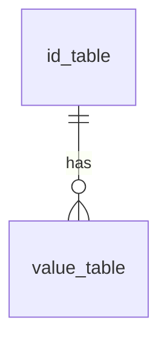
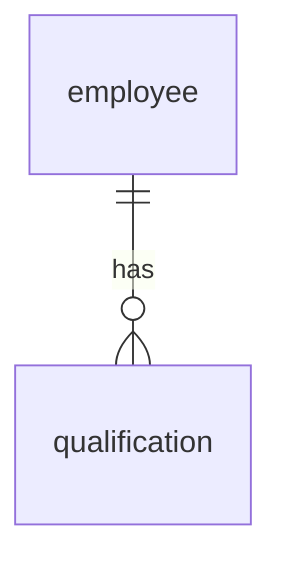

イミュータブルデータモデルでは必ず多重度が1:多になります。

id_tableとvalue_tableが1:多の関係になっています。
そのため、同じvalueを複数持っている場合表現できなくなってしまっています。

例として、社員と資格について考えてみましょう。

この場合、下記のようなデータがinsertされます。

**employeeテーブル**

| 社員id | created_at |
| --- | --- |
| 001 | 2020/4/1 |
| 002 | 2021/4/1 |

**qualificationテーブル**

| 社員id | 保有資格 | created_at |
| --- | --- | --- |
| 001 | 基本情報技術者 | 2020/5/1 |
| 001 | 応用情報技術者 | 2020/8/1 |
| 002 | ITパスポート | 2021/5/1 |
| 002 | CCNA | 2021/6/1 |
| 002 | LPIC | 2021/7/1 |

このようにinsertされてしまうと今有効な資格がわからない、という問題が発生します。
特にCCNAのような資格は有効期間が決まっており失効します。
これを解決するために失効日時のようなvalueテーブルを追加しても良いですが、そこまで厳密に有効な資格を判定する必要が無いのであれば、配列としてデータを持ったほうがシンプルに扱えるようになります。

**qualificationsテーブル**

| 社員id | 保有資格 | created_at |
| --- | --- | --- |
| 001 | 基本情報技術者 | 2020/5/1 |
| 001 | 基本情報技術者,応用情報技術者 | 2020/8/1 |
| 002 | ITパスポート | 2021/5/1 |
| 002 | ITパスポート,CCNA | 2021/6/1 |
| 002 | ITパスポート,CCNA,LPIC | 2021/7/1 |
| 002 | ITパスポート,LPIC | 2023/7/1 |

同じデータを何回もinsertしているように見えますが、それぞれ全く異なる意味を持っています。
配列として扱うことによって、資格の削除が簡単になっています。

> 💡 ひとつのカラムに複数のデータが入るのは良くないと思うかもしれません。
> ほとんどの場合その直感は正しいですが、今回の例は「社員が保有している資格」というひとつの意味で構成されています。
> つまり、データをひとつだけにすることよりも、意味がひとつだけであることのほうが重要だということです。

ここで注目するべきはテーブル名です。
元々「qualification」だったものが配列を扱う時は「qualifications」になっています。
この命名によって1:多の多重度を表現しています。
このことから、テーブル名をとりあえず複数形にする命名規則が害であることがわかります。
名前空間を確保するために通常は単数形で命名しておき、配列を扱う場合のみ複数形で命名したほうがより良いと考えています。
