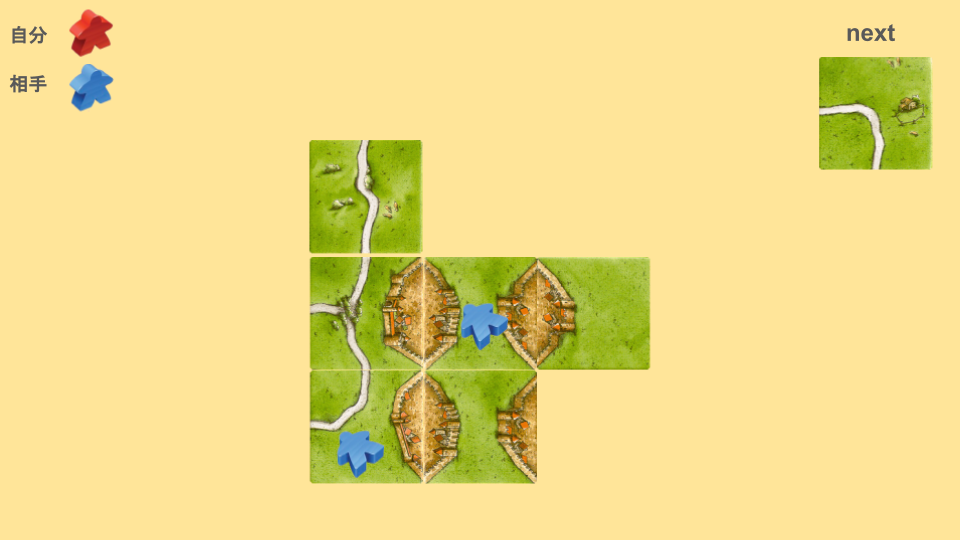
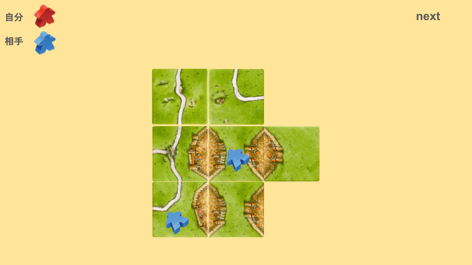

# 草結びとは
次の画像を見てください。

この場合、どのように配置しますか？

次のように配置することを「草結び」と言います。

元々、相手は草原で合計15点を獲得していましたが、草原がつながったことによって合計9点となっています。

草結びをすると、都市の表裏で点が入っている部分がなくなります。
また、ミープルを使わずに相手の点数を削ることができるため、非常に強力です。
ただし、草原の[相乗り(あいのり)](0fbfa626776044e6820a17dfba44cb05.md) を実質的に諦めることになります。
