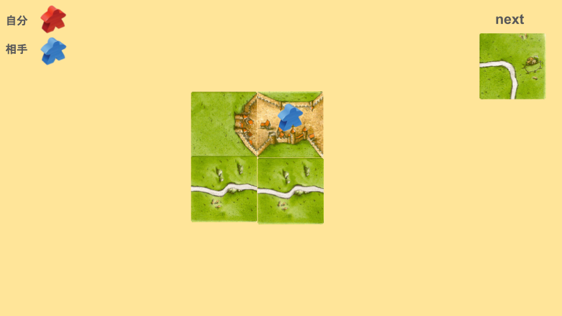
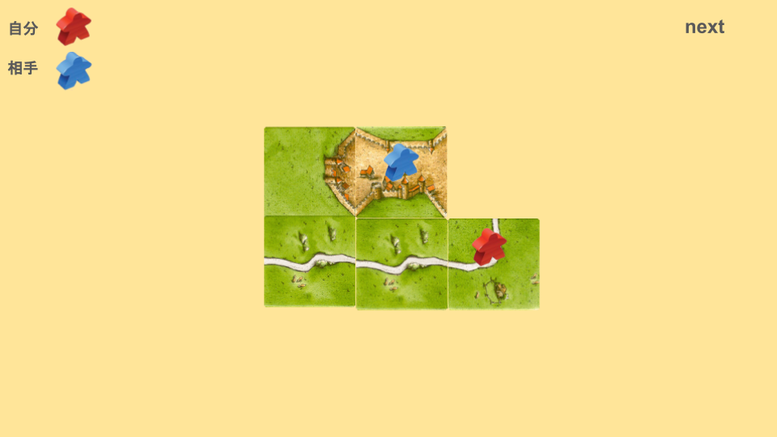

# ぶっさしとは
次の画像を見てください。

相手の都市が完成リーチになっています。
この場合、どのように配置しますか？

次のように配置することを「ぶっさし」と言います。

ポイントは、自分のミープルを道に置くことです。

これをすることで、妨害をしつつも、もし妨害失敗しても、自分の道が追加される状況を作ることができます。
もしぶっさしたタイルが破壊されても、自分のミープルだけ点を伸ばすことができます(タイルの配置によります)。
