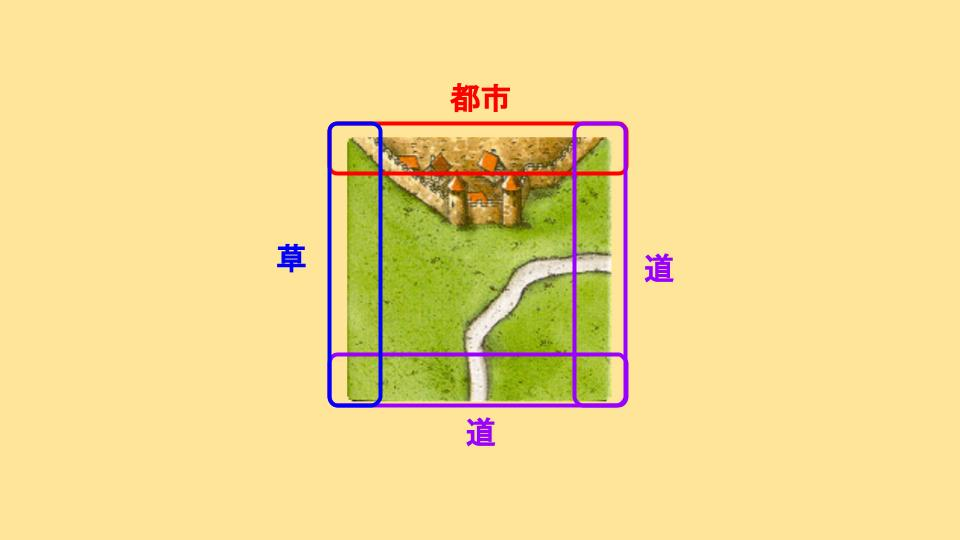
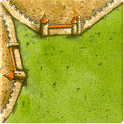

[タイルのグルーピング①](8e8ec2b12a524083b91d0d8763278742.md) では基礎的なタイルのグルーピングについて見てきましたが、更に一歩進んだグルーピングも存在しますので、紹介します。
# 目次
# タイルの構成要素
タイルは「都市」「道」「草」の3種類の要素から構成されています。

この構成要素を元に、タイルをグルーピングしていく方法があります。
# 都市草系(計22枚 30.98%)
一辺 x5

ジブラルタル x3

土管 x3

セパレート x2

二辺 x5

三辺 x4

# 都市道系(計11枚 15.49%)
一辺三叉 x3

二辺アリ x5

三辺アリ x3

# 草道系(計23枚 32.39%)
ストレート x8

カーブ x9

道付修道院 x2

三叉 x4

# 3辺草系(計11枚)
一辺 x5

修道院 x4

道付修道院 x2

# 全種系(計10枚 12.67%)
一辺アリ x4(内1は初期タイル)

ライト x3

レフト x3

# 1種系(計6枚 8.45%)
修道院 x4

十字 x1

オールシティ x1

# まとめ
タイルの大半は、[タイルのグルーピング②](efd4ee61264f4a208a2f323e5cace71f.md)  、[タイルのグルーピング②](efd4ee61264f4a208a2f323e5cace71f.md) 、[タイルのグルーピング②](efd4ee61264f4a208a2f323e5cace71f.md) です。
つまり、次にどのパターンを引いても有効活用できるようにタイルやミープルを事前に配置することがとても重要です。
また、[タイルのグルーピング②](efd4ee61264f4a208a2f323e5cace71f.md) は3種類しか存在しません。破壊や防御をするときに、[タイルのグルーピング②](efd4ee61264f4a208a2f323e5cace71f.md) について考えることが重要になります。
