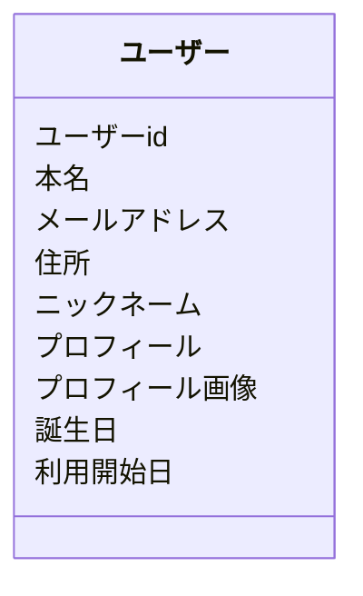

SNSのユーザー情報について考えてみましょう。



ライフサイクルはほぼ同じですが、属性によって役割が違います。

### 公開しない情報
- 本名
- メールアドレス
- 住所

これらは他人には知られたくない情報です。
お知らせメールを送ったり、郵便物を届ける時に使います。

### 公開する情報
- ニックネーム
- プロフィール
- プロフィール画像

これらは他人に知られても良い情報です。
SNSでやりとりをしたり、自分がどんな人なのかを紹介するときに使います。

### 公開してもしなくてもいい情報
- 誕生日
- 利用開始日

これらは任意で公開できる内容です。
SNSでやりとりをするきっかけに使えます。

このように、属性によって役割(ユースケースや公開有無)が違う場合、Repositoryも役割単位で作ったほうが良いでしょう。

```kotlin
interface UserPublicInformationRepository //公開する情報

interface UserNonPublicInformationRepository //非公開の情報

interface UserVoluntaryPublicInformationRepository //任意で公開できる情報
```

上記のようにRepositoryを作った場合、ユーザーidをどのRepositoryで管理するのか、という問題が出てきます。
データモデルはidテーブルひとつにvalueテーブルが複数存在していて、Repositoryによって扱うvalueテーブルが違う、という状態になっています。
このような場合は、ユーザーidを扱う専用のRepositoryを作ると良いでしょう。

```kotlin
interface UserIdRepository
```

id専用のRepositoryを作ることで、ユーザーの情報がほとんど無い状態でもユーザーを作成することができるようになります。
UserIdRepositoryを呼び出すコードは下記のようになります。

```kotlin
@Service
class CreateUserId(
    private val userIdRepository: UserIdRepository,
) {

    fun handle(): UUID {
        val userId = UUID.randomUUID()

        userIdRepository.add(userId)

        return userId
    }
}
```

これをすることで、、公開する情報、非公開の情報、任意で公開できる情報を順不同で保存することができるようになります。

もっと極端に順不同でのデータの保存を達成したい場合、属性ごとにRepositoryを作ると更に特化することができます。

```kotlin
interface UserRealNameRepository

interface UserNickNameRepository

interface UserMailAddressRepository

...
```

このやり方は、データを登録・更新・削除するときの単位が分割されている程効果を発揮します。

```kotlin
//ユーザーの本名を登録するユースケース
@Service
class RegisterRealName(
    private val userIdRepository: UserIdRepository,
    private val realNameRepository: UserRealNameRepository,
) {

    fun handle(input: RealNameRegisterInputData) {
        val userId = input.userId

        userIdRepository.validatedExists(userId)

        realNameRepository.add(
            userId = userId,
            realName = input.realName,
        )
    }

}

data class RealNameRegisterInputData(
    val userId: UUID,
    val realName: String,
)
```

```kotlin
//ユーザーの本名を更新するユースケース
@Service
class UpdateRealName(
    private val userRealNameRepository: UserRealNameRepository
) {

    fun handle(input: RealNameUpdateInputData) {

        userRealNameRepository.replace(
            userId = input.userId,
            realName = input.realName,
        )
    }
}

data class RealNameUpdateInputData(
    val userId: UUID,
    val realName: String
)
```

```kotlin
//ユーザーの本名を削除するユースケース
@Service
class DeleteRealName(
    private val userRealNameRepository: UserRealNameRepository
) {

    fun handle(input: RealNameRemoveInputData) {
        userRealNameRepository.remove(input.userId)
    }
}

data class RealNameRemoveInputData(
    val userId: UUID,
)
```

このように分割していくと特化したユースケースを書くことができ、コードがよりシンプルになります。
特に、属性によってライフサイクルを分けたい場合にこのパターンは使えます。
