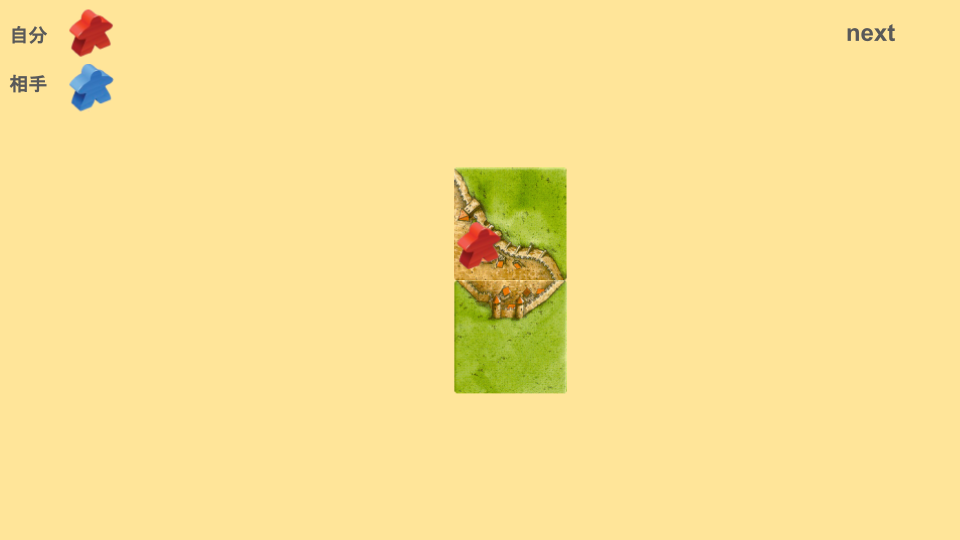
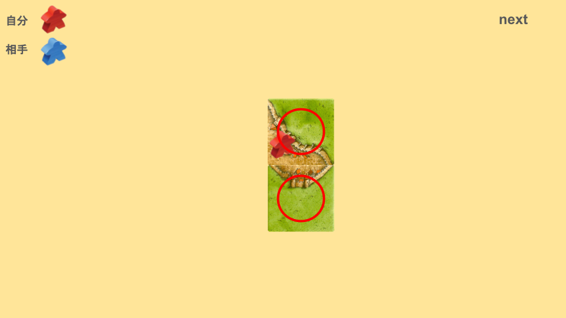
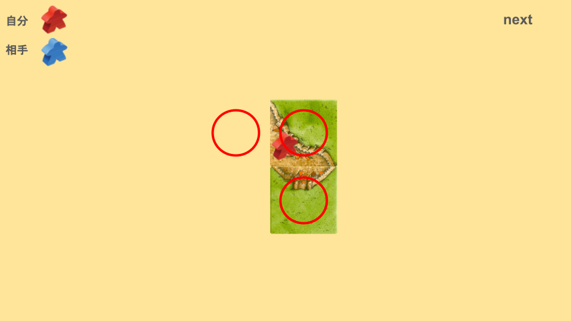
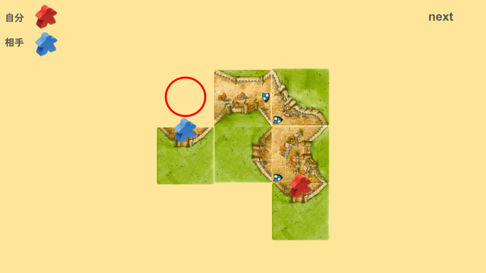
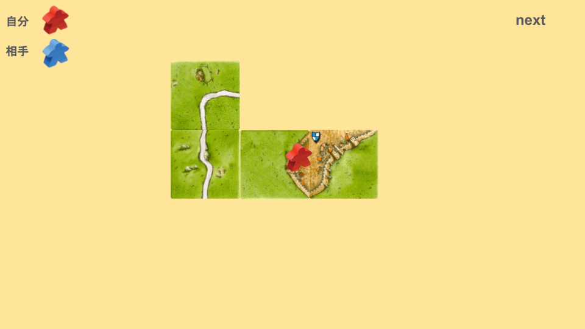

# 自分の陣地
次の画像を見てください。

この場合、自分の陣地はどこでしょうか？

まず、自分のミープルが置かれているタイルは自分の陣地です。

実は、他にも自分の陣地があります。

「自分がタイルを置きたい場所」も自分の陣地です。

カルカソンヌは、自分の陣地を守ることが非常に重要なゲームです。
タイルがまだ置かれていない自分の陣地ごと守ることが重要です。
# 相手の陣地
次の画像を見てください。

自分の都市に、[相乗り(あいのり)](0fbfa626776044e6820a17dfba44cb05.md) を仕掛けられている状態です。
では、この赤丸の部分は誰の陣地でしょうか？

この赤丸は「相手がタイルを置きたい場所」です。
つまり、これは相手の陣地です。
相手の陣地には、妨害や破壊を仕掛けましょう。
# 中立
自分の陣地でも、相手の陣地でもないところは中立と呼びます。

この画像の、道や草原は中立です。

名前は中立ですが、実質的に相手の陣地として考えましょう。
なぜなら、次の相手のターンでミープルが置かれる可能性があるからです。
